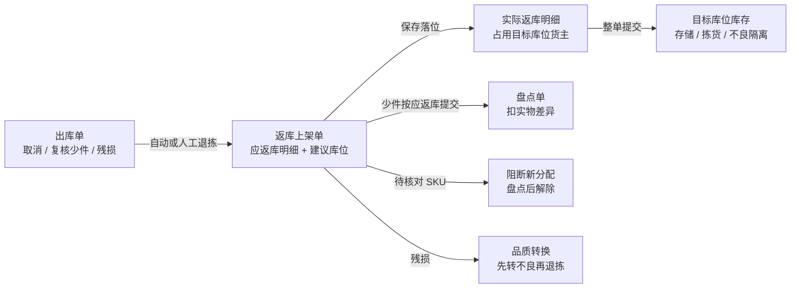
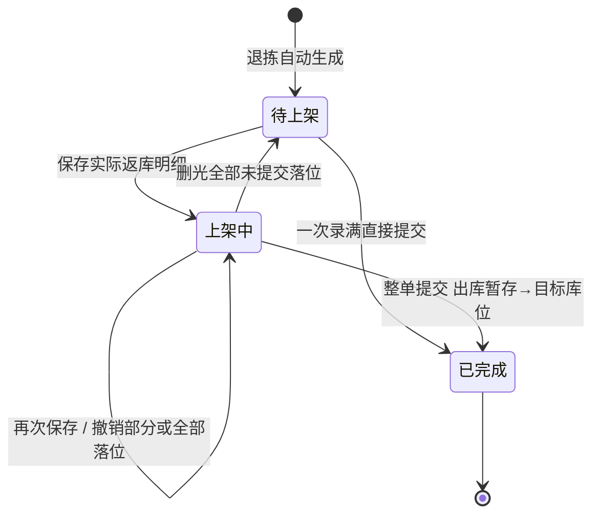

# 返库上架单主PRD

> 用途：定义返库上架单的自动生成、应返库明细、分次保存与重录、整单提交移库、目标库位校验、SN 处理、少件闭环及管理端查询，作为研发实现、测试验收和生成前端原型的业务依据。
> 定位：应用设计层**退拣落位真源**。规则以[《出库模块宏观系统架构》](../../../../../01-全局背景信息/05-出库模块宏观系统架构.md)§2.1.3、§3.4 为准；需求见[《出库业务需求分析》](../../../../../03-需求调研和分析/03-出库业务/出库业务需求分析.md)退拣与返库（OUT-FR-017）；场景见[《出库业务设计》](../../../../../04-业务分析和设计/03-出库业务设计.md)§7.5、§9.7；结构与保存/提交规则同[《上架单主PRD》](../../2-入库管理/上架单/上架单主PRD.md)；字段以[《返库上架单（详细稿）》](../../../字段清单合集/03-出库管理/返库上架单/返库上架单（详细稿）.tsv)为准；页面见[《返库上架单页面骨架》](返库上架单页面骨架.md)；交互以[前端Demo版PRD](返库上架单前端Demo版PRD.md)为准；PDA 见[《PDA返库上架页面骨架》](../../7-PDA作业端/返库上架作业/PDA返库上架页面骨架.md)。
> 不写什么：不写退拣怎么触发、退多少、谁有权退（见[《出库单主PRD》](../出库单/出库单主PRD.md) R13、R14）；不写拣货扫描与任务关闭（见[《拣货任务主PRD》](../拣货任务/拣货任务主PRD.md)）；不写盘点执行与差异确认（见[《盘点单主PRD》](../../4-库存管理/盘点单/盘点单主PRD.md)）；不写残损品质转换操作（见[《品质转换主PRD》](../../4-库存管理/品质转换/品质转换主PRD.md)）；不写库存流水字段与目标库位基础资料维护。

| 版本 | 本次变化 | 状态 |
| --- | --- | --- |
| 2026-10-15 | 由原《出库管理主PRD》拆出；定义返库上架单生成、保存、提交与查询 | 文档修订 |
| 2026-10-18 | 新增 Web 端返库录入页；PDA 改为按建议库位逐站放回；SN 按实际采集记录 | 文档修订 |
| WMS-V1.0（2026-10-27） | 按 ERP 采购订单主 PRD 结构重构：补文档边界、范围与追溯、对象定位、场景索引、状态矩阵与流转表、规则分组、上下游与一致性；业务结论不变 | 待评审，文档修订 |

## 1. 文档信息与阅读边界

| 项目 | 内容 |
| --- | --- |
| 读者 | 研发工程师、测试工程师、现场作业负责人、产品复核；据此生成管理端与 Web 端原型的 AI |
| 业务依据 | 《出库业务需求分析》退拣与返库（OUT-FR-017）；《出库业务设计》§7.5、§9.7 |
| 状态依据 | 《出库模块宏观系统架构》§2.1.3、§3.4；[《单据与状态流转》](../../../系统架构设计/03-单据与状态流转.md)第六节 |
| 字段依据 | [《返库上架单（详细稿）》](../../../字段清单合集/03-出库管理/返库上架单/返库上架单（详细稿）.tsv) |
| 页面依据 | [《返库上架单页面骨架》](返库上架单页面骨架.md)、[前端Demo版PRD](返库上架单前端Demo版PRD.md)、[PDA返库上架页面骨架](../../7-PDA作业端/返库上架作业/PDA返库上架页面骨架.md) |

关联资料：[《上架单主PRD》](../../2-入库管理/上架单/上架单主PRD.md)（保存/提交同构）、[《出库单主PRD》](../出库单/出库单主PRD.md)（取消与人工退拣）、[《拣货任务主PRD》](../拣货任务/拣货任务主PRD.md)（任务关闭）、[《盘点单主PRD》](../../4-库存管理/盘点单/盘点单主PRD.md)、[《品质转换主PRD》](../../4-库存管理/品质转换/品质转换主PRD.md)、[《实体对象关系》](../../../系统架构设计/02-实体对象关系.md)、[《单据术语与生成规则》](../../../../../01-全局背景信息/08-单据术语与生成规则.md)。本目录写法见[需求文档 PRD 写作约定](../../AGENTS.md)。

## 2. 需求背景与目标

### 2.1 背景

出库单取消或复核发现少件、残损时，已经确认下架、放在出库暂存的实物不能凭空消失，也不能直接冲销拣货事实。返库上架单就是把这批实物从出库暂存放回合法库位的作业单：取消时按原单归属自动生成；少件、残损由复核人员人工退拣后生成。

返库单和入库上架单结构相同：保存只记落位、不动库存，整单提交才一次性移库。这样现场可以分几次搬、换人继续，也能在提交前改录；一旦提交就是事实，不更正、不作废、不重复移库。少件则要求按应返库数量填满提交，账面先归位，再由盘点扣减实物差异，避免用返库动作伪造库存。

### 2.2 目标

- 每次退拣自动生成一张返库单，单头指回原出库单，应返库明细按实拣归属生成且不可修改；
- 保存只记落位与目标库位货主占用，不动库存、不计已返库；
- 整单提交才把实物从出库暂存放回目标库位，重复提交不重复移库；
- 目标库位的启用、仓库、用途、品质适配和货主占用在保存与提交时都可判定；
- SN 商品可按数量返库，只有实际采集 SN 时才写单件记录，不推测库位；
- 少件按应返库数量提交后，由盘点扣差异，待核对期间只阻断新分配/补拣，已分配行可继续；
- PDA 与 Web 端共用同一张单、同一套动作。

### 2.3 设计要点（给研发与测试）

| 设计点 | 做法 | 原因与影响 |
| --- | --- | --- |
| 只能自动生成 | 取消、少件、残损退拣时生成；管理端无新建入口 | 返库必须有退拣事实，不能手工造单 |
| 应返库明细只读 | 按实拣归属生成，保留商品、品质、批次、SN；建议库位取原拣货库位 | 退多少、退什么由出库单决定，返库单只负责放回 |
| 保存不动库存 | 写实际返库明细、占用目标库位货主归属，不计已返库 | 允许分次搬、分次录、重录 |
| 整单提交移库 | 每行已保存 = 应返库后，一次把出库暂存移到各目标库位 | 不接受部分行提交，避免半张单落位 |
| 已返库二值展示 | 管理端已返库只在整单提交后等于应返库，未提交恒为 0 | 保存进度只在作业页显示，避免与库存混淆 |
| 少件不伪造 | 少件仍按应返库数量提交，随后盘点扣差异 | 返库只归位，损失由盘点确认一次 |

## 3. 需求范围

### 3.1 本期范围

- 取消、少件、残损三种退拣生成返库单；
- 管理端列表、详情、应返库明细、实际返库明细、操作日志；
- 待上架、上架中单进入 PDA 返库上架或 Web 端返库；
- 按建议库位逐站、扫目标库位、扫商品计数、数满自动保存、跨库位跳转；
- 分次保存、撤销本行落位并重录、整单提交；
- 目标库位启用、仓库、用途、品质、货主占用校验；
- SN 商品按数量返库与实际 SN 采集；
- 少件 SKU 待核对、提交后盘点；
- 列表筛选单号、原出库单号、退拣原因、货主；导出 Mock。

### 3.2 功能清单

| 编号 | 功能/位置 | 本次内容 | 需求来源 |
| --- | --- | --- | --- |
| F01 | 生成与关联 | 取消自动生成；少件、残损人工退拣生成；单头指回原单，明细按实拣归属 | OUT-FR-017 |
| F02 | 返库单列表 | 状态页签、筛选、列展示、导出 Mock、进入详情或作业 | OUT-FR-017 |
| F03 | 返库单详情 | 基本信息、返库进度、应返库明细、实际返库明细、操作日志 | OUT-FR-017 |
| F04 | PDA 返库上架 | 按建议库位逐站，扫目标库位、扫商品计数、自动保存、跨库位跳转 | OUT-FR-017 |
| F05 | Web 端返库 | 逐行录目标库位、数量与可选 SN，保存落位、重录、整单提交 | OUT-FR-017 |
| F06 | 保存与重录 | 分次落位、行内不超应返库、目标库位占用、撤销本行落位 | OUT-FR-017 |
| F07 | 整单提交 | 每行已保存 = 应返库后一次移库；少件按应返库量提交 | OUT-FR-017 |
| F08 | 导出 | 页头导出当前筛选结果（Demo 为 Mock） | — |

### 3.3 需求追溯

| 需求分析 | 本 PRD 功能与规则 | 验收 |
| --- | --- | --- |
| 取消自动退拣与返库 | F01、R01、R09 | AC01、AC02 |
| 少件、残损人工退拣 | F01、R08、R09 | AC08、AC09 |
| 分次保存、重录 | F04～F06、R04～R06 | AC03、AC05、AC06 |
| 整单提交移库 | F07、R07 | AC04、AC10 |
| 目标库位资格 | F06、R03 | AC05 |
| SN 商品返库 | R06 | AC11、AC12 |
| 少件与盘点收口 | R08 | AC08、AC13 |

### 3.4 非本期范围

- 管理端新建、编辑、作废、删除返库单；
- 单行提交、部分行提交、批量提交；
- 批次或品质在返库时修改；
- 目标库位容量硬校验、自动选位、库位推荐算法；
- 返库损失确认、盘亏单、差异审批；
- 未扫描确认的实物回库（由现场人工放回，无库存动作）；
- 用户账号、角色、仓库授权与审批流。

| 范围补充 | 说明 |
| --- | --- |
| 适用对象 | 所有产生已确认实拣后取消、复核少件、复核残损的出库类型；不适用于未扫描确认的实物 |
| 单据数量 | 每次退拣生成一张；一张返库单只对应一张原出库单 |
| 数据范围 | 顶栏当前仓库；来源库位为出库暂存；不做用户或角色裁剪 |

## 4. 对象定位与业务边界

### 4.1 业务作用

| 项目 | 内容 |
| --- | --- |
| 单据层级 | 作业单：承接退拣结果，把出库暂存的实物放回合法库位 |
| 核心职责 | 记录原出库单、退拣原因、应返库明细、实际落位、提交事实 |
| 对象来源 | 出库单取消自动生成；复核少件、残损人工退拣生成；无手工建单 |
| 下游对象 | 目标库位库存、库存流水、盘点单（少件）、品质转换（残损） |
| 数量关系 | 一张返库单 N 条应返库行；一行可拆到多个目标库位；一行可对应多次落位 |
| 业务终结 | 已完成（整单提交并移库）；已完成不更正、不作废、不重复提交 |

### 4.2 上下游关系摘要

### 4.3 业务对象关系

| 关系 | 说明 |
| --- | --- |
| 返库单 : 出库单 | N:1；每次退拣一张，单头指回原单 |
| 返库单 : 应返库行 | 1:N；按实拣归属生成，保留商品、品质、批次、SN |
| 应返库行 : 实际返库明细 | 1:N；一行可拆到多个目标库位，可重录 |
| 实际返库行 : 目标库位 | N:1；保存即占用该库位的货主归属 |
| 返库单 : 库存流水 | 提交时按实际行写暂存减项、目标加项；保存不写 |
| 返库单 : 盘点单 | 少件生成后另行发起盘点；返库单不承载盘点结果 |

### 4.4 本单据不负责的事项

- 返库单不决定退拣数量、原因和权限；这些在出库单退拣时确定；
- 返库单不改变 SKU 实际总量、订单预占、品质或 SN 的仓库级在库身份；
- 保存不搬库存；只有整单提交才把货从出库暂存移到目标库位；
- 返库单不修正原拣货库位的账实差异；少件差异由盘点确认；
- 返库单不执行品质转换；残损须先在库存侧转不良，再退拣生成返库单；
- 返库单不负责复核、确认出库和结果回传。

## 5. 核心业务场景索引

| 场景ID | 场景 | 类型 | 说明 |
| --- | --- | --- | --- |
| S01 | 取消后自动返库 | 主流程 | 已拣 2 的 B2C 单取消，生成 1 张返库单，应返库 2，待上架 |
| S02 | 分次保存 | 主流程 | 保存 1 件到 A-01-01，刷新后再保存 1 件到 A-01-02；上架中，库存不变 |
| S03 | 整单提交 | 主流程 | 每行已保存 = 应返库，一次移库，已完成 |
| S04 | 目标库位不合法 | 异常 | 出库暂存、他货主占用、非本仓库位：阻断，不保存 |
| S05 | 复核少件退拣 | 支线 | 生成原因少件的返库单；SKU 待核对；按应返库量提交后盘点 |
| S06 | 复核残损退拣 | 支线 | 先转不良，再生成原因残损的返库单，目标为不良隔离库位 |
| S07 | 改放到其他合法库位 | 支线 | PDA 按建议库位到站后可改放 L3；页面写明建议 L2 |
| S08 | SN 商品分库位返库 | 分支 | 应返库 SN1、SN2，按数量各放 1 件到两个库位；未采集时不推测 SN 库位 |
| S09 | 重录本行落位 | 支线 | 撤销该行全部落位，剩余回到应返库量；库存不变 |
| S10 | Web 端补录 | 主流程 | 不用 PDA，逐行录落位后提交，与 PDA 结果相同 |
| S11 | 原出库单已取消 | 边界 | 不影响返库单继续保存与提交 |

## 6. 状态与操作

状态定义 owner：[《出库模块宏观系统架构》](../../../../../01-全局背景信息/05-出库模块宏观系统架构.md)§3.4。返库单状态由实际返库明细与提交事实推导，管理端没有改状态入口。

### 6.1 状态维度

| 维度 | 取值 | 说明 |
| --- | --- | --- |
| 单据状态 | 待上架、上架中、已完成 | 待上架：无已保存实际明细；上架中：有已保存实际明细且未提交；已完成：已提交并移库 |
| 退拣原因 | 取消、少件、残损 | 决定预占处理、是否待核对、目标库位品质 |
| 品质 | 良品、不良品 | 单头由退拣实物决定；良品回存储或拣货，不良回隔离 |
| SN | 有清单、无清单 | 有清单时按单件记录；无清单时只按数量移库 |

### 6.2 状态取值说明

| 状态 | 含义 | 是否终态 |
| --- | --- | --- |
| 待上架 | 已生成应返库明细，尚无保存的实际返库明细（含重录清空后回到此态） | 否 |
| 上架中 | 已有保存的实际返库明细，整单尚未提交 | 否 |
| 已完成 | 已提交，库存已从出库暂存移到各目标库位 | 是 |

退拣原因不改变状态机：取消、少件、残损都走待上架→上架中→已完成。少件在提交后仍需盘点，但返库单本身已完成，盘点结果不回写返库单。

### 6.3 状态流转图

触发者：生成为出库单取消或人工退拣；保存、撤销、提交为 PDA 返库上架或 Web 端返库；状态不由人工选择。

### 6.4 状态—功能矩阵

> ✅ = 允许；❌ = 不允许；✅（条件）= 须满足所列规则。查看列表、详情各状态均可用。

| 动作 | 待上架 | 上架中 | 已完成 |
| --- | --- | --- | --- |
| 查看列表、详情（F02、F03） | ✅ | ✅ | ✅ |
| PDA返库上架入口（F04） | ✅ | ✅ | ❌ |
| Web 端返库入口（F05） | ✅ | ✅ | ❌ |
| 保存落位 | ✅（R03～R06） | ✅（R03～R06） | ❌ |
| 撤销/重录未提交落位 | ✅（无落位可撤） | ✅（R05） | ❌ |
| 整单提交（F07） | ✅（R07） | ✅（R07） | ❌ |
| 新建、编辑、作废 | ❌ | ❌ | ❌ |
| 导出（F08） | ✅ | ✅ | ✅ |

已完成单详情页头只有「返回列表」；列表行内无作业入口。待上架、上架中都显示两个作业入口，具体有无可操作内容由作业页按已保存明细判断。

### 6.5 状态流转表

| 当前状态 | 动作/事件 | 前置条件 | 结果状态 | 二次确认 | 后置影响 | 失败处理 |
| --- | --- | --- | --- | --- | --- | --- |
| — | 出库单取消自动退拣 | 已确认实拣；取消受理 | 待上架 | 无 | 生成应返库明细；建议库位取原拣货库位；预占随取消释放 | 无实拣不生成 |
| — | 复核人工退拣 | 出库单 R14；数量 ≤ 有效实拣；残损已转不良 | 待上架 | 退拣弹窗确认 | 生成应返库明细；少件标记 SKU 待核对；预占保留 | 超有效实拣或未转不良：拒绝 |
| 待上架 | 保存落位 | R03～R06；目标库位合法；至少一条实际明细 | 上架中 | 无 | 写实际明细；占用目标库位货主；不动库存 | 校验失败定位到行/库位，整次不保存 |
| 上架中 | 再次保存 | 同上；行内已保存 ≤ 应返库 | 上架中 | 无 | 追加实际明细；库存不变 | 同上 |
| 上架中 | 撤销本行落位 | R05；未提交 | 上架中或待上架 | 危险操作确认 | 清掉该行全部落位，释放占用；库存不变 | 已完成不可撤销 |
| 待上架/上架中 | 整单提交 | R07；每行已保存 = 应返库 | 已完成 | 无 | 一次移库；写提交人与时间；不重复移库 | 有行未满：拒绝并写差多少 |
| 已完成 | 查看 | — | 不变 | — | — | — |

## 7. 核心业务规则

### 7.1 生成、单头与明细

| 规则编号 | 主题 | 规则 | 边界或例外 |
| --- | --- | --- | --- |
| R01 | 自动生成 | 每次退拣生成一张，不允许手工建单。单头记录退拣原因、原出库单、货主、仓库、来源库位（出库暂存）、创建时间 | 一张返库单只对应一张原出库单 |
| R02 | 应返库明细 | 按实拣归属生成，保留商品、品质、批次与 SN；应返库数量 = 退拣数量；每行带建议库位（原拣货库位） | 生成后不可修改；建议库位只作建议，提交按当前库位状态校验 |
| R03 | 三种原因 | 取消：受理取消时按原单归属自动退拣，预占随取消释放；少件：复核人工退拣，SKU 标记待核对，预占保留；残损：在出库暂存先把实物转不良，再退拣生成返库，预占保留 | 少件、残损可重新分配补拣，但补拣须待核对解除后，见 R08 |

### 7.2 保存、目标库位与 SN

| 规则编号 | 主题 | 规则 | 边界或例外 |
| --- | --- | --- | --- |
| R04 | 目标库位资格 | 目标库位须启用、属于本仓，不能是收货暂存、出库暂存或异常处理库位（以库位用途字典为准）；正常品回存储或拣货库位，不良品回不良隔离库位；目标位已有库存或占用须为同货主 | 不合法即阻断，提示原因，不保存 |
| R05 | 保存与重录 | 每行可分次保存到不同库位；行内已保存不超过应返库数量；保存只记落位、占用目标库位货主、不动库存、不计已返库；可撤销本行全部落位后重录 | 撤销是危险操作，须确认并写明清掉的件数与库位；撤销不动库存 |
| R06 | SN 处理 | SN 商品按数量返库，不强制单件落位；采集 SN 时只校验属于本行且未重复，不要求条数等于数量、不绑定库位；未采集不补造 SN | 重复或不属于本行：阻断；未采集或部分采集：允许提交；SN 保持仓库级在库身份 |

### 7.3 提交、少件与关闭

| 规则编号 | 主题 | 规则 | 边界或例外 |
| --- | --- | --- | --- |
| R07 | 整单提交 | 每行已保存 = 应返库才可提交；通过后一次把库存从出库暂存移到各目标库位，保持 SN 仓库级在库身份，仅在实际采集 SN 时写单件记录；记录提交人与提交时间；保存不搬库存，重复提交不再搬 | 不接受单行或部分行提交；有行未满即拒绝 |
| R08 | 少件闭环 | 少件仍按应返库数量填满提交，再对该 SKU 发起盘点扣减实物差异；待核对期间只阻断新分配/补拣，已分配行可继续拣货，盘点完成解除后才允许补拣 | 返库单完成可以早于盘点；盘点结果不回写返库单；不伪造实发 |
| R09 | 原单已取消 | 取消生成的返库单，原出库单已取消不影响本单继续保存与提交；预占已随取消释放，补拣不再适用 | 取消后返库时发现少件，同样按应返库量提交再盘点 |
| R10 | 无更正作废 | 已完成是事实，不更正、不作废、不重复移库；管理端不提供新建、编辑、作废入口 | 保存内容在提交前可撤销、改录 |

### 7.4 数量口径与示例

| 层级 | 数量 | 含义 | 关系 |
| --- | --- | --- | --- |
| 单头 | 应返库 | 各应返库行之和，生成后不变 | 等于本次退拣数量 |
| 应返库行 | 已保存（作业进度） | 该行已保存落位数量之和 | 只在 PDA、Web 端返库作业页展示 |
| 应返库行 | 剩余 | 应返库 − 已保存 | 录入页与 PDA 的计数上限 |
| 单头 | 已返库 | 已完成时等于应返库，否则为 0 | 管理端列表与详情只展示应返库与已返库 |
| 实际返库行 | 返库数量 | 单次落位数量 | 行内各次之和 = 该行已保存 |
| 实际返库行 | SN | 实际采集的序列号 | 未采集时为空，不推测 |

**约束（可判定）**：每行已保存 ≤ 应返库；提交时每行已保存 = 应返库；已返库 ∈ {0, 应返库}；提交前后 SKU 实际总量不变，只改变库位分布；同一 SN 不在本行重复落位。

**数量示例（模拟）**：已拣 2 的 B2C 单取消，生成返库单，应返库 2，待上架；保存 A-01-01 × 1、A-01-02 × 1，状态上架中，管理端已返库仍 0，暂存库存不变；提交后已完成，A-01-01、A-01-02 各加 1，出库暂存减 2，已返库 2。

### 7.5 业务生效点

| 业务动作 | 返库单影响 | 库存影响 | 外部影响 |
| --- | --- | --- | --- |
| 取消退拣生成 | 待上架；应返库明细落库 | 已拣退拣：原单有效已拣减少；预占释放 | 出库单已取消；任务关闭 |
| 少件/残损退拣生成 | 待上架；少件标记待核对 | 有效已拣减少；实物仍在出库暂存 | 出库单待复核；补拣等待 |
| 保存落位 | 上架中；实际明细增加 | 不动库存；占用目标库位货主归属 | 无 |
| 撤销落位 | 上架中或待上架；实际明细减少 | 不动库存；释放占用 | 无 |
| 整单提交 | 已完成 | 出库暂存实际减；目标库位实际增；SKU 总量不变 | 写库存流水；少件进入盘点 |
| 盘点完成 | 不变（已完成） | 盘亏扣减；解除待核对 | 允许补拣 |

### 7.6 字段校验绑定

完整字段见[《返库上架单（详细稿）》](../../../字段清单合集/03-出库管理/返库上架单/返库上架单（详细稿）.tsv)。摘要：

| 校验时机 | 要求 |
| --- | --- |
| 生成 | 单号按 PB 规则；原出库单、货主、仓库、来源库位、退拣原因必填；应返库行商品、品质、批次、数量为正 |
| 保存 | 应返库行、目标库位、数量必填；数量正整数且 ≤ 剩余；目标库位合法；SN 选填，填写时不重复且属于本行，不要求条数与数量一致 |
| 撤销 | 只能撤销未提交落位；须二次确认 |
| 提交 | 每行已保存 = 应返库；提交人、提交时间写入 |
| 详情/列表 | 已完成只读；未完成才渲染作业入口 |

## 8. 功能需求说明（页面索引）

| 编号 | 页面/位置 | 规则与状态依据 | Demo PRD |
| --- | --- | --- | --- |
| F01 | 出库单取消/退拣生成 | §6.5；R01～R03 | [出库单详情页分册](../出库单/前端Demo版PRD/出库单前端Demo版PRD_详情页.md) |
| F02 | 返库单列表 | §6.4；R10 | [返库上架单前端Demo版PRD](返库上架单前端Demo版PRD.md) §三 |
| F03 | 返库单详情 | §7.4；R07 | 同上 §四 |
| F04 | PDA 返库上架 | §7.2；R04～R06 | [PDA返库上架前端Demo版PRD](../../7-PDA作业端/返库上架作业/PDA返库上架前端Demo版PRD.md) |
| F05 | Web 端返库 | §7.2、§7.3；R04～R07 | [返库上架单前端Demo版PRD](返库上架单前端Demo版PRD.md) §五 |
| F06 | 保存与重录 | §7.2；R04～R06 | 同上 §五 |
| F07 | 整单提交 | §7.3；R07～R09 | 同上 §五 |
| F08 | 导出 | — | 同上 §三页头 |

## 9. 上下游影响与协同

| 关联模块/系统 | 需要配合的变化 | 交接内容与时机 | 验收结果 |
| --- | --- | --- | --- |
| 出库单 | 取消或人工退拣时生成返库单；减少有效已拣 | 退拣时 | 应返库 = 退拣数量；出库单返库页签可跳转 |
| 拣货任务 | 任务关闭或退拣后归属有效数量减少 | 取消时 | 任务已关闭；已拣退拣与返库一致 |
| 库存与库内 | 保存占用、提交移库、写流水 | 保存、提交 | 暂存与目标库位实际一致；SKU 总量不变 |
| 盘点单 | 少件提交后发起盘点，扣差异并解除待核对 | 提交后 | 盘亏一次；待核对解除后可补拣 |
| 品质转换 | 残损先转不良再退拣 | 退拣前 | 返库单品质为不良，目标为隔离库位 |
| 基础资料 | 库位用途、货主、商品、SN | 保存、提交 | 停用或不合法库位拒绝 |
| 公共能力 | 当前仓库、操作日志 | 全程 | 只显示当前仓返库单 |

## 10. 关联文档与阅读入口

| 关联内容 | 阅读入口 | 本 PRD 与其边界 |
| --- | --- | --- |
| 返库定位与状态 | 《出库模块宏观系统架构》§2.1.3、§3.4 | 规则真源；本文落到页面与验收 |
| 退拣与少件收口 | 《出库业务设计》§7.5、§9.7 | 业务走查；本文不重复案例 |
| 取消与人工退拣 | [《出库单主PRD》](../出库单/出库单主PRD.md) R13、R14 | 出库单 owner；本文只承接结果 |
| 保存/提交同构 | [《上架单主PRD》](../../2-入库管理/上架单/上架单主PRD.md) R04～R09 | 结构参照；差异在本文明示 |
| 盘点与待核对 | [《盘点单主PRD》](../../4-库存管理/盘点单/盘点单主PRD.md) | 盘点 owner；返库不回写盘点 |
| 品质转换 | [《品质转换主PRD》](../../4-库存管理/品质转换/品质转换主PRD.md) | 转换 owner；返库不转品质 |
| 字段定义 | 《返库上架单（详细稿）》 | 字段 owner |
| 页面结构 | [《返库上架单页面骨架》](返库上架单页面骨架.md) | 区域与线框，非规则权威 |
| 页面交互 | [前端Demo版PRD](返库上架单前端Demo版PRD.md) | 控件、Mock；服从 §6.4 |

## 11. 异常与一致性

### 11.1 并发操作

| 场景 | 业务处理结果 |
| --- | --- |
| 两人同时保存同一应返库行到同一空库位 | 先保存者取得目标库位货主占用；后保存者若同货主且该行累计已保存不超应返库，可继续保存；异货主或累计超量阻断 |
| 两人同时保存同一行不同库位 | 各自按剩余校验；合计不超过应返库 |
| 保存与提交同时到达 | 以先生效者为准；提交前重查每行已保存 = 应返库，未满拒绝 |
| 提交与原出库单取消同时到达 | 取消先生效：退拣生成新返库单，原单继续；提交先生效：库存已归位，取消不再重复退拣 |
| 撤销与提交同时到达 | 先生效者为准；提交后不允许撤销 |
| 盘点开始与返库提交同时到达 | 盘点中冻结该 SKU 的返库保存与提交；已生成返库单在盘点完成后再提交，不能以“已生成”为由绕过冻结。待核对期间允许收尾，但不得改变盘点快照数量 |

### 11.2 幂等与重复处理

| 操作 | 幂等规则 |
| --- | --- |
| 重复保存同一落位 | 同一请求标识返回原结果，不新增实际明细；新的业务保存使用新请求标识，按累计数量校验 |
| 重复提交 | 返回原完成结果，不重复移库 |
| 重复撤销 | 返回原结果，不清空其他行 |
| 重复生成返库单 | 同一退拣事实只生成一张；重复取消不重复退拣 |
| 重复盘点 | 盘点单按自身幂等规则处理，返库单不变 |

### 11.3 与出库单、库存、盘点的一致性

| 场景 | 处理方式 |
| --- | --- |
| 原出库单已取消 | 返库单继续完成；预占已释放，不再补拣 |
| 少件返库单已完成但盘点未完成 | 允许；SKU 保持待核对，阻断新分配；盘点完成后解除 |
| 残损退拣前未转不良 | 不允许生成返库单；先完成品质转换 |
| 目标库位在保存后被他人占用 | 提交时重查；被占则阻断，须改录 |
| 返库单已完成但库存流水失败 | 提交事务回滚；不出现单据已完成而库存未移 |
| SN 未采集 | 按数量移库，流水不带推测 SN；SN 台账仍在本仓在库 |
| 取消后返库发现少件 | 按应返库量提交，再盘点；不补拣 |

## 12. 验收标准与待确认事项

### 12.1 验收标准

| 编号 | 对应功能/规则 | 条件与操作（数字为模拟） | 预期结果 |
| --- | --- | --- | --- |
| AC01 | F01、R01 | 已拣 2 的 B2C 单被取消 | 自动生成返库单 1 张，原因取消，应返库 2，状态待上架 |
| AC02 | R01、R09 | 无已确认实拣的单取消 | 不生成返库单；未扫描实物由现场人工放回 |
| AC03 | F04、R05 | PDA 保存 1 件到 A-01-01，刷新后再保存 1 件到 A-01-02 | 状态上架中；管理端已返库仍为 0；暂存库存不变 |
| AC04 | F07、R07 | 每行已保存 = 应返库后提交 | 已完成；A-01-01、A-01-02 各加 1，暂存减 2；提交人与时间写入；再次提交不再移库 |
| AC05 | R04 | 目标库位填出库暂存库位或他货主占用库位 | 阻断，提示原因，不保存 |
| AC06 | R05 | 已保存落位点「重录本行落位」并确认 | 该行落位全部清空，剩余回到应返库量；库存不变 |
| AC07 | R05、R07 | 一行未保存满就提交 | 拒绝，写明还差多少 |
| AC08 | R08 | 复核时退拣少件 1 | 生成原因少件的返库单；SKU 待核对；按应返库量提交后盘点才解除 |
| AC09 | R03、R04 | 复核残损退拣 | 先转不良；返库单品质不良，目标为隔离库位；未转不良时不能生成 |
| AC10 | F04、R04 | 返库单两行，建议 L1、L2；PDA 扫 L1、扫商品数满 | 自动保存到 L1，跳到 L2 提示扫库位；在 L2 扫 L3 可改放 L3 |
| AC11 | R06 | SN 商品应返库 SN1、SN2，按数量各放 1 件到两个库位 | 可保存并提交；SN 仍在本仓；未采集时流水不带推测 SN |
| AC12 | R06 | 现场逐件核实 SN2 后保存 1 件 | 保留 SN2 记录；同一应返库行重复使用 SN2 时阻断 |
| AC13 | F05、R07 | 不用 PDA：Web 端返库录 A-01-01 × 1、A-01-02 × 1 后提交 | 与 PDA 提交结果相同；提交人为录入人 |
| AC14 | F03、R10 | 打开已完成单 | 页头无作业入口；实际返库明细显示目标库位与数量 |
| AC15 | R04 | 目标库位停用或不属于本仓 | 阻断，不保存 |

### 12.2 待确认事项

| 编号 | 问题 | 影响范围 | 状态/结论 |
| --- | --- | --- | --- |
| Q01 | 少件退拣后的补拣时点：出库单 R14 写“预占保留，可重新分配补拣”，设计 §7.5 与本文要求待核对期间不参与新分配、盘点完成后才允许补拣；两处对“何时可补拣”表述不一 | R08、§11.3、出库单 R14 | **已确认（2026-10-27）**：统一为“盘点完成解除待核对后才能重新分配补拣”；出库单 R14、S05 已同步 |
| Q02 | 残损退拣“须先转不良”由谁发起、在哪个库位转、转换与生成返库单是否同一事务；当前只写前置条件，未写责任人 | R03、AC09、F01 | **已确认（2026-10-27）**：在出库暂存先转不良，再返库到不良隔离库位 |
| Q03 | 同一应返库行部分落位采集了 SN、部分未采集时能否提交；实际返库明细的 SN 列如何展示不完整清单 | R06、AC11、F03 | **已确认（2026-10-27）**：按数量提交；SN可选采集，不挂库位，不强制提示 |
| Q04 | 目标库位“异常处理库位”的枚举范围：现有资料只列收货暂存、出库暂存、异常处理，基础资料库位用途是否已有对应类型 | R04、AC05 | **已确认（2026-10-27）**：以库位用途字典的异常处理类型为准 |
| Q05 | 少件返库单提交后，盘点未完成前该 SKU 已分配行能否继续拣货；当前只写不参与“新分配”，未写已分配行 | R08、§11.3 | **已确认（2026-10-27）**：只阻断新分配/补拣；已分配行可继续 |
| Q06 | 取消生成返库单时，若实拣归属已人工退拣过一部分，自动退拣是否只取剩余有效数量 | R01、R02、AC01 | **已确认（2026-10-27）**：按剩余有效实拣生成；有效=归属实拣−已退拣，避免重复退拣。 |
| Q07 | 返库单已完成但少件盘点长期未做时，是否允许再次人工退拣或手工解除待核对；当前无解除入口 | R08、§11.3 | **已确认（2026-10-27）**：不提供手工解除；只由下一次盘点完成解除 |

## 附录 少件返库与盘点示例（模拟）

| 步骤 | 事件 | 返库单状态 | 应返库/已保存/已返库 | 库存与待核对 |
| --- | --- | --- | --- | --- |
| 1 | 复核发现少 1，退拣生成返库单 | 待上架 | 1 / 0 / 0 | 本单有效已拣减 1；SKU 待核对 |
| 2 | 保存落位到原库位 | 上架中 | 1 / 1 / 0 | 暂存不变；占用目标库位 |
| 3 | 整单提交 | 已完成 | 1 / 1 / 1 | 暂存减 1、目标加 1；账面先归位 |
| 4 | 盘点确认盘亏 1 | 已完成 | 1 / 1 / 1 | 目标库位减 1；待核对解除；允许补拣 |
