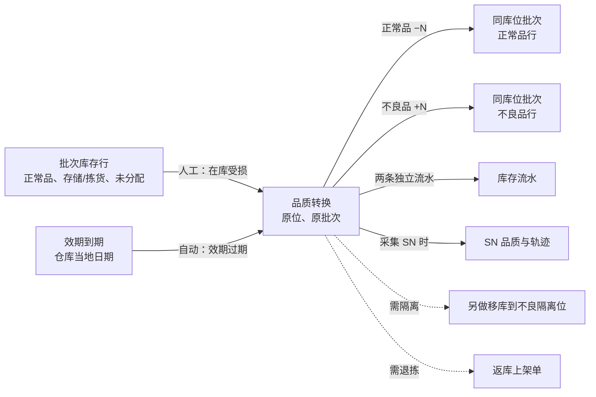
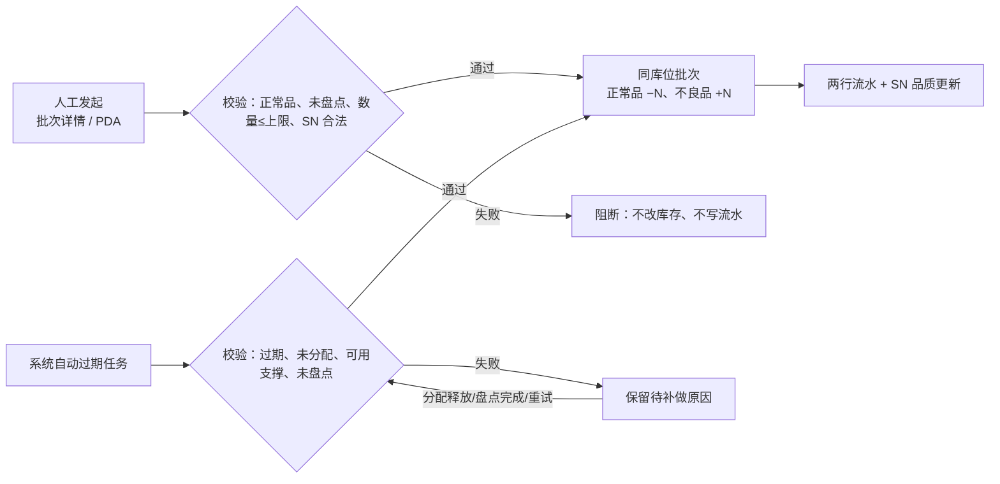

# 品质转换主PRD

> 用途：定义在库正常品转为不良品的系统动作，包括人工转换的入口、输入与校验、SN 处理、结果与流水，自动过期转换的范围、待补做原因与补做时机，以及不建单据、不编号、无独立页面的边界。
> 定位：应用设计层**品质变更真源**。规则依据以[《库存模块宏观系统架构》](../../../../../01-全局背景信息/07-库存模块宏观系统架构.md)§2.2、§2.3、§3.1.3 为准；需求见[《库存与库内业务需求分析》](../../../../../03-需求调研和分析/04-库存与库内业务/库存与库内业务需求分析.md)数量与品质状态口径、批次效期（INV-FR-002、INV-FR-011）；业务场景见[《库存与库内业务设计》](../../../../../04-业务分析和设计/04-库存与库内业务设计.md)§8.1、§8.3、§9.1；字段见[《库存明细（详细稿）》](../../../字段清单合集/04-库存与库内/库存明细/库存明细（详细稿）.tsv)与[《库存流水（详细稿）》](../../../字段清单合集/04-库存与库内/库存流水/库存流水（详细稿）.tsv)；页面见[《品质转换页面骨架》](品质转换页面骨架.md)；交互以[前端Demo版PRD](品质转换前端Demo版PRD.md)为准。
> 不写什么：不写库存查询的完整页面与三视角（见[《库存查询主PRD》](../库存查询/库存查询主PRD.md)）；不写库存流水的字段与查询（见[《库存流水主PRD》](../库存流水/库存流水主PRD.md)）；不写盘点单状态与差异确认（见[《盘点单主PRD》](../盘点单/盘点单主PRD.md)）；不写移库执行（见[《移库作业主PRD》](../移库作业/移库作业主PRD.md)）；不写不良品其他出库、赔偿与货主索赔。

| 版本 | 本次变化 | 状态 |
| --- | --- | --- |
| 2026-10-15 | 定义在库正常品转不良品、人工与自动过期转换 | 文档修订 |
| 2026-10-21 | 补 SN 处理、盘点暂停、待补做原因、负可用阻断 | 文档修订 |
| WMS-V1.0（2026-10-27） | 按 ERP 采购订单主 PRD 结构重构：补文档边界、范围与追溯、对象定位、场景索引、无状态说明与动作矩阵、规则分组、上下游与一致性；业务结论不变 | 待评审，文档修订 |

## 1. 文档信息与阅读边界

| 项目 | 内容 |
| --- | --- |
| 读者 | 研发工程师、测试工程师、仓库主管、库存责任角色、产品复核；据此生成管理端原型的 AI |
| 业务依据 | 《库存与库内业务需求分析》INV-FR-002、INV-FR-011；《库存与库内业务设计》§8.1、§8.3、§9.1 |
| 记账依据 | 《库存模块宏观系统架构》§2.2、§2.3、§3.1.3 |
| 字段依据 | [《库存明细（详细稿）》](../../../字段清单合集/04-库存与库内/库存明细/库存明细（详细稿）.tsv)、[《库存流水（详细稿）》](../../../字段清单合集/04-库存与库内/库存流水/库存流水（详细稿）.tsv) |
| 页面依据 | [《品质转换页面骨架》](品质转换页面骨架.md)、[前端Demo版PRD](品质转换前端Demo版PRD.md)、[《库存查询页面骨架》](../库存查询/库存查询页面骨架.md) |

关联资料：[《库存查询主PRD》](../库存查询/库存查询主PRD.md)（批次详情承载入口）、[《库存流水主PRD》](../库存流水/库存流水主PRD.md)（两行转换流水）、[《盘点单主PRD》](../盘点单/盘点单主PRD.md)（盘点中暂停、完成补做）、[《移库作业主PRD》](../移库作业/移库作业主PRD.md)（转不良后搬隔离位）、[《返库上架单主PRD》](../../3-出库管理/返库上架单/返库上架单主PRD.md)（复核残损后退拣）、[《实体对象关系》](../../../系统架构设计/02-实体对象关系.md)。本目录写法见[需求文档 PRD 写作约定](../../AGENTS.md)。

## 2. 需求背景与目标

### 2.1 背景

正常品在库期间可能受损，或者过了有效期，不能再作为正常品参与接单和拣货。库存不能直接改品质字段了事：必须保留原库位、原批次和实际总量，只把同一行中的正常品数量减掉、不良品数量加上，并留下两行流水。这样既能解释“货还在”，也能解释“为什么可用少了”。

品质转换不是业务单据，没有单号、没有状态、没有列表。人工转换从批次库存详情发起；自动过期由系统按仓库当地日期执行。不良品转回正常品一期不做。

### 2.2 目标

- 只在原库位、原批次把正常品转为不良品，不搬实物、不改变实际总量；
- 转换数量不超过可转换上限：明细实际 − 已分配，且不超过 SKU 可用；
- 转换后良品不足以支撑订单预占时整次阻断，不自动退占、不截零；
- SN 商品可按数量转换；实际采集 SN 时逐件校验并更新品质，未采集不推断；
- 每次转换写两条独立流水：正常品减、不良品加；
- 自动过期只转未被分配且有可用支撑的数量，未转时保留待补做原因；
- 盘点中的 SKU 暂停人工与自动转换，盘点完成后补做。

### 2.3 设计要点（给研发与测试）

| 设计点 | 做法 | 原因与影响 |
| --- | --- | --- |
| 原位转换 | 同库位、同批次正常品减、不良品加，不搬货 | 保留库位与批次事实；需隔离时另做移库 |
| 可转换上限 | `min(明细实际 − 已分配, SKU 可用)` | 已分配的货不能转，可用不足不能转 |
| 预占不动 | 转换只减少可用，不改订单预占；不足则阻断 | 订单占用由出库规则处理 |
| 两行流水 | 正常品减、不良品加各一条，同一动作标识 | 与流水“一行一数”一致 |
| SN 可选 | 采集才校验并更新；未采集按数量、不推断单件 | SN 不要求库位绑定 |
| 自动转换可补做 | 未转保留原因；释放分配、盘点完成或重试后补做 | 不遗漏、不重复 |

## 3. 需求范围

### 3.1 本期范围

- 人工转换：在库受损，管理端批次库存详情发起；PDA 受损实物核对入口业务条件相同，一期 Demo 仅管理端；
- 自动过期转换：按商品效期阈值与仓库当地日期，系统执行；
- 转换数量、原因说明、依据说明、货主通知结果、SN 清单；
- 可转换上限、SKU 可用、盘点中、SN 身份/去重/数量校验；
- 转换结果：批次库存正常品减、不良品加；SKU 实际不变、预占不变、可用减少；
- 两条品质转换流水；SN 品质更新与轨迹；
- 自动过期待补做原因与补做；
- 批次详情入口、Dialog、过期转换展示；不建独立页面、菜单、单据、编号。

### 3.2 功能清单

| 编号 | 功能/位置 | 本次内容 | 需求来源 |
| --- | --- | --- | --- |
| F01 | 人工转换入口 | 批次库存详情页头，可转换 > 0 时显示；打开 Dialog | INV-FR-002 |
| F02 | 人工转换录入 | 转换数量、SN、货主通知结果、原因说明、依据说明；预览 | INV-FR-002、INV-FR-011 |
| F03 | 人工转换校验 | 正常品、可转换上限、SKU 可用、盘点、SN 校验 | INV-FR-002、INV-FR-010 |
| F04 | 转换结果 | 同库位批次正常减/不良加；两行流水；SN 更新 | INV-FR-002、INV-FR-004 |
| F05 | 自动过期转换 | 系统按效期与当地日期转换未分配且有可用支撑的数量 | INV-FR-011 |
| F06 | 待补做展示 | 批次详情「过期转换」展示已转不良或待补做原因 | INV-FR-011 |
| F07 | 自动补做 | 分配释放、盘点完成或系统重试后补做，不重复 | INV-FR-011 |

### 3.3 需求追溯

| 需求分析 | 本 PRD 功能与规则 | 验收 |
| --- | --- | --- |
| 正常品转不良、原位不搬 | F04、R01、R02 | AC01、AC02 |
| 可转换上限与负可用阻断 | F03、R03、R06 | AC03、AC04、AC05 |
| SN 处理 | F02、R05 | AC06、AC07 |
| 两行流水与追溯 | F04、R07 | AC08 |
| 自动过期范围 | F05、R08 | AC09、AC10 |
| 盘点暂停与补做 | F06、F07、R09 | AC11、AC12 |
| 幂等 | R10 | AC13 |

### 3.4 非本期范围

- 不良品转回正常品；
- 独立菜单、路由、列表、单据、编号、状态；
- 转换时同时移库；转换后搬隔离位另做移库；
- 手工触发自动过期转换；
- PDA 入口的一期实现（Demo 延后，业务条件不变）；
- 通过品质转换调整数量、盘亏或账实差异；
- 其他出库、赔偿、货主索赔、财务核销；
- 用户授权、角色权限、审批流。

| 范围补充 | 说明 |
| --- | --- |
| 适用对象 | 存储、拣货库位上的正常品；复核发现已拣残损时在出库暂存转换后退拣；Demo 入口以存储/拣货库位为主 |
| 转换方向 | 正常品 → 不良品，单向 |
| 数据范围 | 当前仓库；转换对象由批次库存行带入，不跨仓跨货主 |
| 触发方式 | 人工：管理端或 PDA；自动：系统按效期与当地日期 |

## 4. 对象定位与业务边界

### 4.1 业务作用

| 项目 | 内容 |
| --- | --- |
| 对象层级 | 库存动作：不建单据、不编号、无状态，结果直接写入批次库存、SN 台账和流水 |
| 核心职责 | 把指定库位、批次、数量的正常品转为不良品，保留原因、依据、通知与操作留痕 |
| 对象来源 | 人工：在库受损；自动：效期过期 |
| 下游对象 | 批次库存品质行、SKU 可用、库存流水、SN 台账、后续移库 |
| 数量关系 | 正常品减 N、不良品加 N；实际总量不变；SKU 可用减 N、预占不变 |
| 业务终结 | 动作成功即生效；无后续状态；重复提交返回原结果 |

### 4.2 上下游关系摘要

### 4.3 业务对象关系

| 关系 | 说明 |
| --- | --- |
| 品质转换 : 批次库存行 | N:1；转换对象是具体仓库＋货主＋SKU＋库位＋批次＋品质行 |
| 品质转换 : 库存流水 | 1:2；正常品减、不良品加各一条，同一业务动作标识 |
| 品质转换 : SN | N:M；只在实际采集并核实时更新品质与轨迹 |
| 品质转换 : 盘点单 | 盘点中 SKU 暂停；完成后补做自动过期 |
| 品质转换 : 移库作业 | 无直接关系；转换后可另做移库 |
| 品质转换 : 返库上架单 | 复核残损时先转不良再退拣；返库单承接实物 |

### 4.4 本对象不负责的事项

- 品质转换不搬实物、不改库位、批次、货主、仓库；
- 品质转换不改订单预占、不释放分配、不自动改单；
- 品质转换不处理数量差异；账实不符走盘点，不能借转换调数量；
- 品质转换不把不良品转回正常品；
- 品质转换不负责搬隔离位，需另做移库；
- 品质转换不负责赔偿、货主索赔、其他出库处置；
- 品质转换不提供独立单据、编号、状态、列表或审批。

## 5. 核心业务场景索引

| 场景ID | 场景 | 类型 | 说明 |
| --- | --- | --- | --- |
| S01 | 人工转换受损品 | 主流程 | 正常 10、预占 3，转 2：正常 8、不良 2、可用 5，实际仍 10 |
| S02 | 超过可转换上限 | 异常 | 正常 10、已分配 3，输入 8：阻断，提示最大 7，不截断 |
| S03 | 良品不足以支撑预占 | 异常 | 良品 10、预占 9，转 2：阻断，提示最多 1，不改库存/预占/流水 |
| S04 | 采集 SN 转换 | 分支 | 选 2 个在库 SN、数量 2：SN 品质更新；数量与 SN 不一致阻断 |
| S05 | 未采集 SN | 分支 | 按数量转换，不推断具体单件品质 |
| S06 | 盘点中 | 异常 | 人工和自动均不生效；自动保留待补做 |
| S07 | 自动过期转换 | 主流程 | 过期且未分配、可用支撑：自动转，两行流水，操作者系统 |
| S08 | 自动过期仍有分配 | 支线 | 先不转，待分配释放后补做 |
| S09 | 复核发现已拣残损 | 支线 | 出库暂存先转不良，再退拣生成返库单；Demo 入口以存储/拣货库位为主 |
| S10 | 收货暂存发现残损 | 边界 | 先按原品质上架，到目标库位再转换 |
| S11 | 重复确认 | 异常 | 返回原结果，不生成第二组流水 |

## 6. 状态与操作

**本对象无独立状态。** 品质转换不建单据、不编号、没有待处理/已完成/已取消；每次成功即生效，失败即不改账。盘点中的“暂停转换”、自动过期的“待补做”是作业条件或展示原因，不是品质转换的状态。

### 6.1 展示维度

| 维度 | 取值 | 说明 |
| --- | --- | --- |
| 转换方向 | 正常品 → 不良品 | 一期单向；不提供反向 |
| 触发来源 | 人工（在库受损）、自动（效期过期） | 决定原因说明、操作者、入口 |
| 对象范围 | 批次库存行 | 仓库＋货主＋SKU＋库位＋批次＋品质 |
| 可转换数量 | `min(明细实际 − 已分配, SKU 可用)` | ≤ 0 时不显示入口/不自动转 |
| 盘点状态 | 未盘点、盘点中 | 盘点中暂停人工与自动 |
| 自动转换展示 | 已转不良、待补做（原因） | 只在批次详情「过期转换」字段 |
| SN | 已采集、未采集 | 已采集才更新单件品质 |

### 6.2 取值说明

| 取值 | 含义 | 是否改变库存 |
| --- | --- | --- |
| 在库受损 | 人工转换原因说明，固定；依据说明、通知结果另填 | 是；符合条件时生效 |
| 效期过期 | 自动转换原因说明，系统写入 | 是；符合条件时生效 |
| 已转不良 | 本行已是不良品且效期等级为过期 | 结果展示，不再重复转 |
| 待补做：盘点中 | 正常品过期，SKU 正在盘点 | 否；盘点完成后补做 |
| 待补做：仍有已分配 | 正常品过期，本行仍有已分配未拣 | 否；分配释放后补做 |
| 待补做：SKU可用不足 | 正常品过期，SKU 可用不足以支撑转换 | 否；可用恢复后补做 |
| 待补做：待系统重试 | 前几类原因已消除但尚未执行 | 否；系统下次执行 |

### 6.3 状态流转图

**状态流转不适用。** 品质转换是单次库存动作，没有单据生命周期。动作与结果如下：

### 6.4 触发—动作矩阵

> ✅ = 允许；❌ = 不允许；✅（条件）= 须满足所列规则。转换不是页面动作，而是库存动作；下表区分人工入口与系统任务。

| 动作 | 人工（管理端） | 人工（PDA） | 自动过期 |
| --- | --- | --- | --- |
| 发起转换 | ✅（批次详情，可转换 > 0） | ✅（业务条件相同；一期 Demo 延后） | ✅（系统任务） |
| 存储、拣货库位正常品 | ✅（未分配、可用足够） | ✅ | ✅（过期、未分配） |
| 出库暂存已拣残损 | ✅（复核残损例外） | ✅（同左） | ❌（已拣不做过期转换） |
| 收货暂存残损 | ❌（先按原品质上架） | ❌ | ❌（上架后再转） |
| 盘点中 SKU | ❌ | ❌ | ❌（待补做） |
| 不良品转正常品 | ❌ | ❌ | ❌ |
| 转换时移库 | ❌ | ❌ | ❌（另做移库） |
| 手工触发自动过期 | ❌ | ❌ | ❌（页面只展示） |

### 6.5 动作与生效表（代替状态流转表）

| 触发 | 前置条件 | 生效结果 | 失败处理 |
| --- | --- | --- | --- |
| 人工在库受损 | 正常品；数量 > 0 且 ≤ 可转换上限；未盘点；SN 合法；原因说明/依据/通知必填 | 同库位批次正常减 N、不良加 N；两行流水；SN 更新 | 阻断并提示上限或原因；不改库存、不写流水 |
| 人工复核残损 | 先转不良再退拣；出库暂存例外 | 转不良后由返库上架单退拣 | 未转不良不能退拣 |
| 自动过期 | 正常品过期；未分配；SKU 可用支撑；未盘点 | 自动减正常、加不良；两行流水，操作者系统 | 保留待补做原因；不重复转 |
| 重复提交 | 同一动作标识 | 返回原结果 | 不生成第二组流水 |

## 7. 核心业务规则

### 7.1 范围、入口与输入

| 规则编号 | 主题 | 规则 | 边界或例外 |
| --- | --- | --- | --- |
| R01 | 单向原位 | 一期只支持正常品→不良品；在原库位、原批次发生，不搬实物、不改变实际总量；需要移至不良隔离库位时，转换完成后另做移库 | 不提供不良品转回正常品；转换不等于移库 |
| R02 | 触发来源 | 人工：在库受损，管理端从批次库存详情发起，PDA 从受损实物核对入口发起；自动：系统按仓库当地日期对过期正常品执行 | 收货暂存发现残损先按原品质上架，到目标库位再转；出库暂存已拣货不做过期自动转换 |
| R03 | 人工输入 | 仓库、货主、SKU、库位、批次、当前品质和可转换数量由批次库存带入；不使用原因代码，输入转换数量、原因说明、依据说明和货主通知结果；SN 商品可在已核实单件时选择或扫描 | 原因说明、依据说明、货主通知结果均必填；一期按当前仓库，不配置用户授权或角色权限 |
| R04 | 可转换上限 | 所选明细必须为正常品；数量 > 0，且同时不超过明细实际 − 已分配及本仓本货主 SKU 的可用数量 | 超过上限阻断并提示最大可转换量；不截断输入 |

### 7.2 SN、结果与负库存

| 规则编号 | 主题 | 规则 | 边界或例外 |
| --- | --- | --- | --- |
| R05 | SN 处理 | 不要求 SN 具备库位绑定；可按数量转换；采集 SN 时，SN 须属于本仓本货主同 SKU 且仍在库，不能使用已出库或已盘亏的 SN；SN 品质与批次行品质不一致时提示但不阻断，不匹配的 SN 不更新品质 | 未采集 SN 时不推断具体哪件改变品质；SN 品质随实际核实更新并保留轨迹 |
| R06 | 负库存阻断 | 转换后良品不足以支撑订单预占时整次阻断，库存、流水和订单预占均不变；提示当前可转换上限 | 先按出库既有取消/释放规则处理占用，再重新确认；不自动选订单退占、不截零 |
| R07 | 结果与流水 | 同一库位、批次上正常品实际减少、不良品实际增加；SKU 实际总量不变，订单预占不变，可用相应减少；不良品不计入预占；系统写两行品质转换流水，保留原因、依据、通知、操作者和时间 | 两行流水独立，不合并；实际逐件核实的 SN 同步更新品质；未采集不推断 |
| R08 | 盘点边界 | 盘点中的 SKU 暂停人工和自动转换，盘点完成后补做过期转换；人工转换须仓库主管核实，无法区分受损与账实不符时先按盘点处理 | 待核对不是第三种品质，也不自动增加品质转换状态；若现场实际是账实不符，须按盘点处理，不能借转换调数量；已核实且仍在库的受损实物，继续按数量与业务条件转换 |

### 7.3 自动过期与幂等

| 规则编号 | 主题 | 规则 | 边界或例外 |
| --- | --- | --- | --- |
| R09 | 自动过期范围 | 效期等级按商品阈值和所属仓库当地日期计算，过期优先于临期；每仓每日执行一次，失败保留原因并支持重试；每次只转换同时未被分配且有 SKU 可用量支撑的数量；已分配未拣的过期品先不转，拣货时上报货位缺货并释放分配后再转 | 自动动作同样生成两条独立流水，原因标为效期过期，操作者显示系统 |
| R10 | 待补做与补做 | 因仍有已分配、SKU 可用不足、盘点暂停或执行失败而未转换时，保留对应待补做原因；原因消除后的下一次任务执行前显示待补做，成功后清除；分配释放、盘点完成或系统重试后补做，不重复转换 | 待补做只展示，不提供手工执行按钮；原因消除后由系统补做 |
| R11 | 幂等 | 同一人工转换重复确认返回原结果，不生成第二组转换流水；自动任务重试不重复扣减正常品或增加不良品 | 以业务动作标识判重 |

### 7.4 数量口径与示例

| 层级 | 数量 | 含义 | 关系 |
| --- | --- | --- | --- |
| 批次行 | 库存数量 | 本库位、本批次、本品质实际 | 转换前正常品实际 |
| 批次行 | 已分配 | 已分给任务或其他出库指定、未拣走 | 不参与转换 |
| 批次行 | 可转换 | min(实际 − 已分配, SKU 可用) | 人工/自动上限 |
| SKU 层 | 良品实际 | 正常品实际 | 转换后减 N |
| SKU 层 | 订单预占 | 未结案有效预占 | 不变 |
| SKU 层 | 可用 | 良品实际 − 预占 | 转换后减 N |
| 流水 | 正常品减、不良品加 | 两条独立流水 | 同一动作标识 |

**约束（可判定）**：转换数量 > 0；≤ 明细实际 − 已分配；≤ SKU 可用；转换后 SKU 实际总量不变；预占不变；可用减 N 且 ≥ 0；正常品与不良品各一条流水；同一 SN 不在本次重复。

**数量示例（模拟）**：正常 10、订单预占 3，转换 2 件受损：实际仍 10；正常 8、不良 2；订单预占 3、可用 5；生成两行转换流水。正常明细 10、已分配 3，输入 8：阻断，提示最大 7，不截断。良品 10、预占 9，转换 2：阻断，提示最多 1，不改库存、订单、流水。

### 7.5 业务生效点

| 业务动作 | 品质转换影响 | 库存影响 | 外部影响 |
| --- | --- | --- | --- |
| 人工在库受损 | 成功即生效，无单据 | 同库位正常减 N、不良加 N；SKU 实际不变、预占不变、可用减 N | 两行流水；SN 更新 |
| 自动过期 | 系统任务 | 同上 | 两行流水，操作者系统 |
| 盘点暂停 | 不生效 | 无 | 保留待补做 |
| 分配未释放 | 自动不生效 | 无 | 待补做：仍有已分配 |
| 可用不足 | 阻断 | 无 | 待补做：SKU可用不足 / 人工提示上限 |
| 重复提交 | 返回原结果 | 无 | 不新增流水 |

### 7.6 字段校验绑定

完整字段见[《库存明细（详细稿）》](../../../字段清单合集/04-库存与库内/库存明细/库存明细（详细稿）.tsv)与[《库存流水（详细稿）》](../../../字段清单合集/04-库存与库内/库存流水/库存流水（详细稿）.tsv)。摘要：

| 校验时机 | 要求 |
| --- | --- |
| 打开入口 | 批次行为正常品、存储/拣货、未盘点、可转换 > 0 |
| 数量 | 正整数 > 0；≤ 可转换上限；不截断 |
| SN | 选填；填写时条数 = 数量、不重复、属于本仓本货主同 SKU 且在库 |
| 文本 | 原因说明、依据说明、货主通知结果必填 |
| 提交 | 重新按最新数据计算上限；负可用阻断 |
| 自动任务 | 过期、未分配、可用支撑、未盘点 |

## 8. 功能需求说明（页面索引）

| 编号 | 页面/位置 | 规则与状态依据 | Demo PRD |
| --- | --- | --- | --- |
| F01 | 批次详情页头入口 | §6.4；R01、R04 | [品质转换前端Demo版PRD](品质转换前端Demo版PRD.md) §2、§6 |
| F02 | 转换 Dialog 录入 | §7.1、§7.2；R03、R05 | 同上 §5 |
| F03 | 转换校验 | §7.2；R04、R06 | 同上 §8 |
| F04 | 转换结果 | §7.2；R07 | 同上 §8.7 |
| F05 | 自动过期转换 | §7.3；R09 | 同上 §7.3 |
| F06 | 待补做展示 | §6.2；R10 | 同上 §7.3 |
| F07 | 自动补做 | §7.3；R10、R11 | 系统任务，无页面 |

## 9. 上下游影响与协同

| 关联模块/系统 | 需要配合的变化 | 交接内容与时机 | 验收结果 |
| --- | --- | --- | --- |
| 库存查询 | 批次详情提供入口；正常/不良数量更新；过期转换展示 | 实时 | 可转换数量与批次行一致 |
| 库存流水 | 写正常减、不良加两条流水 | 转换时同事务 | 两行独立、原因留痕 |
| SN 台账 | 实际采集 SN 更新品质与轨迹 | 转换时 | 未采集不推断 |
| 盘点单 | 盘点中暂停人工/自动；完成后补做 | 建单至完成 | 盘点中不转；完成后补做 |
| 移库作业 | 转不良后可另做移库到隔离位 | 转换后 | 转换本身不搬货 |
| 返库上架单 | 复核残损先转不良再退拣 | 退拣前 | 未转不良不能退拣 |
| 入库上架 | 收货暂存残损先按原品质上架 | 上架后 | 不在暂存直接转 |
| 出库单 | 转换不改预占；可用不足时阻断 | 实时 | 预占不变，可用减少 |
| 基础资料 | 商品效期阈值、保质期天数、SN 配置 | 全程 | 过期判断正确 |
| 公共能力 | 仓库当地日期、操作者/系统 | 全程 | 时间与操作者正确 |

## 10. 关联文档与阅读入口

| 关联内容 | 阅读入口 | 本 PRD 与其边界 |
| --- | --- | --- |
| 品质转换规则 | 《库存模块宏观系统架构》§3.1.3 | 规则真源；本文落到动作与验收 |
| 效期与品质 | 《库存模块宏观系统架构》§2.2、§2.3 | 库位用途与可用口径；本文不重写 |
| 业务场景 | 《库存与库内业务设计》§8.1、§8.3、§9.1 | 业务走查；本文不重复案例 |
| 库存查询 | [《库存查询主PRD》](../库存查询/库存查询主PRD.md) | 承载页 owner；本文只提供入口 |
| 库存流水 | [《库存流水主PRD》](../库存流水/库存流水主PRD.md) | 流水 owner；本文只触发两行 |
| 盘点 | [《盘点单主PRD》](../盘点单/盘点单主PRD.md) | 盘点 owner；本文只暂停与补做 |
| 移库 | [《移库作业主PRD》](../移库作业/移库作业主PRD.md) | 移库 owner；转换不搬货 |
| 返库 | [《返库上架单主PRD》](../../3-出库管理/返库上架单/返库上架单主PRD.md) | 退拣 owner；本文只做前置转换 |
| 字段定义 | 《库存明细（详细稿）》《库存流水（详细稿）》 | 字段 owner |
| 页面结构 | [《品质转换页面骨架》](品质转换页面骨架.md) | 入口与 Dialog，非规则权威 |
| 页面交互 | [前端Demo版PRD](品质转换前端Demo版PRD.md) | 控件、Mock；服从 §6.4 |

## 11. 异常与一致性

### 11.1 并发操作

| 场景 | 业务处理结果 |
| --- | --- |
| 两人同时转换同一批次行 | 各自按最新可转换上限校验；先提交者扣减，后提交者最多转剩余；合计不超上限 |
| 转换与拣货分配同时到达 | 以先生效者为准；分配先生效则已分配增加、可转换减少；转换先生效则可用减少，后续分配按新可用判断 |
| 转换与盘点建单同时到达 | 以先生效者为准；盘点先生效则转换阻断；转换先生效则快照按转换后状态生成 |
| 转换与移库同时到达 | 转换不搬货；移库按库位实际与已分配校验；两者可先后发生，但不得把已分配货转走 |
| 自动任务重复执行 | 按业务动作标识判重，不重复转 |

### 11.2 幂等与重复处理

| 操作 | 幂等规则 |
| --- | --- |
| 重复人工确认 | 返回原结果，不生成第二组流水 |
| 自动任务重试 | 不重复扣减正常品或增加不良品 |
| 重复打开 Dialog | 不产生记录 |
| 重复选择同一 SN | 本次阻断；已转换 SN 不再出现在当前品质候选 |

### 11.3 与库存、盘点、退拣的一致性

| 场景 | 处理方式 |
| --- | --- |
| 转换后正常品与不良品合计 | 等于转换前实际总量；不等于可用 |
| 转换后订单预占 | 不变；可用减少；不足时提交前阻断 |
| 盘点中转换 | 人工/自动均不生效；自动保留待补做 |
| 盘点完成 | 补做暂停的过期转换；不重复转已转部分 |
| 复核残损退拣 | 先转不良，再生成返库单；未转不良不能退拣 |
| 收货暂存残损 | 先按原品质上架，到目标库位再转 |
| SN 未采集 | 不推断单件品质；流水不带具体 SN |
| 账实不符 | 走盘点，不借品质转换调数量 |

## 12. 验收标准与待确认事项

### 12.1 验收标准

| 编号 | 对应功能/规则 | 条件与操作（数字为模拟） | 预期结果 |
| --- | --- | --- | --- |
| AC01 | F01、R01 | 正常 10、订单预占 3，转换 2 件受损 | 实际仍 10；正常 8、不良 2；预占 3、可用 5；生成两行转换流水 |
| AC02 | R01 | 查看转换后库位与批次 | 库位、批次不变；不搬实物；总量不变 |
| AC03 | F03、R04 | 正常明细 10、已分配 3，输入 8 | 阻断并提示最大可转换 7；不截断输入 |
| AC04 | R06 | 良品 10、预占 9，转换 2 件 | 整次阻断，提示最多 1 件；不改库存、订单、流水 |
| AC05 | R04 | 数量为 0、负数或小数 | 阻断，提示大于 0 的整数 |
| AC06 | F02、R05 | 自愿采集 2 个 SN 但数量填 3 | 阻断，提示 SN 数与数量不一致；未采集可按数量转换 |
| AC07 | R05 | 选择已出库/已盘亏/非本 SKU 的 SN | 阻断；SN 不要求与批次行库位一致 |
| AC08 | F04、R07 | 成功转换 | 两行独立流水；原因、依据、通知、操作者、时间完整 |
| AC09 | F05、R09 | 过期正常品未分配、可用足够 | 自动转不良；两行流水；操作者为系统；原因效期过期 |
| AC10 | R09 | 过期正常品仍有已分配，未分配部分仍有可用 | 只转未被分配且可用支撑的数量；已分配部分不转，保留待补做：仍有已分配；分配释放后补做剩余 |
| AC11 | F06、R09 | 盘点中的 SKU 人工或自动转换 | 均不生效；自动进入待补做提示 |
| AC12 | R10 | 盘点完成 | 补做暂停的过期转换；不重复转换 |
| AC13 | R11 | 重复确认同一人工转换 | 库存只转换一次，返回原流水结果 |
| AC14 | R02 | 收货暂存发现残损 | 先按原品质上架，到目标库位再转换；不在暂存直接转 |
| AC15 | R02 | 出库暂存已拣货过期 | 不自动转换；照常复核、发出 |

### 12.2 待确认事项

| 编号 | 问题 | 影响范围 | 状态/结论 |
| --- | --- | --- | --- |
| Q01 | 出库暂存已拣残损的人工转换是否一期支持 | R02、S09、AC15、F01 | **已确认（2026-10-27）**：业务允许；一期 Demo 只实现存储/拣货库位入口，出库暂存入口列为实现待补。返库残损退拣仍按“先转不良”业务规则，代码未支持部分不得写成已验收。 |
| Q02 | 待核对 SKU 的人工转换边界：正文允许“已核实且仍在库的受损实物”继续转换，又要求“账实不符按盘点处理”；现场如何区分“受损”与“账实不符”，是否需要主管核实标记 | R08、S06、AC11 | **已确认（2026-10-27）**：仓库主管核实后转换；无法区分先盘点 |
| Q03 | 自动过期任务的执行频率与时点：按仓库当地日期每日一次、每小时一次，还是由外部调度触发；失败重试间隔未定义 | R09、R10、F05 | **已确认（2026-10-27）**：每仓每日一次，支持失败重试 |
| Q04 | 自动过期“待补做：待系统重试”的判定与展示时限：原因消除后多久仍未转才显示该原因 | §6.2、F06 | **已确认（2026-10-27）**：原因消除后的下一次任务前显示；成功后清除 |
| Q05 | 人工转换是否允许在 PDA 一期上线 | R02、F01 | **已确认（2026-10-27）**：一期只做管理端；PDA 入口延后，业务条件不变。 |
| Q06 | SN 候选清单的“当前品质”如何判定：SN 台账只记仓库级在库与实际采集品质，未采集品质的 SN 是否进入候选 | R05、AC06、AC07 | **已确认（2026-10-27）**：按批次行品质/最近实际采集品质匹配；无采集按在库候选 |
| Q07 | 转换后不良品留在原存储/拣货库位，是否需要在页面上提示“待移隔离”；当前只写可另做移库 | R01、F04 | **已确认（2026-10-27）**：提示但不阻断 |

## 附录 人工与自动转换示例（模拟）

| 步骤 | 事件 | 正常品 | 不良品 | SKU 预占 | 可用 | 流水 |
| --- | --- | --- | --- | --- | --- | --- |
| 1 | 起始 | 10 | 0 | 3 | 7 | — |
| 2 | 人工转 2 件受损 | 8 | 2 | 3 | 5 | 正常 −2、不良 +2 |
| 3 | 自动过期再转 1 件（未分配） | 7 | 3 | 3 | 4 | 正常 −1、不良 +1 |
| 4 | 盘点中尝试转 1 件 | 7 | 3 | 3 | 4 | 无；待补做：盘点中 |
| 5 | 盘点完成补做 | 6 | 4 | 3 | 3 | 正常 −1、不良 +1 |
