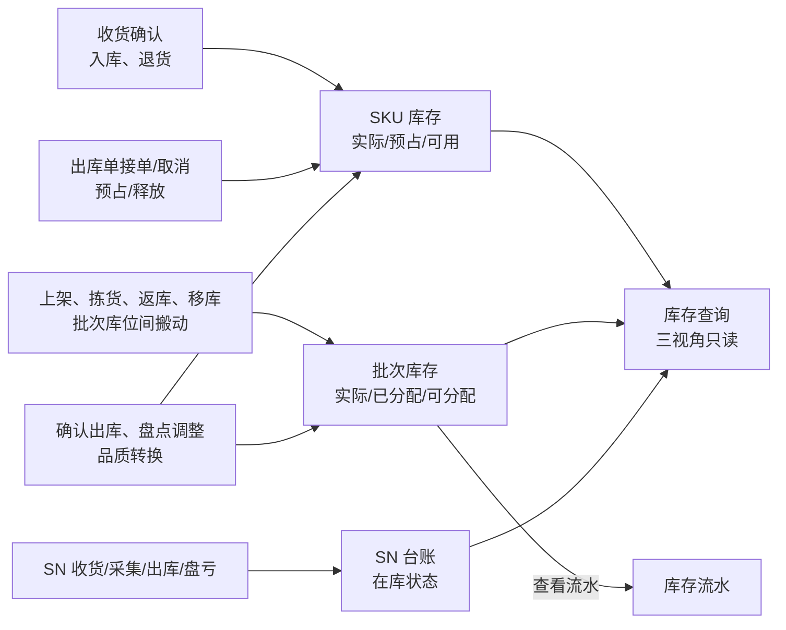
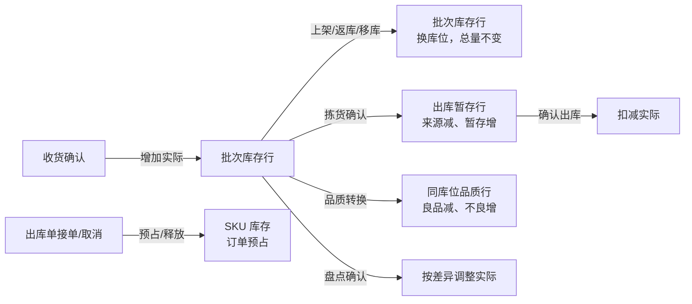

# 库存查询主PRD

> 用途：定义 SKU 库存、批次库存、SN 台账三个查询视角的记录粒度、数量口径、可分配资格、派生标签、详情追溯与只读边界，作为研发实现、测试验收和生成前端原型的业务依据。
> 定位：应用设计层**库存读模型真源**。数量规则以[《库存模块宏观系统架构》](../../../../../01-全局背景信息/07-库存模块宏观系统架构.md)§2.1～§2.4 为准；需求见[《库存与库内业务需求分析》](../../../../../03-需求调研和分析/04-库存与库内业务/库存与库内业务需求分析.md)库存维度与数量口径（INV-FR-001、INV-FR-002、INV-FR-003、INV-FR-011）；业务口径见[《库存与库内业务设计》](../../../../../04-业务分析和设计/04-库存与库内业务设计.md)§3.1、§4.1～§4.3、§5.1、§8.2；字段见[《库存字段清单》](../../../字段清单合集/04-库存与库内/README.md)；页面见[《库存查询页面骨架》](库存查询页面骨架.md)；交互以[前端Demo版PRD](库存查询前端Demo版PRD.md)为准。
> 不写什么：不写库存怎么被业务动作改变（见[《库存流水主PRD》](../库存流水/库存流水主PRD.md)、入库/出库各主 PRD）；不写移库提交（见[《移库作业主PRD》](../移库作业/移库作业主PRD.md)）；不写盘点单状态与差异确认（见[《盘点单主PRD》](../盘点单/盘点单主PRD.md)）；不写品质转换的发起条件与流水（见[《品质转换主PRD》](../品质转换/品质转换主PRD.md)）；不写库位、商品、容器的资料维护。

| 版本 | 本次变化 | 状态 |
| --- | --- | --- |
| 2026-10-15 | 定义 SKU 库存、批次库存、SN 台账三视角查询 | 文档修订 |
| 2026-10-21 | 补可分配资格、派生标签、口径说明与非负校验 | 文档修订 |
| WMS-V1.0（2026-10-27） | 按 ERP 采购订单主 PRD 结构重构：补文档边界、范围与追溯、对象定位、场景索引、无状态说明与查询矩阵、规则分组、上下游与一致性；业务结论不变 | 待评审，文档修订 |

## 1. 文档信息与阅读边界

| 项目 | 内容 |
| --- | --- |
| 读者 | 研发工程师、测试工程师、仓库主管、产品复核；据此生成管理端查询原型的 AI |
| 业务依据 | 《库存与库内业务需求分析》INV-FR-001、INV-FR-002、INV-FR-003、INV-FR-011 |
| 数量依据 | 《库存模块宏观系统架构》§2.1 两层账、§2.3 三量与可分配、§2.4 流水 |
| 字段依据 | [《SKU 库存（详细稿）》](../../../字段清单合集/04-库存与库内/SKU%20库存/SKU%20库存（详细稿）.tsv)、[《库存明细（详细稿）》](../../../字段清单合集/04-库存与库内/库存明细/库存明细（详细稿）.tsv)、[《SN 库存（详细稿）》](../../../字段清单合集/04-库存与库内/SN%20库存/SN%20库存（详细稿）.tsv) |
| 页面依据 | [《库存查询页面骨架》](库存查询页面骨架.md)、[前端Demo版PRD](库存查询前端Demo版PRD.md) |

关联资料：[《库存流水主PRD》](../库存流水/库存流水主PRD.md)（流水与追溯）、[《移库作业主PRD》](../移库作业/移库作业主PRD.md)（库位间搬动）、[《盘点单主PRD》](../盘点单/盘点单主PRD.md)（盘点中标签与待核对解除）、[《品质转换主PRD》](../品质转换/品质转换主PRD.md)（批次详情发起转换）、[《实体对象关系》](../../../系统架构设计/02-实体对象关系.md)。本目录写法见[需求文档 PRD 写作约定](../../AGENTS.md)。

## 2. 需求背景与目标

### 2.1 背景

库存不是一个数，而是两层账：接单时只知道货主和 SKU，所以 SKU 库存记实际、订单预占、可用；生成拣货任务时才知道库位和批次，所以批次库存记实际、已分配、可分配。现场还按 SN 追单件。如果查询页把两层混成一个“库存”数，就会出现“报告有货但拣不出来”或“把不良品算进可用”的争议。

库存查询只读，不提供手工改数、占用、释放、冻结入口。所有数量由收货、上架、拣货、返库、移库、品质转换、盘点、确认出库等业务动作写入。查询页的职责是把两层账、三个视角和派生标签解释清楚，让业务方看到同一个事实的不同切面。

### 2.2 目标

- 三个视角各自的记录粒度清楚，不互相替代；
- SKU 层回答“还能接多少单”，批次层回答“这个库位还能排多少拣货”；
- 可分配只算普通出库资格，暂存、过期、盘点中、暂停分配、已分配满都显示 0 并说明原因；
- 盘点中、暂停分配以派生标签展示，不设独立“分配状态”字段或筛选；
- SN 只记在库仓库与在库状态，不推断库位和品质；
- 数量异常不截为 0、不自动释放预占、不自动改单；页面只读，改动一律回业务单据。

### 2.3 设计要点（给研发与测试）

| 设计点 | 做法 | 原因与影响 |
| --- | --- | --- |
| 三层视角分离 | SKU 库存、批次库存、SN 台账各用一套粒度和列，不合并 | 两层账回答不同问题，合并会诱导错误决策 |
| 可用与可分配分开 | SKU 层看可用；批次层看可分配；页面固定提示两者不同 | 暂存有货可接单但拣不出，必须让业务看见 |
| 可分配按资格过滤 | 只算存储/拣货、未过期、未盘点、未暂停分配、未分配满的良品 | 其他出库指定、暂存、不良品不混入 |
| 标签派生不落字段 | 盘点中、暂停分配从盘点单与待核对记录派生 | 不新增分配状态枚举，避免两套状态 |
| SN 不记库位 | 只记货主＋SKU＋SN、当前仓库、在库状态 | 上架和移库不强制登记 SN 落位，推断会造假 |
| 只读边界 | 无新增、改数、占用、释放、冻结/解冻入口 | 库存由业务动作写入，查询页不能成为第二写入口 |

## 3. 需求范围

### 3.1 本期范围

- SKU 库存视角：良品/不良品分行，库存数量、订单预占、可用数量；
- 批次库存视角：库位、批次、品质、效期等级、库存数量、已分配、可分配；
- SN 台账视角：SN、SKU、货主、在库状态、最后变动时间；
- SKU 详情：数量构成、库位分布、订单预占来源、已分配来源、SN、最近流水；
- 批次详情：身份与位置、批次效期、数量、作业状态、追溯、SN；
- SN 详情：当前状态、来源信息、实际采集轨迹；
- 批次详情发起品质转换（入口，规则归品质转换）；
- 筛选、合计条、口径说明、导出 Mock；
- 顶栏当前仓库限定；不做跨仓汇总。

### 3.2 功能清单

| 编号 | 功能/位置 | 本次内容 | 需求来源 |
| --- | --- | --- | --- |
| F01 | SKU 库存视角 | 按仓库＋货主＋SKU＋品质查询；良品/不良品分行；数量与标签 | INV-FR-001、INV-FR-002 |
| F02 | 批次库存视角 | 按仓库＋货主＋SKU＋品质＋批次＋库位查询；实际/已分配/可分配 | INV-FR-001、INV-FR-003 |
| F03 | SN 台账视角 | 按货主＋SKU＋SN 查询在库状态与最后变动 | INV-FR-011 |
| F04 | SKU 详情 | 数量、库位分布、预占来源、已分配来源、SN、最近流水 | INV-FR-001～003 |
| F05 | 批次详情 | 余额、效期、资格标签、追溯、SN；品质转换入口 | INV-FR-003、INV-FR-011 |
| F06 | SN 详情 | 在库状态、最后来源、逐笔实际采集轨迹 | INV-FR-011 |
| F07 | 口径说明与合计 | 五项口径说明、SKU 数/库存合计、固定提示 | INV-FR-002 |
| F08 | 导出 | 导出当前视角（Demo Mock） | — |

### 3.3 需求追溯

| 需求分析 | 本 PRD 功能与规则 | 验收 |
| --- | --- | --- |
| 库存维度与汇总 | F01～F03、R01、R09 | AC01、AC02 |
| 数量与品质状态口径 | F01、R02、R08 | AC01、AC03 |
| 订单预占与拣货分配 | F01、F02、R03、R04 | AC03、AC04 |
| 批次效期与 SN 台账 | F02、F03、F05、F06、R08、R11 | AC05、AC06、AC07 |
| 负库存校验 | R06 | AC08 |
| 只读与标签派生 | R07、R10、R12 | AC09、AC10 |
| 当前仓库范围 | R13 | AC11 |

### 3.4 非本期范围

- 手工新增库存、直接改数、批量导入；
- 占用/释放、冻结/解冻、维护分配状态；
- 独立的品质转换菜单、路由或单据；不良品转回正常品；
- 按 SN 查当前库位、按 SN 推断品质或批次；
- 库存调拨、跨仓汇总、跨仓可用量；
- 负库存预警、库存水位、补货建议；
- 真实导出文件；
- 用户账号、角色、仓库授权与审批流。

| 范围补充 | 说明 |
| --- | --- |
| 适用对象 | 本仓全部货主、全部品质的库存；无业务单据生命周期 |
| 查询视角 | SKU 库存、批次库存、SN 台账；视角是页面容器，不是业务状态 |
| 数据范围 | 顶栏当前仓库；SN 身份按货主＋SKU＋SN 跨四仓判断，但查询只显示当前仓 |

## 4. 对象定位与业务边界

### 4.1 业务作用

| 项目 | 内容 |
| --- | --- |
| 对象层级 | 读模型：把两层库存账与 SN 台账按三个视角呈现，不产生新事实 |
| 核心职责 | 解释库存数量、订单预占、可用、已分配、可分配；给出可分配资格与派生标签；提供追溯入口 |
| 对象来源 | 收货、上架、拣货、返库、移库、品质转换、盘点、确认出库等业务动作写入 |
| 下游对象 | 无；查询页不驱动业务动作，只提供品质转换入口 |
| 数量关系 | SKU 层：良品实际 = 订单预占 + 可用；批次层：可分配 = 实际 − 已分配 |
| 业务终结 | 无状态；记录随库存变化实时更新 |

### 4.2 上下游关系摘要

### 4.3 业务对象关系

| 关系 | 说明 |
| --- | --- |
| SKU 库存 : 批次库存 | 1:N；SKU 实际 = 同仓同货主同 SKU 同品质的批次实际之和 |
| SKU 库存 : 订单预占 | 1:N；预占来自未结案普通出库单明细，只记良品层 |
| 批次库存 : 已分配 | 1:N；来自普通出库拣货任务未拣量与其他出库指定未拣量 |
| 批次库存 : 容器 | N:1；有容器收货或装箱时记录；同一容器不混货主 |
| SN 台账 : 业务记录 | 1:N；只记实际采集的收发、移库、转换、盘点、确认出库记录 |
| 查询视角 : 业务单据 | 只读引用；不反写 |

### 4.4 本对象不负责的事项

- 查询页不新增、修改、删除任何库存数量、库位、品质或 SN 状态；
- 查询页不做占用、释放、冻结、解冻、分配、取消分配；
- 查询页不解释业务单据为什么占用或未完成，只提供来源链接；
- 查询页不把 SN 位置、批次、品质从库位分布推断出来；
- 查询页不修正负库存、不自动释放预占、不自动改单；
- 查询页不执行品质转换、盘点、移库，只提供入口或只读展示。

## 5. 核心业务场景索引

| 场景ID | 场景 | 类型 | 说明 |
| --- | --- | --- | --- |
| S01 | 良品与不良品分行 | 主流程 | 良品 8／预占 3／可用 5；不良 2／预占 0／可用 0 |
| S02 | 批次按库位分行 | 主流程 | 同一批次分布两个库位分两行；品质不同继续分行 |
| S03 | 暂存有货但不可分配 | 支线 | 收货暂存良品 5、存储良品 3、已分配 2：可用 8，暂存可分配 0，存储可分配 1 |
| S04 | 不可分配原因 | 异常 | 不良品、过期、盘点中、暂停分配、已分配满显示 0 并标原因 |
| S05 | 非批次商品 | 分支 | 批次为空，仍按库位显示实际/已分配/可分配，批次列显示“—” |
| S06 | 负数阻断 | 异常 | 盘亏或转不良会导致良品负或可用负：阻断，不改账、不写流水 |
| S07 | SN 在库但库位未知 | 分支 | 已收货未登记 SN 落位，仍查到本仓在库，不显示推测库位 |
| S08 | 移库流水追溯 | 支线 | 源位减、目标位加各一条，不合并、不做源→目标联动 |
| S09 | 盘点中标签 | 异常 | 商品旁显示“盘点中”；无分配状态列与筛选 |
| S10 | 品质转换入口 | 支线 | 批次详情页头按可转换条件显示；转换规则回品质转换主 PRD |

## 6. 状态与操作

**本对象无独立业务状态。** 库存查询是只读读模型，没有待处理、进行中、已完成等单据状态；页面上的“盘点中”“暂停分配”“不参与分配”是从其他业务派生并展示的标签或资格，不改变库存层状态。

### 6.1 展示维度

| 维度 | 取值 | 说明 |
| --- | --- | --- |
| 查询视角 | SKU 库存、批次库存、SN 台账 | 页面容器，不是业务状态；切换不改变数据 |
| 品质 | 良品、不良品 | SKU 与批次均按品质分行；不良品不可用 |
| 效期等级 | 正常、临期、过期 | 由商品配置与仓库当地日期算出，只展示、不记账 |
| 可分配资格 | 可分配 > 0、不参与分配 | 不参与分配须带原因：暂存、过期、盘点中、暂停分配、已分配满 |
| 作业标签 | 盘点中、暂停分配 | 派生；正常记录不显示“正常” |
| SN 在库状态 | 在库、已出库、已盘亏 | 仅 SN 台账；品质变化不改变在库状态 |

### 6.2 取值说明

| 取值 | 含义 | 是否影响库存 |
| --- | --- | --- |
| 盘点中 | 该 SKU 有盘点中单据，冻结数量、库位、品质变化 | 不改数量；按盘点单规则阻断作业 |
| 暂停分配 | 该 SKU 因缺货、少件、上架找不到等被标记待核对，暂停新增分配 | 不改数量；盘点完成后解除 |
| 不参与分配 | 批次行因暂存、过期、不良、已分配满等不具备普通出库资格 | 不改数量；只是资格判断 |
| 在库 | SN 在本仓且未出库、未盘亏 | 是 SN 台账状态，不是数量 |
| 已出库 | SN 已随确认出库离仓 | 保留追溯，不参与在库统计 |
| 已盘亏 | 逐件核实后 SN 不存在 | 保留追溯，不参与在库统计 |

### 6.3 状态流转图

**不适用。** 库存查询没有单据状态流转。库存记录的数量变化由其他模块动作驱动，示意如下：

### 6.4 视角—动作矩阵

> ✅ = 允许；❌ = 不允许；✅（条件）= 须满足所列条件。本对象所有动作均为查询或跳转，不产生库存写入。

| 动作 | SKU 库存 | 批次库存 | SN 台账 |
| --- | --- | --- | --- |
| 查询、筛选、分页（F01～F03） | ✅ | ✅ | ✅ |
| 打开详情（F04～F06） | ✅ | ✅ | ✅ |
| 查看库存流水 | ✅（按货主、SKU、品质带入） | ✅（按库存明细号带入） | ✅（按 SN 带入） |
| 发起品质转换 | ❌ | ✅（条件：正常品、存储/拣货、未盘点、可转换 > 0、SKU 可用足够） | ❌ |
| 手工新增、改数、占用、释放、冻结/解冻 | ❌ | ❌ | ❌ |
| 导出当前视角（F08） | ✅（Mock） | ✅（Mock） | ✅（Mock） |

### 6.5 数量变化与来源（代替状态流转表）

| 数量 | 由谁改变 | 查询页如何体现 | 是否可手工改 |
| --- | --- | --- | --- |
| SKU 良品实际 | 收货确认、确认出库、盘点确认、品质转换 | 良品行库存数量 | 否 |
| SKU 不良品实际 | 收货确认、确认出库、盘点确认、品质转换 | 不良品行库存数量 | 否 |
| 订单预占 | 出库单接单、补占、取消、确认出库 | 良品行订单预占；不良品行为 0 | 否 |
| 可用 | 良品实际 − 订单预占 | 良品行可用数量 | 否 |
| 批次实际 | 收货、上架、拣货、返库、移库、品质转换、盘点、确认出库 | 批次行库存数量 | 否 |
| 批次已分配 | 生成拣货任务、其他出库指定、扫描确认、提交释放 | 批次行已分配 | 否 |
| 可分配 | 实际 − 已分配，再按资格过滤 | 批次行可分配 + 原因标签 | 否 |
| SN 在库状态 | 收货、确认出库、盘点逐件核实 | SN 台账在库状态 | 否 |

## 7. 核心业务规则

### 7.1 记录粒度与数量口径

| 规则编号 | 主题 | 规则 | 边界或例外 |
| --- | --- | --- | --- |
| R01 | 三视角粒度 | SKU 库存：仓库＋货主＋SKU＋品质；批次库存：仓库＋货主＋SKU＋品质＋批次＋库位＋容器（有容器号时；散件为空）；SN 台账：货主＋SKU＋SN，当前仓库为属性 | 同库位同批次不同容器分行；容器内容不在此页展开，只作追溯维度 |
| R02 | SKU 数量 | 良品行：库存数量 = 良品实际，订单预占 = 未结案普通出库单有效预占合计，可用 = 良品实际 − 订单预占；不良品行：库存数量 = 不良品实际，普通订单预占与可用均为 0 | 全仓总库存 = 良品实际 + 不良品实际；不得写成订单预占 + 可用 |
| R03 | 批次数量 | 批次库存展示库存数量、已分配、可分配；可分配 = 实际 − 已分配，再按普通出库资格过滤 | 已分配的货仍在库位，只是不能再分配；其他出库指定不混入普通出库可分配 |
| R04 | 可分配资格 | 只包括存储/拣货库位、未过期、SKU 未暂停分配、未盘点、良品的未分配数量；不符合显示 0 并标原因 | 收货暂存、出库暂存、不良隔离、异常处理库位不参与普通出库分配 |
| R05 | 暂存与可用 | 收货暂存、出库暂存的良品仍计入 SKU 可用数量，但可分配为 0；上架或返库完成后才可分配 | 页面须同时解释“可用 8”和“可分配 1”不是同一个数 |
| R06 | 非负 | 实际、订单预占、可用、已分配均不得为负；会造成任一负数的提交整次阻断，提示 SKU 与可用上限；不得截为 0、自动释放预占或自动改单 | 盘点实录可保存，确认失败时账、流水、完成状态不变；异常负数的展示口径见 Q05 |
| R07 | 派生标签 | 不设独立“分配状态”字段、枚举、筛选或维护入口；商品旁按盘点单/暂停分配依据派生“盘点中”“暂停分配”；正常记录不显示“正常” | 标签不增加预占或已分配，不改变品质；解除由原业务或盘点结果驱动 |
| R08 | 效期等级 | 临期/过期按商品配置与仓库当地日期计算，与良品/不良品分开展示 | 效期等级只用于展示与分配资格，不参与记账 |
| R09 | 合计与去重 | 合计条按当前筛选结果计算库存合计、良品/不良品数量；SKU 数按仓库＋货主＋SKU 去重，品质分行不重复计 | 批次视角合计不等于 SKU 数，不得混用 |

### 7.2 标签、口径与 SN

| 规则编号 | 主题 | 规则 | 边界或例外 |
| --- | --- | --- | --- |
| R10 | 列名与口径说明 | 页面固定提示“SKU 看可用数量，批次看可分配；订单预占不等于已分配”；“口径说明”至少覆盖库存数量、订单预占、可用数量、已分配、可分配五项 | 列头可简称“可分配”，但表头说明保留“普通出库”资格口径；不得把预占与已分配互称 |
| R11 | SN 规则 | SN 只记本仓在库与货主＋SKU＋SN 身份；不要求登记库位；能从 SKU 库位分布推断位置时不展示为事实；轨迹逐条显示实际采集记录，不合并移库流水、不补造节点 | 仓内数量盘点不自动把 SN 判为丢失；只有逐件核实的 SN 差异才改变在库状态；SN 身份不因上架、移库变化 |
| R12 | 只读边界 | 不提供手工新增、直接改数、占用/释放、冻结/解冻入口；标签解除由原业务或盘点结果驱动 | 取消盘点不自动清除未核实差异的暂停分配标识；品质转换只能从批次详情发起 |
| R13 | 数据范围 | 顶栏当前仓库限定；不汇总跨仓可用量；不设仓库列与仓库筛选 | SN 身份跨四仓判断，但查询只显示当前仓记录 |

### 7.3 数量示例（模拟）

| 条件 | SKU 层 | 批次层 | 说明 |
| --- | --- | --- | --- |
| 良品 8、不良 2、订单预占 3 | 良品 8／预占 3／可用 5；不良 2／预占 0／可用 0；SKU 数 1、库存合计 10 | — | 不能把不良 2 算进可用 |
| 同一批次分布两个库位 | — | 两行，各按库位实际/已分配/可分配 | 品质不同继续分行 |
| 收货暂存 5、存储 3、存储已分配 2 | 可用 8 | 暂存可分配 0；存储可分配 1 | 可用与可分配不同 |
| 良品 4、订单预占 4，盘亏 1 或转不良 1 | 可用 0 | 调整后良品 3 < 预占 4 | 阻断，不写流水、不完成盘点/转换 |
| 非批次商品 | 良品实际按 SKU 汇总 | 批次为空，仍按库位显示实际/已分配/可分配 | 批次列显示“—”，不改记到 SKU 层 |

## 8. 功能需求说明（页面索引）

| 编号 | 页面/位置 | 规则与状态依据 | Demo PRD |
| --- | --- | --- | --- |
| F01 | SKU 库存视角 | §6.4；R01、R02、R07、R09 | [库存查询前端Demo版PRD](库存查询前端Demo版PRD.md) §三 |
| F02 | 批次库存视角 | §6.4；R01、R03、R04、R08 | 同上 §四 |
| F03 | SN 台账视角 | §6.4；R11 | 同上 §五 |
| F04 | SKU 详情 | §7.2；R02、R05 | 同上 §六 |
| F05 | 批次详情 | §7.2；R03、R04、R08 | 同上 §七 |
| F06 | SN 详情 | §7.2；R11 | 同上 §八 |
| F07 | 口径说明与合计 | §7.1；R09、R10 | 同上 §二 |
| F08 | 导出当前视角 | — | 同上 §二页头 |

## 9. 上下游影响与协同

| 关联模块/系统 | 需要配合的变化 | 交接内容与时机 | 验收结果 |
| --- | --- | --- | --- |
| 入库与退货 | 收货确认增加暂存实际；上架提交换库位 | 实时 | SKU/批次实际与单据一致 |
| 出库单 | 接单/补占/释放订单预占；确认出库扣减 | 实时 | 预占 = 未结案有效预占合计 |
| 拣货任务 | 生成任务增加批次已分配；扫描确认改库位；提交释放 | 实时 | 已分配 = 未拣任务分配 + 其他出库指定 |
| 返库上架单 | 提交把出库暂存移回目标库位 | 实时 | 暂存与目标库位实际一致 |
| 移库作业 | 提交改变库位分布，总量不变 | 实时 | 源减目标增各一条流水 |
| 品质转换 | 同库位良品减、不良增；可用变化 | 实时 | 预占不变；两行流水 |
| 盘点单 | 盘点中标签；确认后调账、解除待核对 | 实时 | 标签与盘点单状态一致 |
| 基础资料 | 库位用途、商品批次/效期/SN 配置 | 实时 | 停用资料不参与新分配 |
| 公共能力 | 当前仓库、仓库当地日期、操作日志 | 全程 | 只显示当前仓 |

## 10. 关联文档与阅读入口

| 关联内容 | 阅读入口 | 本 PRD 与其边界 |
| --- | --- | --- |
| 两层账与三量 | 《库存模块宏观系统架构》§2.1、§2.3 | 规则真源；本文落到查询口径 |
| 库位用途 | 《库存模块宏观系统架构》§2.2 | 可分配资格来源；本文不重写用途表 |
| 流水记法 | 《库存模块宏观系统架构》§2.4 | 流水 owner；查询只跳转 |
| 数量业务口径 | 《库存与库内业务设计》§4.1～§4.3、§5.1 | 业务走查；本文不重复案例 |
| 流水查询 | [《库存流水主PRD》](../库存流水/库存流水主PRD.md) | 流水 owner；本文只带入条件 |
| 移库 | [《移库作业主PRD》](../移库作业/移库作业主PRD.md) | 移库 owner；查询只展示结果 |
| 盘点 | [《盘点单主PRD》](../盘点单/盘点单主PRD.md) | 盘点 owner；本文只展示标签 |
| 品质转换 | [《品质转换主PRD》](../品质转换/品质转换主PRD.md) | 转换 owner；本文只提供入口 |
| 字段定义 | 《库存字段清单》及三份详细稿 | 字段 owner |
| 页面结构 | [《库存查询页面骨架》](库存查询页面骨架.md) | 区域与线框，非规则权威 |
| 页面交互 | [前端Demo版PRD](库存查询前端Demo版PRD.md) | 控件、Mock；服从 §6.4 |

## 11. 异常与一致性

### 11.1 并发操作

| 场景 | 业务处理结果 |
| --- | --- |
| 查询时另一人正在拣货确认 | 查询读取最新已提交事实；未确认的本机草稿不显示 |
| 查询时盘点开始 | 下一次查询显示“盘点中”标签；数量不变 |
| 查询时品质转换提交 | 下一次查询显示良品减少、不良增加；实际总量不变 |
| 两人同时查看同一批次 | 只读，无并发冲突；各自看到查询时点数据 |
| 查询时确认出库 | 已出库数量扣减；出库暂存行消失或减少；以最新事实为准 |

### 11.2 幂等与重复处理

| 操作 | 幂等规则 |
| --- | --- |
| 重复查询、翻页、切换视角 | 不改变任何数据 |
| 重复打开详情 | 不产生业务记录 |
| 重复导出 | Mock；真实导出也只读，不改变数据 |
| 重复发起品质转换 | 由品质转换动作幂等规则处理；查询页不重复提交 |

### 11.3 与业务单据、流水的一致性

| 场景 | 处理方式 |
| --- | --- |
| SKU 实际与批次合计不一致 | 以业务单据与流水核查；查询页不自动修正、不隐藏差异 |
| 订单预占与出库单合计不一致 | 以未结案出库单明细为准；查询页不自动释放或补占 |
| 已分配与任务合计不一致 | 以未完成任务和其他出库指定为准；查询页只展示 |
| SN 在库但无库位 | 正常；SN 不要求登记库位，页面不推断 |
| 盘点中仍有旧标签 | 以盘点单当前状态为准；取消盘点不自动清除未核实差异的暂停分配 |
| 负库存异常数据 | 业务提交应阻断；历史异常数据的展示口径见 Q05 |

## 12. 验收标准与待确认事项

### 12.1 验收标准

| 编号 | 对应功能/规则 | 条件与操作（数字为模拟） | 预期结果 |
| --- | --- | --- | --- |
| AC01 | F01、R02 | 良品 8、不良 2、订单预占 3 | 同 SKU 两行：良品 8／预占 3／可用 5，不良 2／预占 0／可用 0；SKU 数 1、库存合计 10 |
| AC02 | F02、R01 | 同一批次分布两个库位 | 批次库存分两行；品质不同继续分行 |
| AC03 | F01、F02、R05 | 收货暂存良品 5、存储良品 3、存储已分配 2 | SKU 可用 8；暂存可分配 0；存储可分配 1；页面能解释两个数不同 |
| AC04 | F02、R04 | 筛选“可分配大于 0”，数据含不良、过期、盘点中、暂停分配 | 不返回不具备普通出库资格的行；原因标签正确 |
| AC05 | F02、R01 | 非批次商品有库位实际、批次为空 | 批次库存仍按库位显示实际/已分配/可分配；批次列“—” |
| AC06 | F03、R11 | SN 已收货、上架未登记 SN 库位 | 仍查到本仓在库；不显示推测库位；上架可按数量提交 |
| AC07 | F06、R11 | 查看 SN 轨迹 | 逐条显示实际记录；移库不合并为源→目标；不补造节点 |
| AC08 | R06 | 良品 4、订单预占 4，确认盘亏 1 或转不良 1 | 阻断；不新增流水、不改预占、不完成盘点/转换 |
| AC09 | R07 | SKU 正在盘点或暂停分配 | 商品旁显示相应标签；无“分配状态”列与筛选 |
| AC10 | R12 | 在查询页寻找新增、改数、占用、释放入口 | 均不存在；页面只读 |
| AC11 | R13 | 切换顶栏仓库 | 只显示该仓库存；不出现跨仓汇总 |
| AC12 | F04 | 查看 SKU 详情 | 数量、库位分布、预占来源、已分配来源、SN、最近流水与列表一致 |
| AC13 | F05 | 查看批次详情并点品质转换 | 仅在可转换条件满足时显示入口；转换结果回品质转换主 PRD |

### 12.2 待确认事项

| 编号 | 问题 | 影响范围 | 状态/结论 |
| --- | --- | --- | --- |
| Q01 | “未结案普通出库单”的状态集合 | R02、§7.3、AC01 | **已确认（2026-10-27）**：待处理、待拣货、待复核、待出库计预占；已取消、已出库不计。 |
| Q02 | “暂停分配”与“待核对”是否同一标签 | R04、R07、AC09 | **已确认（2026-10-27）**：页面主标签统一为“暂停分配”；“待核对”是其中一种原因，详情展示来源单号。 |
| Q03 | 批次库存查询行是否按容器拆分 | R01、F02 | **已确认（2026-10-27）**：按容器分行；容器号为空表示散件。与库存明细详细稿、宏观架构批次库存唯一键一致。 |
| Q04 | SN 在库状态是否只有“在库/已出库/已盘亏” | R11、F03、F06 | **已确认（2026-10-27）**：保持三态；已拣未出库仍为在库，退拣仍为在库。 |
| Q05 | 历史异常负库存的展示 | R06、F01 | **已确认（2026-10-27）**：业务提交继续阻断；查询遇到历史异常数据保留真实负数并标红，不截为 0，不因此阻断详情查看。 |
| Q06 | 同一批次行多个不可分配原因的展示 | R04、F02 | **已确认（2026-10-27）**：按“盘点中 > 暂停分配 > 过期 > 暂存 > 已分配满”显示主原因，详情列出全部原因。 |
| Q07 | SKU 详情“订单预占来源”/“已分配来源”展示 | F04、R02、R03 | **已确认（2026-10-27）**：展示来源单号、类型，只读跳转；已分配区分普通出库任务与其他出库指定；不在此页做释放。 |

## 附录 两层账对照示例（模拟）

| 层 | 行 | 实际 | 预占/已分配 | 可用/可分配 |
| --- | --- | --- | --- | --- |
| SKU 库存 | 良品 | 8 | 3 | 5 |
| SKU 库存 | 不良品 | 2 | 0 | 0 |
| 批次库存 | 收货暂存 STAGE-IN-01 | 5 | 0 | 0（暂存） |
| 批次库存 | 存储 A-01-01 | 3 | 2 | 1 |
| 批次库存 | 不良隔离 Q-01-01 | 2 | 0 | 0（不良） |
| 合计 | SKU 实际 10 = 批次实际 10 | 10 | — | — |
