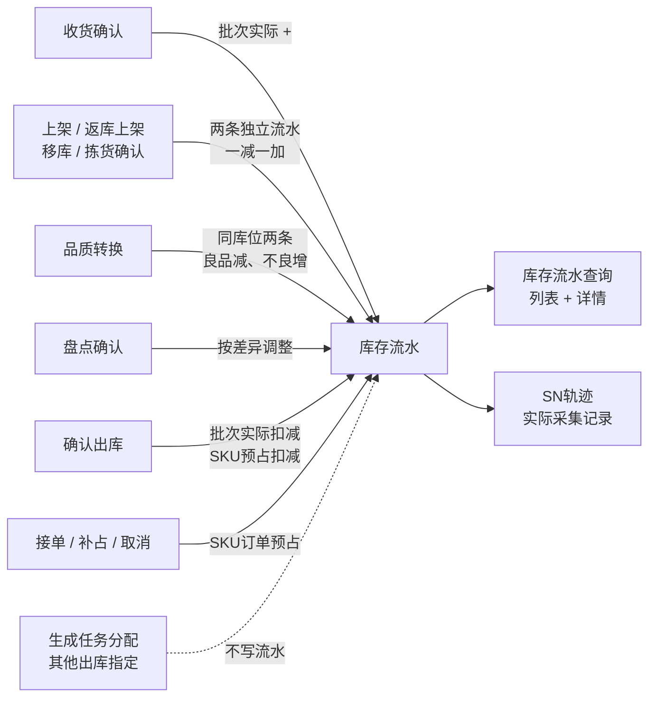
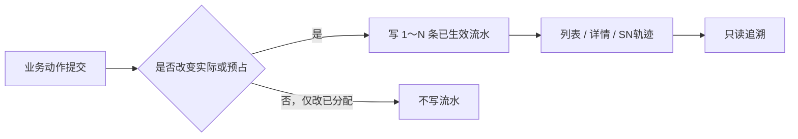

# 库存流水主PRD

> 用途：定义库存流水的记账粒度、流水类型闭集、一减一加记法、确认出库双口径、查询与追溯规则、只读边界，作为研发实现、测试验收和生成前端原型的业务依据。
> 定位：应用设计层**库存变化留痕真源**。记账口径以[《库存模块宏观系统架构》](../../../../../01-全局背景信息/07-库存模块宏观系统架构.md)§2.4 为准；需求见[《库存与库内业务需求分析》](../../../../../03-需求调研和分析/04-库存与库内业务/库存与库内业务需求分析.md)库存流水（INV-FR-004）；业务口径见[《库存与库内业务设计》](../../../../../04-业务分析和设计/04-库存与库内业务设计.md)§5.1、§5.2；字段以[《库存流水（详细稿）》](../../../字段清单合集/04-库存与库内/库存流水/库存流水（详细稿）.tsv)为准；页面见[《库存流水页面骨架》](库存流水页面骨架.md)；交互以[前端Demo版PRD](库存流水前端Demo版PRD.md)为准。
> 不写什么：不写各业务动作怎么发生（见入库、出库、移库、盘点、品质转换各主 PRD）；不写库存查询的数量口径与标签（见[《库存查询主PRD》](../库存查询/库存查询主PRD.md)）；不写流水接口与数据库字段；不写财务凭证、成本核算与对账。

| 版本 | 本次变化 | 状态 |
| --- | --- | --- |
| 2026-10-15 | 定义库存流水查询与追溯 | 文档修订 |
| 2026-10-21 | 明确一行一数、确认出库双口径、分配不写流水 | 文档修订 |
| WMS-V1.0（2026-10-27） | 按 ERP 采购订单主 PRD 结构重构：补文档边界、范围与追溯、对象定位、场景索引、无状态说明与查询矩阵、规则分组、上下游与一致性；业务结论不变 | 待评审，文档修订 |

## 1. 文档信息与阅读边界

| 项目 | 内容 |
| --- | --- |
| 读者 | 研发工程师、测试工程师、库存责任角色、产品复核；据此生成管理端查询原型的 AI |
| 业务依据 | 《库存与库内业务需求分析》INV-FR-004；《库存与库内业务设计》§5.1、§5.2 |
| 记账依据 | 《库存模块宏观系统架构》§2.1、§2.3、§2.4 |
| 字段依据 | [《库存流水（详细稿）》](../../../字段清单合集/04-库存与库内/库存流水/库存流水（详细稿）.tsv) |
| 页面依据 | [《库存流水页面骨架》](库存流水页面骨架.md)、[前端Demo版PRD](库存流水前端Demo版PRD.md) |

关联资料：[《库存查询主PRD》](../库存查询/库存查询主PRD.md)（五量口径与详情跳转）、[《移库作业主PRD》](../移库作业/移库作业主PRD.md)、[《盘点单主PRD》](../盘点单/盘点单主PRD.md)、[《品质转换主PRD》](../品质转换/品质转换主PRD.md)、[《入库单主PRD》](../../2-入库管理/入库单/入库单主PRD.md)、[《出库单主PRD》](../../3-出库管理/出库单/出库单主PRD.md)、[《实体对象关系》](../../../系统架构设计/02-实体对象关系.md)。本目录写法见[需求文档 PRD 写作约定](../../AGENTS.md)。

## 2. 需求背景与目标

### 2.1 背景

库存有两层账：SKU 层记实际、订单预占、可用；批次层记实际、已分配、可分配。两层数量必须能逐笔还原。如果只保留余额，出现差异时无法说明是哪一次收货、上架、拣货、返库、移库、品质转换、盘点或确认出库造成的，也无法判断流水是否重复。

库存流水就是这套留痕：一行只记一个数的一次变化，写清变化前后、余额维度、来源单据、操作者和时间。它不承担“把一减一加合成一条业务故事”的职责；上架、移库这类动作会留下两条独立流水，各自只描述自己的库位和数量。查询页只读，不能改数、冲销或补造。

### 2.2 目标

- 每一笔已生效库存变化至少有一条流水，且能指回来源单据或业务动作；
- 一行只记一个数量口径、一个余额维度，前后值不跨口径解释；
- 上架、拣货、返库、移库、品质转换的一减一加各记两条独立流水；
- 确认出库按批次实际与 SKU 订单预占分别记两行，不合并；
- 分配与其他出库指定只改已分配，不写库存流水；
- 流水不可编辑、删除、冲销；重复提交不新增第二组流水；
- 查询按当前仓库、时间、类型、来源、SKU、品质、库位、批次、SN 定位到单条。

### 2.3 设计要点（给研发与测试）

| 设计点 | 做法 | 原因与影响 |
| --- | --- | --- |
| 一行一数 | 每行只写一个数量口径（批次库位实际或 SKU 订单预占） | 防止前后值被误读为总库存或可用 |
| 一减一加不合并 | 上架、移库、品质转换、拣货移入暂存各两行，独立展示 | 每条只描述自己的库位/品质，便于逐行核对 |
| 不记源/目标库位 | 不设源库位、目标库位字段，不做配对跳转 | 避免把两条独立事实合成一条不可审计的记录 |
| 分配不写流水 | 已分配变化只在批次库存和任务上体现 | 已分配不是实际数量变化，写流水会重复计量 |
| 确认出库双口径 | 批次实际扣减与 SKU 预占扣减各一行 | 两个口径回答不同问题，不能塞进一行 |
| 只读不可冲销 | 无编辑、删除、冲销入口；误操作走原业务规则 | 流水是事实，不能成为第二写入口 |

## 3. 需求范围

### 3.1 本期范围

- 10 类流水：收货入暂存库位、上架移库、拣货移入出库暂存库位、返库上架、品质转换、移库、盘点调整、确认出库扣减、预占、释放；
- 批次库位实际与 SKU 订单预占两种数量口径；
- 一减一加两条独立流水；确认出库双口径两行；
- 流水列表：筛选、列展示、排序、分页、口径说明、导出 Mock；
- 流水详情：变动、余额维度、来源、本次涉及 SN、原因与留痕；
- 来源单据、关联作业记录、SN 轨迹跳转；
- 顶栏当前仓库限定。

### 3.2 功能清单

| 编号 | 功能/位置 | 本次内容 | 需求来源 |
| --- | --- | --- | --- |
| F01 | 流水生成 | 业务动作按规则写一条或多条流水；分配不写 | INV-FR-004 |
| F02 | 流水列表 | 10 项筛选、11 列、默认时间倒序、分页、导出 Mock | INV-FR-004 |
| F03 | 流水详情 | 变动、余额维度、来源单据/行号、关联作业记录、SN、原因、终端与操作者 | INV-FR-004 |
| F04 | 来源追溯 | 来源单号可跳对应详情；不存在或跨仓不展示 | INV-FR-004 |
| F05 | SN 追溯 | 展示本次实际采集 SN，可进入 SN 轨迹 | INV-FR-004、INV-FR-011 |
| F06 | 口径说明 | 解释库存数量、订单预占、可用、已分配、可分配五个量 | INV-FR-004 |

### 3.3 需求追溯

| 需求分析 | 本 PRD 功能与规则 | 验收 |
| --- | --- | --- |
| 一行一数、两层记账 | F01、R01、R02 | AC01、AC02 |
| 一减一加独立 | F02、F03、R03 | AC02、AC03、AC08 |
| 确认出库双口径 | R06 | AC04 |
| 分配不写流水 | R04 | AC07 |
| 品质转换与盘点追溯 | R07、R09 | AC09、AC10 |
| SN 追溯 | F05、R10 | AC11 |
| 只读与幂等 | R11、R12 | AC12、AC13 |

### 3.4 非本期范围

- 手工新增流水、修改余额、批量导入、冲销流水；
- 流水状态页签、状态筛选、草稿或待生效流水；
- 成对流水跳转、源/目标库位联动面板；
- 跨仓查询与跨仓汇总；
- 财务凭证、成本核算、库存对账、库存估值；
- 真实导出文件；
- 用户账号、角色、仓库授权与审批流。

| 范围补充 | 说明 |
| --- | --- |
| 适用对象 | 本仓全部已生效库存变化；分配、其他出库指定不写流水 |
| 流水状态 | 一期只有“已生效”，无第二状态 |
| 数据范围 | 顶栏当前仓库；来源对象跨仓时不展示 |

## 4. 对象定位与业务边界

### 4.1 业务作用

| 项目 | 内容 |
| --- | --- |
| 对象层级 | 事实记录：一次已生效库存变化的不可编辑留痕 |
| 核心职责 | 记录变化前后、数量口径、余额维度、来源单据/作业、操作者与时间；支撑追溯与差异核查 |
| 对象来源 | 收货确认、上架提交、拣货确认、返库提交、移库提交、品质转换、盘点确认、确认出库、接单/补占/取消/释放 |
| 下游对象 | 无；流水不驱动业务动作 |
| 数量关系 | 一次动作可产生 1～N 条流水；一减一加为两条；确认出库为两条不同口径 |
| 业务终结 | 生成即已生效，无状态流转；不可修改 |

### 4.2 上下游关系摘要

### 4.3 业务对象关系

| 关系 | 说明 |
| --- | --- |
| 流水 : 批次库存行 | N:1；批次库位实际流水指向具体库存明细行 |
| 流水 : SKU 库存 | N:1；订单预占流水指向仓库＋货主＋SKU＋良品 |
| 流水 : 来源单据 | N:1；来源单号、行号、关联作业记录可追溯 |
| 流水 : SN | N:M；只记本次实际采集并写入的 SN |
| 流水 : 业务动作 | 同一动作可产生多条流水，用内部动作标识关联幂等，不合成一条业务记录 |

### 4.4 本对象不负责的事项

- 流水不改变库存，只记录已生效变化；写流水失败时业务动作整体回滚；
- 流水不负责解释业务为何发生，只给出来源与原因留痕；
- 流水不合并一减一加，也不提供源/目标库位配对；
- 流水不记录分配、其他出库指定、冻结/解冻、标签变化；
- 流水不做财务核算、成本结转、库存估值；
- 流水不补造未采集的 SN 节点。

## 5. 核心业务场景索引

| 场景ID | 场景 | 类型 | 说明 |
| --- | --- | --- | --- |
| S01 | 收货入暂存 | 主流程 | 正常品 3：`批次库位实际 0→3（+3）`，一行 |
| S02 | 上架移库 | 主流程 | 暂存 3 到 A-01：暂存 −3、A-01 +3 两行，SKU 实际合计不变 |
| S03 | 接单预占 | 主流程 | `SKU订单预占 0→2（+2）`，库位/批次为空 |
| S04 | 确认出库 | 主流程 | 批次实际 200→120、SKU 预占 500→420，两行 |
| S05 | 非批次商品 | 分支 | 批次为空，仍记批次库位实际，不改记 SKU 层 |
| S06 | 生成任务分配 | 边界 | 不写流水；已分配增加，追溯看任务 |
| S07 | 重复提交移库 | 异常 | 仍只有原两条流水，库存不再变化 |
| S08 | 品质转换 | 支线 | 同库位良品减、不良增两行；无来源单号时显示“—” |
| S09 | 盘点调整 | 支线 | 按差异调整；详情链接盘点快照、实盘与差异 |
| S10 | 按 SN 查询 | 分支 | 只返回涉及该 SN 的流水，可打开 SN 轨迹 |
| S11 | 来源跨仓 | 异常 | 不展示来源详情，避免跨仓泄露 |

## 6. 状态与操作

**本对象无业务状态流转。** 一期流水只保存“已生效”记录，没有草稿、待处理、已冲销等状态；列表不设状态页签，详情里的“流水状态”固定为已生效，不构成状态机。

### 6.1 展示维度

| 维度 | 取值 | 说明 |
| --- | --- | --- |
| 流水状态 | 已生效 | 唯一取值；不是可流转状态 |
| 流水类型 | 10 类闭集 | 业务分类，不是状态 |
| 数量口径 | 批次库位实际、SKU订单预占 | 决定前后值与余额维度 |
| 余额维度 | 仓库＋货主＋SKU＋库位＋批次＋品质；或仓库＋货主＋SKU＋良品 | 订单预占行库位/批次为空 |
| 变化方向 | 增（+）、减（−） | 记在变化量，不单独设状态 |
| SN | 有实际采集、无采集 | 无采集时不补造 |

### 6.2 取值说明

| 取值 | 含义 | 是否可人工改变 |
| --- | --- | --- |
| 已生效 | 业务动作已提交成功，库存与流水同时落账 | 否 |
| 批次库位实际 | 某库位、某批次（有则）、某品质的实际数量 | 否 |
| SKU订单预占 | SKU 良品层的订单预占数量，不带库位、批次 | 否 |
| 增/减 | 本次变化方向；正数写“＋”，负数写“－” | 否 |

### 6.3 状态流转图

**不适用。** 流水没有状态流转。流水由业务动作一次写入，示意如下：

### 6.4 类型—动作矩阵

> ✅ = 会产生流水；— = 不产生；条数为一次动作的典型值。

| 业务动作 | 批次库位实际 | SKU订单预占 | 条数 | 来源单据/作业 |
| --- | --- | --- | --- | --- |
| 收货确认 | ✅ 增 | — | 1 | 入库单/退货单、收货记录 |
| 上架提交 | ✅ 减＋增 | — | 2 | 上架单 |
| 拣货扫描确认 | ✅ 减＋增 | — | 2 | 出库单、拣货任务 |
| 返库上架提交 | ✅ 减＋增 | — | 2 | 返库上架单 |
| 品质转换 | ✅ 减＋增（同库位不同品质） | — | 2 | 无独立单据；业务动作标识 |
| 移库提交 | ✅ 减＋增 | — | 2 | 移库作业 |
| 盘点确认 | ✅ 按差异增/减 | — | 0～N | 盘点单 |
| 确认出库 | ✅ 减 | ✅ 减 | 2 | 出库单 |
| 接单预占、补占 | — | ✅ 增 | 1 | 出库单 |
| 取消、释放、确认出库释放 | — | ✅ 减 | 1 | 出库单 |
| 生成拣货任务分配 | — | — | 0 | 拣货任务 |
| 其他出库指定 | — | — | 0 | 出库单 |

### 6.5 流水生成与来源表（代替状态流转表）

| 流水类型 | 数量口径 | 来源单据/作业 | 是否一减一加 | 追溯入口 |
| --- | --- | --- | --- | --- |
| 收货入暂存库位 | 批次库位实际 | 入库单/退货单、收货记录 | 否 | 入库单/退货单详情 |
| 上架移库 | 批次库位实际 | 上架单 | 是 | 上架单详情 |
| 拣货移入出库暂存库位 | 批次库位实际 | 出库单、拣货任务 | 是 | 出库单/拣货任务详情 |
| 返库上架 | 批次库位实际 | 返库上架单 | 是 | 返库上架单详情 |
| 品质转换 | 批次库位实际 | 无独立单据；业务动作标识 | 是 | 原因、依据、通知留痕 |
| 移库 | 批次库位实际 | 移库作业 | 是 | 移库作业详情 |
| 盘点调整 | 批次库位实际 | 盘点单 | 否 | 盘点快照、实盘、差异 |
| 确认出库扣减 | 批次库位实际、SKU订单预占 | 出库单 | 否（两口径各一行） | 出库单详情 |
| 预占、释放 | SKU订单预占 | 出库单 | 否 | 出库单详情 |

## 7. 核心业务规则

### 7.1 记账粒度与类型

| 规则编号 | 主题 | 规则 | 边界或例外 |
| --- | --- | --- | --- |
| R01 | 一行一数 | 一行只记一个数的一次变化；写清变化前、变化后、变化量、数量口径、余额维度、来源、操作者、时间 | 不得一行同时写两个口径或两个余额维度 |
| R02 | 两层记账 | 库存数量变化记在批次库存层，带库位、批次、品质；SKU 库存的实际不另记第二笔；订单预占变化记在 SKU 良品层，库位、批次为空 | 按 SKU 汇总时，搬动的一减一加抵消，实际与预占合计等于 SKU 库存 |
| R03 | 一减一加独立 | 上架、拣货移入出库暂存、返库上架、移库、品质转换按实际变化的余额行分别记减项、加项独立流水：单行/单目标为一组两条，多行/多目标为多组；每条只有自己的库位、批次、品质与前后数量 | 不设源库位/目标库位字段，不合并、不联动、不提供成对跳转；内部动作标识只用于幂等和追溯 |
| R04 | 分配不写流水 | 分配与其他出库指定只改变批次库存的已分配，不写库存流水 | 追溯看拣货任务与出库单明细 |
| R05 | 类型闭集 | 一期流水类型只有 10 类：收货入暂存库位、上架移库、拣货移入出库暂存库位、返库上架、品质转换、移库、盘点调整、确认出库扣减、预占、释放；收货入暂存库位同时覆盖入库收货与退货收货，来源单据显示入库/退货 | 盘点无差异不写流水；新增类型须先改本文与字段清单，不由实现自造 |
| R06 | 确认出库双口径 | 普通出库确认出库按数量口径分别记批次库位实际减项、SKU订单预占减项；两行必须同事务写入，任一失败整次回滚；其他出库没有订单预占，只写批次库位实际减项；多库存行按行分别记，不强行凑两条 | 各口径独立记，不合并；是否有预占行由出库类型和实际变化决定 |
| R07 | 品质转换追溯 | 品质转换没有来源单号时列表显示“—”，详情以业务动作标识、原因说明、依据、通知结果追溯；不虚构品质转换单号。一期不使用原因代码，统一记录原因说明文本 | 不把品质转换写成有独立单号的单据 |
| R08 | 流水号 | 流水号沿用系统统一编号规则，不单独维护流水序列、不与业务单据号隔离；一期 Demo 按写入顺序展示，跨仓共用 | 按全局编号规则生成，流水号只追加、不回收 |

### 7.2 前后值、追溯与 SN

| 规则编号 | 主题 | 规则 | 边界或例外 |
| --- | --- | --- | --- |
| R09 | 前后值口径 | 前后值只属本条数量口径和本条余额维度：批次库位实际的前后值不是 SKU 总量；订单预占的前后值不带库位、批次 | 列表不并列总库存、可用、已分配、锁定或冻结；不得把两种口径合并 |
| R10 | 来源追溯 | 来源单号或关联作业记录号有值时可跳对应详情；对象不存在或所属仓库与顶栏当前仓库不一致时不展示详情 | 无独立详情的动作按普通文本或“—”展示，不做禁用链接 |
| R11 | SN 追溯 | 启用 SN 的商品展示本次涉及 SN 清单；一期清单只读，不提供 SN 轨迹跳转，轨迹跳转列入后续；只展示实际采集并写入流水的 SN | 未采集时整段不显示，不按数量补造 SN |
| R12 | 只读与幂等 | 流水不可编辑、删除、手工冲销；重复提交返回既有结果，不新增第二组流水 | 业务误操作恢复走原业务规则；一期不定义实收误记更正入口，不得通过流水绕过 |
| R13 | 数据范围 | 顶栏当前仓库限定；跨仓来源不展示；不做跨仓汇总 | 列表不设仓库列 |

### 7.3 数量示例（模拟）

| 动作 | 流水 | 说明 |
| --- | --- | --- |
| 收货确认正常品 3 | `批次库位实际 0→3（+3）` 一行，库位为收货暂存 | 前后量可核对 |
| 上架暂存 3 至 A-01 | 暂存 `3→0（-3）`、A-01 `0→3（+3）` 两行 | SKU 实际合计不变 |
| 接单预占 2 | `SKU订单预占 0→2（+2）` 一行，库位/批次为空 | 品质为良品 |
| 确认出库 80 | `批次库位实际 200→120（-80）`、`SKU订单预占 500→420（-80）` 两行 | 不生成一条同时写两个口径 |
| 非批次商品收货 2 | `批次库位实际 0→2（+2）`，库位有值、批次为空 | 不得改记到 SKU 层 |
| 生成拣货任务分配 2 | 不生成流水 | 已分配增加，任务可追溯 |
| 重复提交同一移库 | 仍只有原两条独立流水 | 库存不再变化 |

## 8. 功能需求说明（页面索引）

| 编号 | 页面/位置 | 规则与状态依据 | Demo PRD |
| --- | --- | --- | --- |
| F01 | 流水生成 | §6.4、§6.5；R01～R07 | 各业务主 PRD |
| F02 | 流水列表 | §6.4；R09、R13 | [库存流水前端Demo版PRD](库存流水前端Demo版PRD.md) §5 |
| F03 | 流水详情 | §7.2；R09～R11 | 同上 §7 |
| F04 | 来源追溯 | §7.2；R10 | 同上 §7 |
| F05 | SN 追溯 | §7.2；R11 | 同上 §7 |
| F06 | 口径说明 | §7.1；R09 | 同上 §3 |

## 9. 上下游影响与协同

| 关联模块/系统 | 需要配合的变化 | 交接内容与时机 | 验收结果 |
| --- | --- | --- | --- |
| 入库与退货 | 收货确认、上架提交换库位时写流水 | 动作提交同事务 | 收货一行；上架两行 |
| 出库单 | 接单/补占/取消/确认出库写预占与扣减 | 动作提交同事务 | 预占、释放各一行；确认出库两行 |
| 拣货任务 | 扫描确认写批次移库两行；分配不写 | 确认时 | 来源减、暂存增；分配无流水 |
| 返库上架单 | 提交写返库两行 | 提交时 | 暂存减、目标增 |
| 移库作业 | 提交写移库两行 | 提交时 | 源减、目标增 |
| 品质转换 | 同库位写良品减、不良增两行 | 转换提交时 | 实际总量不变；原因留痕 |
| 盘点单 | 确认差异写盘点调整 | 确认时 | 按差异调整；无差异不写流水 |
| 基础资料 | 库位、批次、商品、SN 维度 | 全程 | 维度完整，不补造 |
| 公共能力 | 当前仓库、时区、操作者 | 全程 | 时间与操作者正确 |

## 10. 关联文档与阅读入口

| 关联内容 | 阅读入口 | 本 PRD 与其边界 |
| --- | --- | --- |
| 流水记法 | 《库存模块宏观系统架构》§2.4 | 规则真源；本文落到类型与页面 |
| 两层账与三量 | 《库存模块宏观系统架构》§2.1、§2.3 | 数量口径来源；本文不重写 |
| 业务变化与追溯 | 《库存与库内业务设计》§5.1、§5.2 | 业务走查；本文不重复案例 |
| 库存查询 | [《库存查询主PRD》](../库存查询/库存查询主PRD.md) | 查询 owner；本文只承接跳转 |
| 移库 | [《移库作业主PRD》](../移库作业/移库作业主PRD.md) | 移库 owner；本文只记结果 |
| 盘点 | [《盘点单主PRD》](../盘点单/盘点单主PRD.md) | 盘点 owner；本文只记调整 |
| 品质转换 | [《品质转换主PRD》](../品质转换/品质转换主PRD.md) | 转换 owner；本文只记两行流水 |
| 字段定义 | 《库存流水（详细稿）》 | 字段 owner |
| 页面结构 | [《库存流水页面骨架》](库存流水页面骨架.md) | 区域与线框，非规则权威 |
| 页面交互 | [前端Demo版PRD](库存流水前端Demo版PRD.md) | 控件、Mock；服从 §6.4 |

## 11. 异常与一致性

### 11.1 并发操作

| 场景 | 业务处理结果 |
| --- | --- |
| 同一动作重复提交 | 返回原结果，不新增第二组流水 |
| 两个动作同时改同一批次行 | 各自按提交时的前后值落账；以数据库串行结果为准，不产生交叉的前后值 |
| 查询时正在写流水 | 只展示已提交流水；未提交事务不出现半组 |
| 来源单据被取消或跨仓 | 流水保留；来源链接按当前仓库与对象存在性判断 |
| 盘点确认与移库同时到达 | 盘点中的 SKU 阻断移库；先生效者为准 |

### 11.2 幂等与重复处理

| 操作 | 幂等规则 |
| --- | --- |
| 重复确认、重复提交业务动作 | 返回原结果，不新增第二组流水 |
| 重复写同一流水号 | 拒绝，不覆盖原流水 |
| 重复查询、翻页、导出 | 不改变数据 |
| 重复打开详情 | 不产生记录 |

### 11.3 与业务单据、库存查询的一致性

| 场景 | 处理方式 |
| --- | --- |
| 流水合计与批次库存不一致 | 以流水逐笔核对；查询页不自动修正 |
| 一次动作只写成一条 | 单行/单目标动作视为缺项；多行/多目标动作按实际余额行应有多组，不按固定两条判断 |
| 普通出库确认出库只写一条 | 视为异常：应有批次实际减项与 SKU 预占减项；其他出库没有预占，只写批次实际减项 |
| SN 未采集 | 不显示 SN 段，不补造；SN 台账仍按仓库级在库 |
| 来源单据删除 | 流水保留；来源显示普通文本，不展示详情 |
| 跨仓来源 | 不展示详情；流水仍可按当前仓查询 |

## 12. 验收标准与待确认事项

### 12.1 验收标准

| 编号 | 对应功能/规则 | 条件与操作（数字为模拟） | 预期结果 |
| --- | --- | --- | --- |
| AC01 | F01、R01 | 收货确认正常品 3 | 生成 `批次库位实际 0→3（+3）` 一行，库位为收货暂存 |
| AC02 | F01、R03 | 上架暂存 3 至 A-01 | 同一动作显示暂存 `3→0（-3）`、A-01 `0→3（+3）` 两行；SKU 实际合计不变 |
| AC03 | F01、R02 | 接单预占 2 | `SKU订单预占 0→2（+2）` 一行；库位/批次为空；品质良品 |
| AC04 | R06 | 普通出库确认出库 80 | 两条：`批次库位实际 200→120（-80）`、`SKU订单预占 500→420（-80）`；不生成一条同时写两个口径。其他出库无预占时只生成批次实际减项 |
| AC05 | R02 | 非批次商品收货 2 | `批次库位实际 0→2（+2）`；库位有值、批次为空；不改记 SKU 层 |
| AC06 | F02、R09 | 查看列表 | 数量变化列第一行口径、第二行前后值；不并列总库存/可用/已分配 |
| AC07 | R04 | 生成拣货任务分配 2 | 不生成流水；批次已分配增加，可从任务追溯 |
| AC08 | R12 | 重复提交同一移库 | 仍只有原两条独立流水；库存不再变化 |
| AC09 | R07 | 查看品质转换流水 | 来源单号显示“—”；详情显示业务动作标识、原因说明、依据、通知结果；不展示原因代码 |
| AC10 | R10、F04 | 查看盘点调整流水 | 来源为盘点单；详情可跳盘点快照、实盘与差异依据 |
| AC11 | R11、F05 | 按 SN 筛选 | 只返回涉及该 SN 的流水；可查看本次 SN 清单；一期不提供 SN 轨迹跳转 |
| AC12 | R12 | 寻找编辑、删除、冲销入口 | 均不存在；流水只读 |
| AC13 | R10、R13 | 来源单据属于其他仓库 | 不展示来源详情；列表仍按当前仓查询 |
| AC14 | F03 | 打开流水详情 | 变动、余额维度、来源、SN、原因留痕完整；无成对跳转与源/目标库位 |

### 12.2 待确认事项

| 编号 | 问题 | 影响范围 | 状态/结论 |
| --- | --- | --- | --- |
| Q01 | 确认出库的两行流水是否必须共用同一动作标识并同事务写入；若预占行写失败，批次行是否回滚 | R06、§11.1 | **已确认（2026-10-27）**：同一事务 |
| Q02 | “流水状态”字段是否保留：一期只有“已生效”，详情展示一次；是否需要在列表或筛选中出现 | §6.1、F03 | **已确认（2026-10-27）**：列表不展示；详情可显示已生效 |
| Q03 | 盘点无差异确认是否写流水：差异为 0 时没有数量变化，当前类型表写“0～N 条” | R05、§6.4、AC10 | **已确认（2026-10-27）**：无差异不写流水 |
| Q04 | 品质转换的“原因代码”与页面“原因说明”关系：页面可选原因为“在库受损”，原因代码固定两类，原因说明是否自由文本 | R07、AC09 | **已确认（2026-10-27）**：取消原因代码，改用原因说明文本 |
| Q05 | 同一动作的一减一加在列表中如何看出属于同一次业务：当前不合并、不配对，仅详情有业务动作标识；是否需要列表轻量标记 | R03、F02 | **已确认（2026-10-27）**：不配对，两行独立记录 |
| Q06 | “收货入暂存库位”是否同时覆盖入库收货与退货收货；来源单据类型是否需在列表区分 | R05、§6.5 | **已确认（2026-10-27）**：都覆盖；来源单据显示入库/退货 |
| Q07 | 流水号与业务单据号序列是否完全隔离；跨仓是否共用流水号序列 | R08 | **已确认（2026-10-27）**：不隔离，使用同一序列 |

## 附录 一次上架动作的流水示例（模拟）

| 时间 | 流水号 | 类型 | 数量口径 | 库位 | 批次 | 品质 | 变化 |
| --- | --- | --- | --- | --- | --- | --- | --- |
| 10:30:01 | 000121 | 上架移库 | 批次库位实际 | STAGE-IN-01 | — | 良品 | 3→0（-3） |
| 10:30:01 | 000122 | 上架移库 | 批次库位实际 | A-01-01 | — | 良品 | 0→3（+3） |

两行独立展示，不提供“查看另一条”；SKU 实际合计仍为 3。
