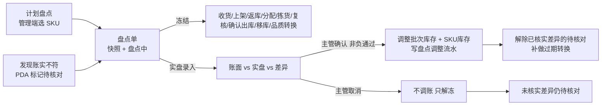
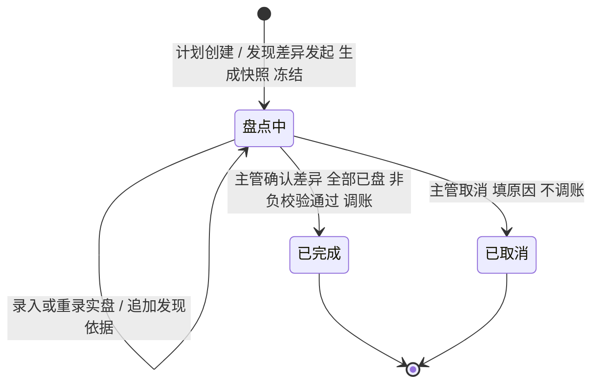

# 盘点单主PRD

> 用途：定义盘点单的发起、建单前置、SKU 冻结范围、账面快照、实盘录入、差异确认与非负校验、取消与待核对解除，以及管理端列表/详情与 PDA 实盘的同一套规则，作为研发实现、测试验收和生成前端原型的业务依据。
> 定位：应用设计层**盘点与差异收口真源**。状态与数量依据以[《库存模块宏观系统架构》](../../../../../01-全局背景信息/07-库存模块宏观系统架构.md)§3.1.2、§5、§6.1、§6.2 为准；需求见[《库存与库内业务需求分析》](../../../../../03-需求调研和分析/04-库存与库内业务/库存与库内业务需求分析.md)盘点（INV-FR-006）；业务场景见[《库存与库内业务设计》](../../../../../04-业务分析和设计/04-库存与库内业务设计.md)§7.1～§7.5；字段以[《盘点单（详细稿）》](../../../字段清单合集/04-库存与库内/盘点单/盘点单（详细稿）.tsv)为准；页面见[《盘点单页面骨架》](盘点单页面骨架.md)；交互以[前端Demo版PRD](盘点单前端Demo版PRD.md)为准；PDA 见[《PDA盘点前端Demo版PRD》](../../7-PDA作业端/盘点作业/PDA盘点前端Demo版PRD.md)。
> 不写什么：不写库存查询的数量口径（见[《库存查询主PRD》](../库存查询/库存查询主PRD.md)）；不写库存流水的字段与记法（见[《库存流水主PRD》](../库存流水/库存流水主PRD.md)）；不写移库、品质转换的具体执行（见[《移库作业主PRD》](../移库作业/移库作业主PRD.md)、[《品质转换主PRD》](../品质转换/品质转换主PRD.md)）；不写无主货登记；不写审批流、账号权限与财务核销。

| 版本 | 本次变化 | 状态 |
| --- | --- | --- |
| 2026-10-15 | 定义盘点建单、冻结、实盘、差异确认与取消 | 文档修订 |
| 2026-10-21 | 补发现账实不符追加、待核对解除、新增实盘行效期规则 | 文档修订 |
| WMS-V1.0（2026-10-27） | 按 ERP 采购订单主 PRD 结构重构：补文档边界、范围与追溯、对象定位、场景索引、状态矩阵与流转表、规则分组、上下游与一致性；业务结论不变 | 待评审，文档修订 |

## 1. 文档信息与阅读边界

| 项目 | 内容 |
| --- | --- |
| 读者 | 研发工程师、测试工程师、仓库主管、盘点执行角色、产品复核；据此生成管理端与 PDA 原型的 AI |
| 业务依据 | 《库存与库内业务需求分析》INV-FR-006；《库存与库内业务设计》§7.1～§7.5 |
| 状态依据 | 《库存模块宏观系统架构》§5；[《单据与状态流转》](../../../系统架构设计/03-单据与状态流转.md)第六节 |
| 字段依据 | [《盘点单（详细稿）》](../../../字段清单合集/04-库存与库内/盘点单/盘点单（详细稿）.tsv) |
| 页面依据 | [《盘点单页面骨架》](盘点单页面骨架.md)、[前端Demo版PRD](盘点单前端Demo版PRD.md)、[PDA盘点前端Demo版PRD](../../7-PDA作业端/盘点作业/PDA盘点前端Demo版PRD.md) |

关联资料：[《库存查询主PRD》](../库存查询/库存查询主PRD.md)（盘点中标签、待核对）、[《库存流水主PRD》](../库存流水/库存流水主PRD.md)（盘点调整流水）、[《移库作业主PRD》](../移库作业/移库作业主PRD.md)（盘点中阻断）、[《品质转换主PRD》](../品质转换/品质转换主PRD.md)（盘点中不转、过期补做）、[《上架单主PRD》](../../2-入库管理/上架单/上架单主PRD.md)、[《返库上架单主PRD》](../../3-出库管理/返库上架单/返库上架单主PRD.md)、[《拣货任务主PRD》](../../3-出库管理/拣货任务/拣货任务主PRD.md)。本目录写法见[需求文档 PRD 写作约定](../../AGENTS.md)。

## 2. 需求背景与目标

### 2.1 背景

库存差异不能靠改数解决。盘点单先用账面快照固定“账上认为有多少”，再让现场按库位、货主、SKU、批次、品质清点，最后由仓库主管确认差异、一次调账。这样差异有来源、有实盘依据、有调整流水，事后能还原。

盘点期间这些 SKU 不能收货、上架、返库、新分配、组波、补拣、移库、品质转换；已生成任务可继续拣货、复核、确认出库，避免手上任务被硬停。新出库单仍可接单预占、可以取消，因为这些只动 SKU 预占，不动实物。

发现账实不符时，现场先标记该 SKU 待核对并暂停新分配；已有任务可继续收尾，盘点可同时发起。建单本身不是标记待核对的触发点，两者不能混为一谈。

### 2.2 目标

- 按仓库＋SKU 建单，盘这些 SKU 在本仓存储、拣货、不良隔离库位的库存；暂存不盘；
- 建单即生成账面快照并冻结，盘点期间该 SKU 的数量、库位、品质不变；
- 实盘只记数、不动库存，可分人分次录入；SN 只作为核实依据，不要求账实库位一致；
- 差异确认先预演非负校验，通过后一次调整批次库存与 SKU 库存并写盘点调整流水；
- 盘亏不足以支撑预占或已分配时整次阻断，不自动退占、不截零；
- 完成解除已核实差异的待核对并补做过期转换；取消只解冻，未核实差异仍待核对；
- 已完成、已取消不可恢复；重盘新建。

### 2.3 设计要点（给研发与测试）

| 设计点 | 做法 | 原因与影响 |
| --- | --- | --- |
| 快照即冻结 | 建单取当时实际生成明细快照，SKU 进入盘点中 | 实盘必须对着一个不动的账 |
| 建单前置 | 这些 SKU 未在盘点中即可建单；已有上架、返库、拣货任务不阻断 | 已有任务继续，盘点并行收口 |
| 实盘只记数 | 保存实盘不改库存；确认才调账 | 支持分人分次、重录 |
| 差异一次生效 | 确认时先演算全部差异，非负通过后整单调整 | 不允许部分行成功 |
| 预占不动 | 盘点不自动退占、不自动改单；不足时阻断确认 | 订单占用由出库规则处理 |
| 待核对分开 | 创建不是标记待核对；完成解除已核实差异，取消不解除 | 防止把盘点当解除差异的工具 |

## 3. 需求范围

### 3.1 本期范围

- 计划盘点：管理端选本仓一个或多个 SKU 建单；
- 发现账实不符：PDA 现场标记待核对后发起盘点，记录发现环节、原单、库位、差异数量、说明；
- 建单前置校验与已在盘点中的追加；
- 账面快照、SKU 冻结、盘点期间作业阻断；
- 管理端与 PDA 实盘录入、分次保存、重录；
- 快照外新增实盘行、效期商品日期计算；
- SN 实盘采集、身份/去重/数量校验；
- 差异确认、非负校验、盘点调整流水、待核对解除、过期转换补做；
- 取消盘点、取消原因、冻结解除；
- 列表、详情、盘点明细、SN 明细、发现依据、操作日志；导出 Mock。

### 3.2 功能清单

| 编号 | 功能/位置 | 本次内容 | 需求来源 |
| --- | --- | --- | --- |
| F01 | 创建计划盘点 | 选本仓 SKU、生成快照、冻结；已在盘点中时阻断，已有任务不阻断 | INV-FR-006 |
| F02 | PDA 发起盘点 | 标记待核对，提交手上作业后发起，记录发现依据 | INV-FR-006 |
| F03 | 盘点单列表 | 状态页签、筛选、列展示、导出 Mock | INV-FR-006 |
| F04 | 盘点单详情 | 基本信息、实盘进度、盘点明细、SN 明细、发现依据、操作日志 | INV-FR-006、INV-FR-011 |
| F05 | 实盘录入 | 管理端 Sheet 或 PDA 逐行录入、分次保存、重录；新增快照外行 | INV-FR-006 |
| F06 | 差异确认 | 全部已盘后预演、非负校验、整次调账、写流水 | INV-FR-006、INV-FR-010 |
| F07 | 取消盘点 | 填原因取消，不调账，只解冻 | INV-FR-006 |
| F08 | 导出 | 页头导出（Demo Mock） | — |

### 3.3 需求追溯

| 需求分析 | 本 PRD 功能与规则 | 验收 |
| --- | --- | --- |
| 按仓库＋SKU 建单、快照 | F01、R01、R05 | AC01、AC02 |
| 发现账实不符与待核对 | F02、R02、R03 | AC03、AC04 |
| 盘点期间冻结 | R04、R06 | AC05、AC06 |
| 实盘录入与新增行 | F05、R07、R08 | AC07、AC08、AC09 |
| 差异确认与非负校验 | F06、R09、R10 | AC10、AC11、AC12 |
| 取消与待核对解除 | F07、R11、R12 | AC13、AC14 |
| SN 核实 | R08、R10 | AC15 |

### 3.4 非本期范围

- 管理端发起「发现账实不符」；
- 审批、驳回、主管复核单据；
- 直接修改账面数量、编辑已生成快照；
- 批量勾选、批量确认、导入盘点结果；
- 盘点单恢复、重开、合并、拆分；
- 按库区冻结（冻结按仓库＋货主＋SKU）；
- 盘亏自动退占、自动取消订单；
- 账号、角色、仓库授权；
- 真实导出文件。

| 范围补充 | 说明 |
| --- | --- |
| 适用对象 | 本仓存储、拣货、不良隔离库位上的批次库存；收货暂存、出库暂存不盘 |
| 盘点范围 | 一张单可选多个 SKU；范围按 SKU 展开到本仓全部可盘库位，不因库区筛选缩小 |
| 冻结粒度 | 仓库＋货主＋SKU；不冻结同 SKU 其他仓或其他货主 |
| 数据范围 | 顶栏当前仓库；PDA 同样按当前仓 |

## 4. 对象定位与业务边界

### 4.1 业务作用

| 项目 | 内容 |
| --- | --- |
| 对象层级 | 差异收口单据：用账面快照与实盘结果确认库存差异，并一次调账 |
| 核心职责 | 记录盘哪些 SKU、为什么盘、账面多少、实盘多少、差异多少、谁确认、是否调账 |
| 对象来源 | 管理端计划盘点；PDA 发现账实不符发起 |
| 下游对象 | 批次库存、SKU 库存、SN 台账、库存流水、待核对标记、过期转换 |
| 数量关系 | 一张盘点单 N 个 SKU、M 条明细行；差异 = 实盘 − 账面 |
| 业务终结 | 已完成（确认差异并调账）；已取消（不调账，只解冻） |

### 4.2 上下游关系摘要

### 4.3 业务对象关系

| 关系 | 说明 |
| --- | --- |
| 盘点单 : 仓库/SKU | 1:N；一张单一个仓库、多个 SKU；按货主分别冻结与盘点 |
| 盘点单 : 明细行 | 1:N；行 = 库位＋容器＋货主＋SKU＋批次＋品质，创建时快照 |
| 明细行 : 实盘记录 | 1:N；可分人分次录入，保留最后实盘人与时间 |
| 明细行 : SN | 1:N；账面 SN 快照与实盘 SN 分开 |
| 盘点单 : 发现依据 | 1:N；建单第一段，PDA 后续追加 |
| 盘点单 : 库存流水 | 确认时按差异写盘点调整；取消不写 |

### 4.4 本对象不负责的事项

- 盘点单不直接修改账面数量；账面是创建时快照，只读；
- 实盘录入不改库存；只有差异确认才调账；
- 盘点不自动退占、不自动取消订单、不截零；
- 盘点不处理无主货；认不出货主或商品的实物按无主货登记；
- 盘点不执行移库、品质转换；盘点中反而阻断这些动作；
- 盘点不负责审批、财务核销、损失赔偿；
- 盘点不解除所有待核对；只解除本次已核实差异对应的标记。

## 5. 核心业务场景索引

| 场景ID | 场景 | 类型 | 说明 |
| --- | --- | --- | --- |
| S01 | 计划盘点正常完成 | 主流程 | 正常 5、不良 2、预占 4，快照 7；实盘 4+2，预占 4，确认后实际 6 |
| S02 | 有未完成任务时建单 | 支线 | 允许建单并冻结；已有任务继续拣货、复核、确认出库 |
| S03 | 选到已在盘点中的 SKU | 异常 | 整次阻断并列出盘点单号；不生成快照 |
| S04 | 盘点期间接单 | 支线 | 新出库单照常接收、按可用预占；不能新分配，已有任务可继续拣货 |
| S05 | 盘亏不足以支撑预占 | 异常 | 确认阻断；实盘保留、仍盘点中；账与流水不变 |
| S06 | 盘盈 | 支线 | 确认归属和商品身份后新增实盘行或调增；认不出按无主货 |
| S07 | 不良品短少 | 支线 | 实际与不良品同步减；剩余不良仍不可用 |
| S08 | 新增快照外批次 | 分支 | 账面 0 新增行；效期商品补生产/失效日期 |
| S09 | PDA 发现差异时已在盘点 | 边界 | 不新建单，追加发现依据并返回原单号 |
| S10 | 取消发现账实不符盘点 | 支线 | 不调账、只解冻；SKU 仍待核对 |
| S11 | 重复确认差异 | 异常 | 返回原结果，不重复调账 |
| S12 | 实盘发现残损 | 分支 | 按不良品录实盘；确认时正常/不良一起调整 |

## 6. 状态与操作

状态定义 owner：[《库存模块宏观系统架构》](../../../../../01-全局背景信息/07-库存模块宏观系统架构.md)§5。盘点单状态只由建单、确认、取消三个事实驱动，管理端和 PDA 都不能直接改状态。

### 6.1 状态维度

| 维度 | 取值 | 说明 |
| --- | --- | --- |
| 单据状态 | 盘点中、已完成、已取消 | 盘点中：快照已生成、SKU 冻结、未确认；已完成：差异确认并调账；已取消：不调账，只解冻 |
| 盘点来源 | 计划盘点、发现账实不符 | 决定是否带发现环节、原业务记录与待核对 |
| 明细行状态 | 未盘、已盘 | 已盘 = 实盘数量有值；未盘不按 0 计 |
| 差异状态 | 无差异、盘盈、盘亏 | 差异 = 实盘 − 账面 |
| 待核对 | 有、无 | SKU 级标记；与单据状态分开 |

### 6.2 状态取值说明

| 状态 | 含义 | 是否终态 |
| --- | --- | --- |
| 盘点中 | 快照已生成，SKU 冻结；可录入/重录实盘，可确认或取消 | 否 |
| 已完成 | 主管确认差异且非负校验通过；批次库存、SKU 库存、SN 台账按差异调整，写盘点调整流水 | 是 |
| 已取消 | 建错或暂时盘不了，主管取消；不调账，只解除盘点冻结 | 是 |

已完成、已取消均不可恢复到盘点中；需要重盘时新建盘点单。取消不等于解除待核对：来源为发现账实不符且差异未核实的，SKU 仍保持待核对。

### 6.3 状态流转图

触发者：创建为管理端计划盘点或 PDA 发现差异；实盘为管理端或 PDA；确认、取消为仓库主管；状态不由人工选择。

### 6.4 状态—功能矩阵

> ✅ = 允许；❌ = 不允许；✅（条件）= 须满足所列规则。查看列表、详情各状态均可用。

| 动作 | 盘点中 | 已完成 | 已取消 |
| --- | --- | --- | --- |
| 查看列表、详情（F03、F04） | ✅ | ✅ | ✅ |
| 录入/重录实盘（F05） | ✅ | ❌ | ❌ |
| 新增快照外实盘行 | ✅ | ❌ | ❌ |
| 确认差异（F06） | ✅（全部行已盘） | ❌ | ❌ |
| 取消盘点（F07） | ✅（原因必填） | ❌ | ❌ |
| 恢复盘点中、重新打开 | ❌ | ❌ | ❌ |
| 编辑账面数量、删除快照行 | ❌ | ❌ | ❌ |
| 管理端发起「发现账实不符」 | ❌（只由 PDA） | ❌ | ❌ |
| 导出（F08） | ✅ | ✅ | ✅ |

已完成、已取消详情只读，页头只有「返回列表」。盘点中页头按钮按状态显示：录入实盘、取消盘点、确认差异；有未盘行时确认差异置灰并写明还差几行。

### 6.5 状态流转表

| 当前状态 | 动作/事件 | 前置条件 | 结果状态 | 二次确认 | 后置影响 | 失败处理 |
| --- | --- | --- | --- | --- | --- | --- |
| — | 计划创建 | 选本仓 SKU；SKU 不在盘点中；已有上架、返库、拣货任务不阻断建单 | 盘点中 | 创建 Dialog | 生成账面快照；SKU 冻结 | 有阻断：整次不创建，列出原因与单号/任务号 |
| — | 发现差异发起 | PDA 已标记待核对；手上作业已提交；SKU 不在盘点中 | 盘点中 | 发起确认 | 生成快照；记录发现环节、原单、库位、差异、说明 | SKU 已在盘点中：不新建，追加发现依据并返回原单号 |
| 盘点中 | 录入/重录实盘 | 单据盘点中；行属于本单 | 盘点中 | 无 | 只记数，不动库存；可分次保存 | 数量非法或 SN 不一致：阻断该次保存 |
| 盘点中 | 新增实盘行 | 实物归属、商品确认；库位非暂存且无他货主 | 盘点中 | 无 | 账面 0；效期商品补日期 | 已存在同维度行：提示直接录入原行 |
| 盘点中 | 确认差异 | 全部行已盘；SN 校验通过；非负校验通过 | 已完成 | 差异确认 Dialog | 调批次与 SKU 库存；写盘点调整流水；解冻；解除已核实待核对；补做过期转换 | 有未盘行或非负失败：整次阻断，实盘保留、仍盘点中 |
| 盘点中 | 取消盘点 | 原因必填 | 已取消 | 取消 Dialog | 不调账；解冻；未核实差异仍待核对 | 原因空：阻断 |
| 已完成/已取消 | 查看 | — | 不变 | — | — | — |

## 7. 核心业务规则

### 7.1 建单、来源与前置

| 规则编号 | 主题 | 规则 | 边界或例外 |
| --- | --- | --- | --- |
| R01 | 建单粒度 | 按仓库＋SKU 建单，一张单可选多个 SKU；盘这些 SKU 在本仓存储、拣货、不良隔离库位上的库存；收货暂存、出库暂存不盘；已有任务可继续 | 库区筛选只缩小候选，不缩小盘点范围；冻结按仓库＋货主＋SKU |
| R02 | 计划盘点 | 管理端选择本仓一个或多个 SKU，创建即生成账面快照并进入盘点中 | 管理端不能发起「发现账实不符」 |
| R03 | 发现账实不符 | 发现时立即按本仓库＋货主＋SKU 标记待核对；发现人员先提交手上作业，再发起盘点并记录发现环节、原单、库位、差异数量、说明 | 创建盘点单不是标记待核对的触发点；等待期间保持待核对，不恢复新分配、组波、补拣或其他出库指定 |
| R04 | 建单前置 | 这些 SKU 已在盘点中不能再建单；已有上架单、返库上架单或拣货任务不阻断建单，任务可继续 | 计划选到已在盘点中的 SKU：整次阻断并列出盘点单号；PDA 发现差异时该 SKU 已在盘点：不新建，追加发现依据并返回原单号 |

### 7.2 冻结、快照与实盘

| 规则编号 | 主题 | 规则 | 边界或例外 |
| --- | --- | --- | --- |
| R05 | 账面快照 | 创建时按库位、容器、货主、SKU、批次、品质生成数量快照行，账面数量只读；不假设 SN 已绑定库位 | 快照后库存变动不改变账面；实盘新增行账面为 0 |
| R06 | 盘点冻结 | 盘点中这些 SKU 不能收货；含这些 SKU 的上架单、返库上架单不能新建或开始，已生成任务可继续；新出库单仍可接收、按可用预占、可受理取消；不能分配、组波、补拣或其他新出库指定；已生成任务可继续拣货、复核、确认出库；不能移库、人工品质转换；过期自动转换暂停，完成后补做 | 冻结按仓库＋货主＋SKU；不冻结同 SKU 其他仓或其他货主；接单预占不属于实物作业 |
| R07 | 实盘录入 | 实盘按数量录入，可分人、分次保存和重录；保存只记数、不动库存；未盘行不按 0 计算 | 已保存行清空输入不撤销已保存实盘；本期不提供取消实盘 |
| R08 | SN 与新增行 | 现场逐件扫描的 SN 只作为实际核实依据，不要求原账面位置等于实盘库位；未逐件核实的数量差异不能随意选 SN 标记盘亏；快照没有但归属明确的实物可新增账面 0 行；认不出货主或商品的不加行，按无主货登记 | 新增效期库存时，生产日期或失效日期至少填一项，按商品保质期天数计算另一项，两项可改，生产日期不得晚于失效日期；已存在同维度行时直接录原行 |
| R09 | 差异口径 | 差异数量 = 实盘数量 − 账面数量；盘盈为正、盘亏为负；未盘行差异为空，不参与汇总 | 差异行数只统计已盘且差异不为 0 的行 |

### 7.3 差异确认、取消与解除

| 规则编号 | 主题 | 规则 | 边界或例外 |
| --- | --- | --- | --- |
| R10 | 确认前置 | 再次校验仍为盘点中、实盘已覆盖全部范围；有采集 SN 时校验身份、去重及 SN 与数量一致；有未盘行不得确认 | 未盘时按钮置灰并写明还差几行，不进入确认 |
| R11 | 非负预演与调账 | 先在提交副本中演算全部差异，校验实际、订单预占、可用、已分配非负；通过后同时调整批次库存和按品质汇总的 SKU 库存，生成盘点调整流水；只有已逐件核实的 SN 差异才更新 SN 台账 | 盘亏后良品不足以支撑现有预占：整次失败，实盘保留、仍盘点中，不自动退占、不截零；不良品调减后不足以支撑已分配/指定：先取消原指定再确认 |
| R12 | 一次生效与幂等 | 确认成功后整单已完成，所有调整一次生效；重复确认返回原结果，不重复增减库存 | 不允许部分行确认、部分行成功 |
| R13 | 取消 | 仓库主管可取消盘点，原因必填；不调账，只解除盘点冻结；已完成、已取消不可恢复 | 来源为发现账实不符且差异未核实的，取消后 SKU 仍待核对 |
| R14 | 待核对解除与过期补做 | 已完成时解除该 SKU 在本仓的全部待核对标记，并补做盘点期间暂停的过期转换；取消不解除未核实差异 | 补货、换位、原单取消或盘点取消都不自动解除；只有盘点完成才解除；其他仓/货主不解除 |
| R15 | 权限 | 一期不做账号、角色或权限配置；创建、发起、实盘、确认、取消只受单据状态与业务规则约束 | 不提供审批、驳回或直接编辑账面数量 |

### 7.4 数量口径与示例

| 层级 | 数量 | 含义 | 关系 |
| --- | --- | --- | --- |
| 明细行 | 账面数量 | 创建时快照的实际数量，只读 | 新增实盘行为 0 |
| 明细行 | 实盘数量 | 现场清点数量；可分次重录 | 未盘为空 |
| 明细行 | 差异数量 | 实盘 − 账面 | 盘盈正、盘亏负 |
| 明细行 | 实盘状态 | 未盘、已盘 | 录入 0 仍为已盘 |
| 单头 | SKU 数、明细行数、已盘行数、差异行数 | 汇总 | 明细行数含新增行；差异行数不含未盘与 0 差异 |
| SKU 层 | 良品实际、预占、可用；不良实际 | 确认后按差异调整 | 预占不自动调整 |

**约束（可判定）**：差异 = 实盘 − 账面；未盘行不按 0 计；确认前全部行必须已盘；调整后实际、预占、可用、已分配均非负；盘点中 SKU 的批次实际、库位、品质不变；盘点调整只改实际，不改订单预占与已分配（除非先按原业务取消占用/指定）。

**数量示例（模拟）**：正常 5、不良 2、订单预占 4，创建盘点快照 7；实盘正常 4、不良 2。预占 4 时确认：实际由 7 调为 6，良品 4／预占 4／可用 0，不良 2／预占 0／可用 0，完成并写流水。若此时订单预占已变为 5，确认阻断；实盘保留、仍盘点中，账与流水不变。

### 7.5 业务生效点

| 业务动作 | 盘点单影响 | 库存影响 | 外部影响 |
| --- | --- | --- | --- |
| 创建盘点 | 盘点中；生成快照 | 不改数量；SKU 冻结 | 阻断收货、上架、返库、新分配、组波、补拣、移库、品质转换；已生成任务继续 |
| 录入实盘 | 盘点中；行已盘、差异更新 | 不改库存 | 无 |
| 新增实盘行 | 盘点中；明细增加 | 不改库存 | 无 |
| 确认差异 | 已完成 | 按差异调整批次与 SKU 实际；写盘点调整流水；SN 差异更新台账 | 解冻；解除已核实待核对；补做过期转换 |
| 取消盘点 | 已取消 | 不调账 | 解冻；未核实差异仍待核对 |
| 重复确认 | 返回原结果 | 不重复调整 | 无 |

### 7.6 字段校验绑定

完整字段见[《盘点单（详细稿）》](../../../字段清单合集/04-库存与库内/盘点单/盘点单（详细稿）.tsv)。摘要：

| 校验时机 | 要求 |
| --- | --- |
| 创建 | 至少 1 个 SKU；本仓；SKU 不在盘点中；已有任务不阻断 |
| 实盘 | 实盘数量为非负整数或空（未盘）；SN 填写时条数 = 实盘数量且不重复 |
| 新增行 | 库位非暂存且无他货主；商品、品质、数量必填；批次/效期按商品配置；生产日期 ≤ 失效日期 |
| 确认 | 全部已盘；SN 身份/去重/数量一致；非负预演通过 |
| 取消 | 原因必填 |
| 详情/列表 | 已完成、已取消只读；未盘行实盘为空、差异为空 |

## 8. 功能需求说明（页面索引）

| 编号 | 页面/位置 | 规则与状态依据 | Demo PRD |
| --- | --- | --- | --- |
| F01 | 创建计划盘点 | §6.5；R01、R02、R04 | [盘点单前端Demo版PRD](盘点单前端Demo版PRD.md) §8.1 |
| F02 | PDA 发起盘点 | §6.5；R03、R04 | [PDA盘点前端Demo版PRD](../../7-PDA作业端/盘点作业/PDA盘点前端Demo版PRD.md) |
| F03 | 盘点单列表 | §6.4；R09 | [盘点单前端Demo版PRD](盘点单前端Demo版PRD.md) §5 |
| F04 | 盘点单详情 | §7.4；R05、R10 | 同上 §7 |
| F05 | 实盘录入 | §7.2；R07、R08 | 同上 §8.2 |
| F06 | 差异确认 | §7.3；R10～R12 | 同上 §8.3 |
| F07 | 取消盘点 | §7.3；R13、R14 | 同上 §8.4 |
| F08 | 导出 | — | 同上 §3 |

## 9. 上下游影响与协同

| 关联模块/系统 | 需要配合的变化 | 交接内容与时机 | 验收结果 |
| --- | --- | --- | --- |
| 入库与退货 | 盘点中不收货；含盘点 SKU 的上架单不能开始 | 建单至完成/取消 | 收货与上架阻断 |
| 出库单 | 可接单预占、可取消；其他作业等待 | 建单至完成/取消 | 预占正常，分配/拣货/复核/确认出库阻断 |
| 拣货任务 | 含盘点 SKU 的新任务不能生成；已有任务继续 | 建单至完成 | 已有任务不阻断建单 |
| 返库上架单 | 含盘点 SKU 的返库单不能开始 | 建单至完成/取消 | 返库阻断 |
| 移库作业 | 盘点中 SKU 不能移库 | 建单至完成/取消 | 移库阻断 |
| 品质转换 | 人工转换阻断；过期转换暂停，完成后补做 | 建单至完成 | 转换阻断/补做 |
| 库存查询 | 显示盘点中标签；完成后解除 | 实时 | 标签与单据状态一致 |
| 库存流水 | 确认差异写盘点调整流水 | 确认时 | 按差异调整，可追溯 |
| 待核对 | 发现即标记；完成解除已核实差异；取消不解除 | 发现、完成、取消 | 待核对与盘点结果一致 |
| 基础资料 | 库位用途、商品批次/效期/SN 配置 | 全程 | 暂存不盘、效期计算正确 |
| 公共能力 | 当前仓库、操作者、时间 | 全程 | 只显示当前仓 |

## 10. 关联文档与阅读入口

| 关联内容 | 阅读入口 | 本 PRD 与其边界 |
| --- | --- | --- |
| 盘点状态与冻结 | 《库存模块宏观系统架构》§5、§6.1 | 规则真源；本文落到页面与验收 |
| 发现差异与待核对 | 《库存模块宏观系统架构》§6.2 | 待核对 owner；本文只承接发起与解除 |
| 盘点业务场景 | 《库存与库内业务设计》§7.1～§7.5 | 业务走查；本文不重复案例 |
| 库存查询 | [《库存查询主PRD》](../库存查询/库存查询主PRD.md) | 查询 owner；本文只影响标签 |
| 库存流水 | [《库存流水主PRD》](../库存流水/库存流水主PRD.md) | 流水 owner；本文只触发盘点调整 |
| 移库 | [《移库作业主PRD》](../移库作业/移库作业主PRD.md) | 移库 owner；盘点中阻断 |
| 品质转换 | [《品质转换主PRD》](../品质转换/品质转换主PRD.md) | 转换 owner；盘点中暂停 |
| 字段定义 | 《盘点单（详细稿）》 | 字段 owner |
| 页面结构 | [《盘点单页面骨架》](盘点单页面骨架.md) | 区域与线框，非规则权威 |
| 页面交互 | [前端Demo版PRD](盘点单前端Demo版PRD.md) | 控件、Mock；服从 §6.4 |
| PDA | [PDA盘点前端Demo版PRD](../../7-PDA作业端/盘点作业/PDA盘点前端Demo版PRD.md) | 作业端页面；规则回本文 |

## 11. 异常与一致性

### 11.1 并发操作

| 场景 | 业务处理结果 |
| --- | --- |
| 两人同时创建含同一 SKU 的盘点单 | 先创建者冻结；后创建者整次阻断并列出已存在盘点单号 |
| 建单与生成拣货任务同时到达 | 以先生效者为准；任务先生效则建单阻断；建单先生效则任务生成阻断 |
| 两人同时录入同一行实盘 | 以最后保存为准；保留最后实盘人与时间；不重复计数 |
| 确认差异与实盘保存同时到达 | 确认前重查全部行已盘；未盘则拒绝；已完成后不再接受实盘 |
| 确认差异与取消同时到达 | 以先生效者为准；确认后不可取消，取消后不可确认 |
| 确认差异与收货/上架同时到达 | 盘点中阻断这些动作；确认成功解冻后恢复 |

### 11.2 幂等与重复处理

| 操作 | 幂等规则 |
| --- | --- |
| 重复创建同一 SKU 盘点 | 第二次阻断，不生成第二张单 |
| 重复保存实盘 | 覆盖该行实盘值，不重复累加 |
| 重复新增同一维度行 | 提示已存在，直接录入原行 |
| 重复确认差异 | 返回原结果，不重复调账、不重复写流水 |
| 重复取消 | 返回原结果，不重复解冻 |
| 重复追加发现依据 | 按发现记录逐条追加；同一发现不重复写 |

### 11.3 与库存、任务、待核对的一致性

| 场景 | 处理方式 |
| --- | --- |
| 盘点中库存被其他动作改变 | 不应发生；相关动作应被阻断；若历史数据已变，确认时按最新账预演并阻断 |
| 确认后 SKU 实际与批次合计不一致 | 以盘点调整与流水核查；查询页不自动修正 |
| 盘亏不足以支撑预占 | 确认阻断；不自动退占、不截零、不完成 |
| 不良品短少不足以支撑已分配 | 先按原出库规则取消指定，再确认 |
| 取消发现账实不符盘点 | SKU 仍待核对；不恢复新分配 |
| 完成盘点后仍有他单待核对 | 盘点按 SKU 覆盖本仓可盘库位；确认成功后解除该 SKU 在本仓的全部待核对标记；未纳入本次盘点范围的其他仓/货主不解除 |
| 盘点中新增快照外行 | 确认后形成对应批次库存；无主货不加行 |

## 12. 验收标准与待确认事项

### 12.1 验收标准

| 编号 | 对应功能/规则 | 条件与操作（数字为模拟） | 预期结果 |
| --- | --- | --- | --- |
| AC01 | F01、R01 | 正常 5、不良 2、订单预占 4，创建盘点 | 快照 7；SKU 冻结；新出库单仍可预占，作业等待 |
| AC02 | F01、R04 | SKU 有未完成拣货任务时计划建单 | 阻断并列出任务号；不生成快照或冻结 |
| AC03 | F01、R04 | 计划盘点选到已在盘点中的 SKU | 整次阻断并列出盘点单号；不生成快照 |
| AC04 | F02、R03 | PDA 发现账实不符 | 立即标记待核对；提交手上作业后可发起；记录发现环节、原单、库位、差异、说明 |
| AC05 | R06 | 盘点中尝试收货、上架、返库、分配、拣货、复核、确认出库、移库、品质转换 | 均阻断；新出库单接单预占与取消不受影响 |
| AC06 | R06 | 同 SKU 在其他仓或其他货主 | 不被冻结；可正常作业 |
| AC07 | F05、R07 | 实盘正常 4、不良 2，订单预占 4 | 实盘只记数，库存不变；差异 −1 |
| AC08 | F05、R08 | 发现一个归属明确的新批次 | 新增账面 0 的实盘行；确认后形成对应批次库存与流水 |
| AC09 | R08 | 新增效期库存，只填生产日期 | 按保质期天数计算失效日期；可手动改；生产日期不得晚于失效日期 |
| AC10 | F06、R11 | 实盘正常 4、不良 2，订单预占 5 时确认 | 整次阻断；实盘保留、仍盘点中，账和流水不变；预占不自动调整 |
| AC11 | F06、R11 | 实盘正常 4、不良 2，订单预占 4 时确认 | 实际由 7 调为 6，良品 4／预占 4／可用 0，不良 2／预占 0／可用 0，完成并写流水 |
| AC12 | F06、R10 | 有未盘行时点确认 | 按钮置灰并写明还差几行；不进入确认 Dialog |
| AC13 | F07、R13 | 取消“发现账实不符”盘点 | 不调账，只解盘点冻结；SKU 仍待核对 |
| AC14 | R14 | 计划盘点完成 | 解冻；解除本次已核实差异的待核对；补做暂停的过期转换 |
| AC15 | R08、R10 | SN 商品实盘数量与 SN 清单不一致或重复 | 阻断；不要求 SN 原账面位置等于实盘库位 |
| AC16 | R12 | 重复差异确认 | 返回既有结果，不重复增减库存 |
| AC17 | F04、R05 | 查看已完成盘点 | 明细、SN、发现依据、日志只读；无录入/确认/取消按钮 |
| AC18 | R04 | PDA 对已在盘点中的 SKU 上报差异后发起盘点 | 不新建盘点单；本次发现追加到该单发现依据并返回原单号；SKU 保持待核对 |
| AC19 | R04、R11 | SKU 有其他出库指定/已分配，且已有进行中的上架、返库上架或拣货任务时创建盘点 | 允许建单；快照记录已分配；确认时若调减后不足，先按原出库规则取消指定再确认，不自动退占 |

### 12.2 待确认事项

| 编号 | 问题 | 影响范围 | 状态/结论 |
| --- | --- | --- | --- |
| Q01 | 账面快照行是否含容器 | R05、F04、AC08 | **已确认（2026-10-27）**：R05 已含容器；与批次库存唯一键、页面列一致。TSV 缺容器/生产日期/有效期是字段稿待补，不是业务规则未定。 |
| Q02 | 同一 SKU 存在多个来源的待核对标记时，一张盘点单完成是否全部解除 | R14、§11.3、AC14 | **已确认（2026-10-27）**：盘点按 SKU 覆盖本仓可盘库位，确认成功后解除该 SKU 在本仓的全部待核对标记；其他仓/货主不解除。 |
| Q03 | 盘点中追加发现依据的时点与限制：SKU 已冻结，PDA 还能在哪些环节发现新差异；追加是否要求重新核实、是否影响已录实盘 | R03、R04、AC18 | **已确认（2026-10-27）**：只在盘点执行中发现并追加；不改已录实盘 |
| Q04 | 取消后“未核实差异仍待核对”由谁在何时解除：是否只能通过新建盘点完成，还是允许主管手工解除 | R13、R14 | **已确认（2026-10-27）**：不提供手工解除；只由下一次盘点完成解除 |
| Q05 | 盘点期间暂停的过期转换由谁补做、何时触发：确认完成时系统自动、还是仓库主管手动发起 | R06、R14、AC14 | **已确认（2026-10-27）**：确认完成时系统自动补做；失败保留原因 |
| Q06 | 新增实盘行的批次/效期维度与已有快照行重复时，是否允许合并；当前页面提示“已存在，直接录入原行” | R08、F05 | **已确认（2026-10-27）**：不合并；按同维度原行录入 |
| Q07 | 盘点单“差异行数”是否包含新增实盘行：新增行账面 0、实盘 >0，属于盘盈 | R09、F03 | **已确认（2026-10-27）**：计入差异行数 |
| Q08 | 盘点确认时，差异为 0 是否解除本单对应待核对 | R14、AC14 | **已确认（2026-10-27）**：实盘已覆盖全部范围并确认成功，差异 0 也解除该 SKU 在本仓的待核对标记。 |

## 附录 盘点时间线示例（模拟）

| 时点 | 事件 | 盘点状态 | 实际／预占／可用 | 说明 |
| --- | --- | --- | --- | --- |
| T0 | 起始 | — | 7／4／1 | 正常 5、不良 2 |
| T1 | 按 X 建盘点单 | 盘点中 | 7／4／1 | 快照 S1 正常 5、Q1 不良 2；X 冻结 |
| T2 | 新 B2C 单预占 1 | 盘点中 | 7／5／0 | 可接单；不能新分配，已有任务可继续拣货 |
| T3 | 实盘 S1 正常 4、Q1 不良 2 | 盘点中 | 7／5／0 | 只记数，库存不变 |
| T4 | 确认盘亏 1 | 盘点中 | 7／5／0 | 良品 4 < 预占 5，整次阻断 |
| T5 | 先按原出库规则释放 1 件预占，再重新确认 | 已完成 | 6／4／0 | 正常 4、不良 2，实际 6；预占 4、可用 0；调账成功；解冻；补做过期转换 |
