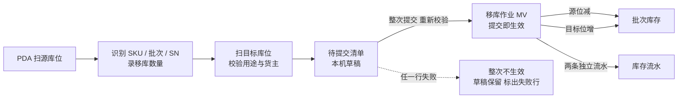
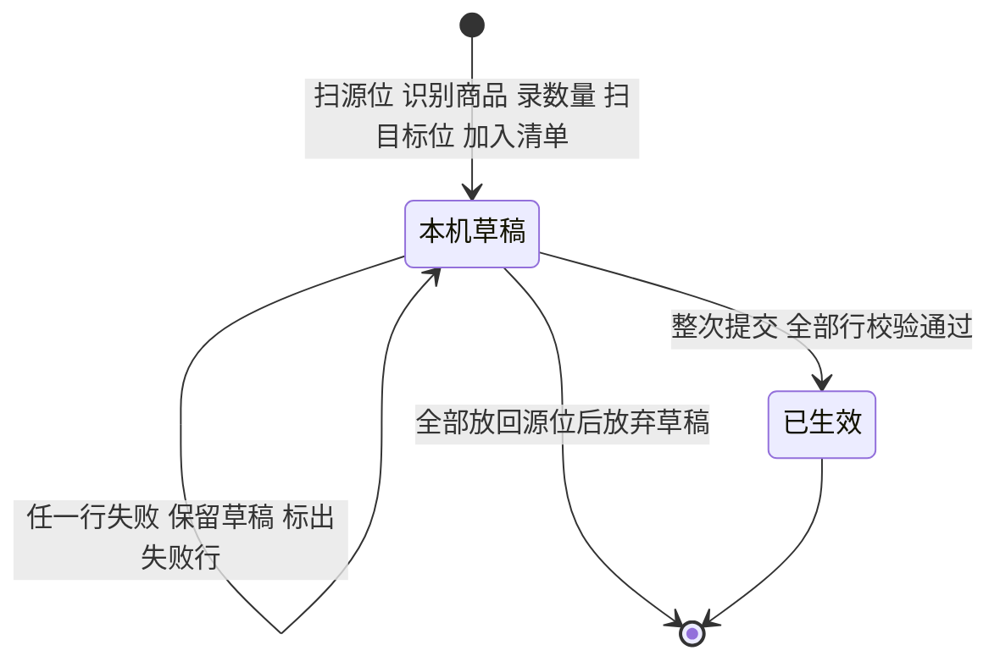

# 移库作业主PRD

> 用途：定义同仓移库的适用边界、PDA 扫源位/扫目标位/整次提交流程、源位与目标位校验、SN 与容器处理、整次原子性、幂等及管理端只读查询，作为研发实现、测试验收和生成前端原型的业务依据。
> 定位：应用设计层**库位搬动真源**。业务依据以[《库存模块宏观系统架构》](../../../../../01-全局背景信息/07-库存模块宏观系统架构.md)§3.1.1 为准；需求见[《库存与库内业务需求分析》](../../../../../03-需求调研和分析/04-库存与库内业务/库存与库内业务需求分析.md)移库（INV-FR-005）；场景见[《库存与库内业务设计》](../../../../../04-业务分析和设计/04-库存与库内业务设计.md)§6.1～§6.3；字段以[《移库作业（详细稿）》](../../../字段清单合集/04-库存与库内/移库作业/移库作业（详细稿）.tsv)为准；页面见[《移库作业页面骨架》](移库作业页面骨架.md)；交互以[前端Demo版PRD](移库作业前端Demo版PRD.md)为准；PDA 见[《PDA移库前端Demo版PRD》](../../7-PDA作业端/移库作业/PDA移库前端Demo版PRD.md)。
> 不写什么：不写库存查询的数量口径（见[《库存查询主PRD》](../库存查询/库存查询主PRD.md)）；不写库存流水的字段与记法（见[《库存流水主PRD》](../库存流水/库存流水主PRD.md)）；不写盘点单的创建、差异确认与取消（见[《盘点单主PRD》](../盘点单/盘点单主PRD.md)）；不写品质转换（见[《品质转换主PRD》](../品质转换/品质转换主PRD.md)）；不写补货任务、拣货区下限、自动选位和跨仓调拨。

| 版本 | 本次变化 | 状态 |
| --- | --- | --- |
| 2026-10-15 | 定义 PDA 移库执行与管理端记录查询 | 文档修订 |
| 2026-10-21 | 补容器处理、待核对边界、整次提交原子性 | 文档修订 |
| WMS-V1.0（2026-10-27） | 按 ERP 采购订单主 PRD 结构重构：补文档边界、范围与追溯、对象定位、场景索引、无状态说明与作业矩阵、规则分组、上下游与一致性；业务结论不变 | 待评审，文档修订 |

## 1. 文档信息与阅读边界

| 项目 | 内容 |
| --- | --- |
| 读者 | 研发工程师、测试工程师、PDA 作业负责人、库存责任角色、产品复核；据此生成管理端查询原型的 AI |
| 业务依据 | 《库存与库内业务需求分析》INV-FR-005；《库存与库内业务设计》§6.1～§6.3 |
| 记账依据 | 《库存模块宏观系统架构》§2.1、§2.4、§3.1.1 |
| 字段依据 | [《移库作业（详细稿）》](../../../字段清单合集/04-库存与库内/移库作业/移库作业（详细稿）.tsv) |
| 页面依据 | [《移库作业页面骨架》](移库作业页面骨架.md)、[前端Demo版PRD](移库作业前端Demo版PRD.md)、[PDA移库前端Demo版PRD](../../7-PDA作业端/移库作业/PDA移库前端Demo版PRD.md) |

关联资料：[《库存流水主PRD》](../库存流水/库存流水主PRD.md)（一减一加两行）、[《库存查询主PRD》](../库存查询/库存查询主PRD.md)（批次库存与可分配）、[《盘点单主PRD》](../盘点单/盘点单主PRD.md)（盘点中阻断、待核对）、[《品质转换主PRD》](../品质转换/品质转换主PRD.md)（不良品搬隔离库位）、[《实体对象关系》](../../../系统架构设计/02-实体对象关系.md)、[《单据术语与生成规则》](../../../../../01-全局背景信息/08-单据术语与生成规则.md)。本目录写法见[需求文档 PRD 写作约定](../../AGENTS.md)。

## 2. 需求背景与目标

### 2.1 背景

仓内货物需要挪位：大货存储位转到适合零散拣货的位置，不良品从存储/拣货位搬到不良隔离位，或者同一库区内的位置调整。这些动作不改变货主、SKU、批次、品质和总量，只改变库位分布。它不应该被做成管理端下达的任务，因为现场是边看实物边搬，搬完才知道目标位是否可用；也不应该有“执行中”状态，因为一次提交就是一次完整事实。

移库只能在 PDA 上做：扫源库位、识别商品/批次/SN、录数量、搬到目标位、扫目标位、整次提交。系统一次完成源减、目标增并写两条流水。管理端只查询记录，不新建、不编辑、不撤销、不重做。

### 2.2 目标

- 移库只改库位分布，不改仓库、货主、SKU、批次、品质和 SKU 三量合计；
- 拟移量不超过源位未被分配的实际，不能搬走已分给任务或已被其他出库指定的货；
- 目标位属于本仓、启用、品质适配、空着或同货主，暂存位不作源或目标；
- 多行提交整次生效，任一行失败整次不生效，不出现半次移库；
- SN 商品可按数量移库，实际采集 SN 时逐件校验；
- 同一提交重复发送只返回原移库作业号，不重复改库存；
- 管理端只读，记录可追溯到源减、目标增两条独立流水。

### 2.3 设计要点（给研发与测试）

| 设计点 | 做法 | 原因与影响 |
| --- | --- | --- |
| 提交即完成 | 一次 PDA 提交形成一个 MV 号；无待执行、执行中、取消 | 现场搬完才提交，不需要管理端任务态 |
| 只搬库位 | 仓库、货主、SKU、批次、品质、三量合计不变 | 移库不是调拨、不是品质转换 |
| 扣减基数是可移量 | 数量 ≤ 源位实际 − 已分配 | 已分配给任务或其他出库的货不能搬走 |
| 目标位按用途校验 | 正常品去存储/拣货，不良品去隔离；暂存位不作源/目标 | 防止把货放进不能作业的位置 |
| 整次原子 | 所有行重新校验后一次生效，失败行标出、草稿保留 | 实物可能已搬，不能静默部分成功 |
| 容器不强制 | 可部分移出转散件，可整容器移；不自动改容器档案状态 | 容器是追溯引用，不是移库前置条件 |

## 3. 需求范围

### 3.1 本期范围

- 同仓同货主的库位搬动：存储/拣货位之间、存储转拣货、正常品转不良后搬隔离；
- PDA 扫源库位、扫/选 SKU、识别批次/SN、录数量、扫目标库位、加入待提交清单、整次提交；
- 多行提交、同货主约束、同一源批次累计校验；
- 源位可移量、目标位用途/货主/启用校验；
- 盘点中 SKU 阻断；待核对 SKU 的移库边界；
- SN 逐件校验与按数量移库；
- 容器整移/部分移与散件处理；
- 管理端列表、详情、明细、库存流水、操作日志；
- 列表筛选作业号、SKU、货主、源/目标库位、提交时间、操作者；导出 Mock。

### 3.2 功能清单

| 编号 | 功能/位置 | 本次内容 | 需求来源 |
| --- | --- | --- | --- |
| F01 | PDA 移库作业 | 扫源位、识别商品/批次/SN、录数量、扫目标位、加入清单 | INV-FR-005 |
| F02 | 整次提交 | 重新校验所有行，一次生效；失败行标出、草稿保留 | INV-FR-005 |
| F03 | 源位校验 | 存在同货主/SKU/批次/品质实际；数量 ≤ 实际 − 已分配 | INV-FR-005 |
| F04 | 目标位校验 | 本仓、启用、不同位、非暂存、同货主或空、用途适配 | INV-FR-005 |
| F05 | SN 与容器 | SN 逐件校验；容器整移/部分移/散件处理 | INV-FR-005 |
| F06 | 管理端列表 | 筛选、列展示、分页、导出 Mock | INV-FR-005 |
| F07 | 管理端详情 | 基本信息、汇总、移库明细、库存流水、操作日志 | INV-FR-005、INV-FR-004 |

### 3.3 需求追溯

| 需求分析 | 本 PRD 功能与规则 | 验收 |
| --- | --- | --- |
| 同仓库位搬动、提交即完成 | F01、F02、R01、R02 | AC01、AC02 |
| 源位可移量 | F03、R04 | AC03、AC04 |
| 目标位资格 | F04、R05 | AC05、AC06 |
| 盘点与待核对 | R06 | AC07、AC08 |
| SN 校验 | F05、R07 | AC09、AC10 |
| 多行原子性与幂等 | F02、R08、R10 | AC11、AC12 |
| 管理端只读 | F06、F07、R11 | AC13、AC14 |

### 3.4 非本期范围

- 跨仓调拨、跨货主移库；
- 管理端新建、下达移库任务、待执行任务列表；
- 编辑、删除、撤销、重做、再次执行；
- 自动补货任务、拣货区下限、自动选位、路径优化；
- 通过移库改变品质、批次或把不良品变为可用；
- 行勾选、批量操作、状态页签；
- 真实导出文件；
- 用户账号、角色、仓库授权与审批流。

| 范围补充 | 说明 |
| --- | --- |
| 适用对象 | 同仓同货主的库位搬动；暂存位、盘点中 SKU 不适用 |
| 作业数量 | 一次提交 1～N 行；一行一个源库位、一个目标库位 |
| 数据范围 | 顶栏当前仓库；PDA 也按当前仓库；一期不做角色授权 |

## 4. 对象定位与业务边界

### 4.1 业务作用

| 项目 | 内容 |
| --- | --- |
| 对象层级 | 作业记录：一次 PDA 提交的库位搬动结果 |
| 核心职责 | 记录源库位、目标库位、SKU、批次/SN、品质、数量、操作者、提交时间 |
| 对象来源 | PDA 移库提交；管理端不建单、不下达 |
| 下游对象 | 批次库存库位分布、库存流水、库存查询 |
| 数量关系 | 一次提交一个 MV 号，N 行；每行对应源减、目标增两条流水 |
| 业务终结 | 提交成功即已生效；不可撤销、不可重做 |

### 4.2 上下游关系摘要

### 4.3 业务对象关系

| 关系 | 说明 |
| --- | --- |
| 移库作业 : 明细行 | 1:N；一次提交可含多行 |
| 明细行 : 源/目标库位 | N:1 各一；一行只一个源位、一个目标位 |
| 明细行 : 批次库存 | N:1；按仓库＋货主＋SKU＋库位＋批次＋品质＋容器定位 |
| 明细行 : 库存流水 | 1:2；源减、目标增各一条 |
| 明细行 : 容器 | N:1 可选；部分移出转散件，整容器移保留引用 |
| 移库作业 : 盘点单 | 盘点中 SKU 阻断；待核对不等同盘点冻结 |

### 4.4 本对象不负责的事项

- 移库不改变仓库、货主、SKU、批次、品质和 SKU 三量合计；
- 移库不创建或释放订单预占、不改已分配；
- 移库不执行品质转换；不良品转隔离是转换后的另一次移库；
- 移库不做跨仓调拨，不改变容器档案状态、当前位置或复用资格；
- 移库不恢复缺货单或短拣单；补货后仍需出库单人工重新分配；
- 移库不修正源位账实差异；发现差异须停止移库并发起盘点。

## 5. 核心业务场景索引

| 场景ID | 场景 | 类型 | 说明 |
| --- | --- | --- | --- |
| S01 | 正常移库 | 主流程 | A 位正常品 10、已分配 3，移 5 到 B：A 减 5、B 加 5，三量不变 |
| S02 | 超过可移量 | 异常 | 尝试移 8：阻断，提示最大 7，不截断、不改库存 |
| S03 | 目标位他货主占用 | 异常 | 阻断并保留草稿 |
| S04 | 源/目标为暂存位 | 异常 | 阻断，提示暂存货跟随收发单据 |
| S05 | 盘点中 SKU | 异常 | 阻断并可跳盘点单 |
| S06 | 多行中第二行不足 | 异常 | 整次阻断，标出失败行；第一行也不生效 |
| S07 | 重复提交 | 异常 | 返回原 MV 号，只保留一次库存变化 |
| S08 | 存储转拣货位 | 主流程 | 不改变预占与分配，只换位置，供后续拣货 |
| S09 | 不良品搬隔离 | 支线 | 品质转换后另做移库；移库不改品质 |
| S10 | 部分移出容器 | 分支 | 目标转散件，未移部分保留原容器；不要求新容器 |
| S11 | 整容器移动 | 分支 | 按容器内全部在库明细移动，保留容器引用 |
| S12 | 待核对 SKU | 边界 | 不自动冻结移库；现场发现账实不符即停止并发起盘点 |

## 6. 状态与操作

**管理端无业务状态。** 移库作业没有待执行、执行中、已完成、已取消等状态；一次 PDA 提交成功即形成记录并生效。PDA 侧只有“本机草稿”和“提交成功”两个作业阶段，草稿不形成单据、不占库位、不改变库存。

### 6.1 展示维度

| 维度 | 取值 | 说明 |
| --- | --- | --- |
| 管理端记录 | 已生效 | 唯一取值；列表无状态列、无状态页签 |
| PDA 作业阶段 | 本机草稿、提交成功 | 草稿仅本机，不进入管理端、不影响库存 |
| 明细行校验 | 待提交、校验失败 | 失败行在草稿中标出，整次不生效 |
| 操作终端 | PDA | 一期固定；管理端只查询 |
| 容器处理 | 整容器移、部分移转散件、源位保留 | 影响目标库存的容器引用，不影响总量 |

### 6.2 取值说明

| 取值 | 含义 | 是否改变库存 |
| --- | --- | --- |
| 本机草稿 | 已扫源位/目标位并加入待提交清单，尚未提交 | 否；不占库位、不改库存 |
| 已生效 | 整次提交成功，源减目标增已落账 | 是；一次完成 |
| 校验失败 | 提交时某行不满足源位、目标位、盘点或 SN 条件 | 否；整次不生效，草稿保留 |
| 整容器移 | 按容器内全部在库明细移动，保留容器引用 | 是 |
| 部分移转散件 | 只移出部分数量，目标库存不绑定新容器 | 是 |

### 6.3 状态流转图

**管理端状态流转不适用。** PDA 作业阶段如下：

触发者：扫源位、识别、扫目标位、加入清单、提交均为 PDA 作业人员；管理端不参与状态变化。

### 6.4 阶段—动作矩阵

> ✅ = 允许；❌ = 不允许；✅（条件）= 须满足所列规则。

| 动作 | 本机草稿 | 已生效 |
| --- | --- | --- |
| 继续扫源位/添加行 | ✅（同仓同货主） | ❌ |
| 修改/删除草稿行 | ✅（本机） | ❌ |
| 整次提交 | ✅（R04～R09） | ❌ |
| 部分行提交 | ❌ | ❌ |
| 放弃草稿 | ✅（实物全部放回源位后） | ❌ |
| 管理端查看列表/详情 | 不可见 | ✅ |
| 管理端新建/编辑/删除/撤销/重做 | ❌ | ❌ |
| 管理端再次执行 | ❌ | ❌（重新移库须在 PDA 重新扫描，生成新 MV） |

### 6.5 作业流转表（代替状态流转表）

| 当前阶段 | 动作/事件 | 前置条件 | 结果 | 二次确认 | 后置影响 | 失败处理 |
| --- | --- | --- | --- | --- | --- | --- |
| — | 扫源库位 | 当前仓；库位存在且启用 | 本机草稿开始 | 无 | 无库存变化 | 库位不存在/停用：提示 |
| 本机草稿 | 识别 SKU/批次/SN、录数量 | 源位有同货主/SKU/批次/品质实际；数量 > 0 | 行加入草稿 | 无 | 无库存变化 | 无实际或超可移量：提示 |
| 本机草稿 | 扫目标库位 | 本仓、启用、不同位、非暂存、用途适配、空或同货主 | 行完成 | 无 | 无库存变化 | 不合法：提示并留在本行 |
| 本机草稿 | 整次提交 | 所有行重新校验通过 | 已生效 | 作业人员确认清单 | 源减目标增一次生效；每行两条流水；生成 MV 号 | 任一行失败：整次不生效，草稿保留并标出失败行 |
| 已生效 | 查看/追溯 | — | 不变 | — | — | — |

## 7. 核心业务规则

### 7.1 对象、边界与提交

| 规则编号 | 主题 | 规则 | 边界或例外 |
| --- | --- | --- | --- |
| R01 | 提交即完成 | 一次 PDA 提交形成一个移库作业号（MV），可含一行或多行；同一次提交只能同仓库、同货主；提交成功即生效 | 无待执行、执行中、取消状态；管理端不建单、不下达 |
| R02 | 只改库位 | 移库只改变库位分布，不改变仓库、货主、SKU、批次、品质和 SKU 三量合计；不用于跨仓调拨，不能把不良品变成正常品 | 过期或残损转不良后要搬隔离位，另做一次移库 |
| R03 | 适用触发 | 同仓挪位、存储位转适合零散拣货的位置、不良品移不良隔离位 | 不承担补货任务、自动选位、拣货区下限 |

### 7.2 源位、目标位与盘点

| 规则编号 | 主题 | 规则 | 边界或例外 |
| --- | --- | --- | --- |
| R04 | 源位校验 | 源库位属于当前仓且启用；存在本货主、本 SKU、本批次、本品质的实际库存；移库数量 > 0 且 ≤ 实际 − 已分配 | 超过可移量阻断并提示最大可移；不截断、不改库存 |
| R05 | 目标位校验 | 目标库位属于当前仓且启用；不得与源位相同；不得是收货暂存或出库暂存；空着或已归同一货主；品质与目标库区用途适配；目标位占用包括他货主实物、上架/返库进行中、已分配未拣，盘点冻结不纳入目标位占用 | 目标位有他货主实物或未完结作业占用时阻断；异常处理库位不作目标 |
| R06 | 盘点与待核对 | 盘点中的 SKU 不得移库；待核对只暂停新分配、组波、补拣和其他出库指定，不自动新增移库冻结 | 现场核对发现源位账实不符时，必须停止本次移库并发起盘点，不能通过移库绕过差异 |
| R07 | SN 校验 | SN 商品逐件校验本仓、本货主、SKU、实际核实品质与在库状态一致；不要求 SN 已绑定当前源位或批次；同一 SN 本次不得重复；可按数量移库，不强制逐件落位；实际采集 SN 时校验清单数量与去重 | 不在本仓/本货主/本 SKU、已出库、已盘亏或重复：阻断并保留草稿 |
| R08 | 多行原子 | 同一提交所有行同仓库、同货主；多行使用同一源批次库存时累计移库数量不得超过可移数量；同一 SN 不得跨行重复；整次重新校验后一次生效 | 任一行失败整次不生效，不得部分移库；草稿保留并标出失败行 |
| R09 | 容器处理 | 源库存带容器号时，可移出部分或全部数量并将目标转为散件，不必绑定新容器；源位未移出部分保留原容器引用；整容器移按容器内全部在库明细移动并保留引用 | 散件移库不自动修改容器档案状态、当前位置或复用资格；移库不以容器档案状态为前置条件 |

### 7.3 草稿、幂等与管理端

| 规则编号 | 主题 | 规则 | 边界或例外 |
| --- | --- | --- | --- |
| R10 | 幂等 | 同一提交重复发送只返回原移库作业号，不重复改库存、不新增第二组流水 | 重试按原提交结果返回 |
| R11 | 管理端只读 | 管理端只提供列表与详情，不提供新增、编辑、删除、撤销、重做、再次执行；列表无状态页签、无勾选、无行操作 | 需要重新移库时在 PDA 重新扫描，生成新 MV |
| R12 | 草稿处理 | 待提交清单仅为本机作业草稿，不占库位、不改变库存；任一行失败时整次不生效，草稿保留并标出失败行；换设备不继承本机草稿 | 实物可能已搬到目标位：须解决阻断后重新整次提交，或把本次实物全部放回源位后再放弃草稿；不得直接清空草稿继续其他作业 |
| R13 | 数据范围 | 操作人在单据所属当前仓库执行移库；管理端只显示当前仓记录；一期不做登录、角色或用户仓库授权校验 | 切换仓库后按新仓查询 |

### 7.4 数量口径与示例

| 层级 | 数量 | 含义 | 关系 |
| --- | --- | --- | --- |
| 明细行 | 移库数量 | 本行源位到目标位的件数 | > 0 且 ≤ 源位实际 − 已分配 |
| 单头 | 明细行数 | 本次提交的行数 | ≥ 1 |
| 单头 | 移库总数 | 各行数量直接相加 | 不同 SKU 合计只表示件数，不代表单一 SKU 数量；PDA 保留件数并提示不同 SKU 不可直接相加 |
| 批次库存 | 源位实际 | 提交后减少移库数量 | 已分配不变 |
| 批次库存 | 目标位实际 | 提交后增加移库数量 | 目标位空或同货主 |
| 流水 | 源减、目标增 | 每行两条独立流水 | 不合并、不配对 |

**约束（可判定）**：每行移库数量 ≤ 源位实际 − 已分配；提交前后 SKU 实际总量、订单预占、可用、已分配均不变；同一源批次多行累计 ≤ 可移量；同一 SN 不重复。

**数量示例（模拟）**：A 位正常品 10、已分配 3，移 5 至 B 位。提交成功：A 减 5、B 加 5；SKU 实际 10、预占 0、可用 10 不变；生成 MV 号及两条独立流水。尝试移 8：阻断，提示最大可移 7；不截断为 7，不改变库存。

### 7.5 业务生效点

| 业务动作 | 移库作业影响 | 库存影响 | 外部影响 |
| --- | --- | --- | --- |
| 扫源位、识别、录数量 | 本机草稿 | 无 | 无 |
| 扫目标位 | 本机草稿行完成 | 无 | 无 |
| 整次提交 | 生成 MV 号，已生效 | 源位实际减、目标位实际增；已分配、预占、三量不变 | 写两条独立流水；库存查询更新 |
| 重复提交 | 返回原 MV | 无 | 无 |
| 放弃草稿 | 草稿清除 | 无（实物须已放回源位） | 无 |

### 7.6 字段校验绑定

完整字段见[《移库作业（详细稿）》](../../../字段清单合集/04-库存与库内/移库作业/移库作业（详细稿）.tsv)。摘要：

| 校验时机 | 要求 |
| --- | --- |
| 扫源位 | 当前仓、启用、存在、非暂存 |
| 录数量 | 正整数；≤ 源位实际 − 已分配 |
| 扫目标位 | 当前仓、启用、不同位、非暂存、空或同货主、用途适配 |
| 提交 | 所有行同仓同货主；逐行重查源位与目标位；盘点中 SKU 阻断；SN 一致且不重复 |
| 管理端详情 | 明细、流水、日志只读；无状态徽标 |

## 8. 功能需求说明（页面索引）

| 编号 | 页面/位置 | 规则与状态依据 | Demo PRD |
| --- | --- | --- | --- |
| F01 | PDA 移库作业 | §6.4；R01～R09 | [PDA移库前端Demo版PRD](../../7-PDA作业端/移库作业/PDA移库前端Demo版PRD.md) |
| F02 | 整次提交 | §6.5；R08、R10、R12 | 同上 |
| F03 | 源位校验 | §7.2；R04 | 同上 |
| F04 | 目标位校验 | §7.2；R05 | 同上 |
| F05 | SN 与容器 | §7.2；R07、R09 | 同上 |
| F06 | 管理端列表 | §6.4；R11、R13 | [移库作业前端Demo版PRD](移库作业前端Demo版PRD.md) §5 |
| F07 | 管理端详情 | §7.4；R11 | 同上 §7 |

## 9. 上下游影响与协同

| 关联模块/系统 | 需要配合的变化 | 交接内容与时机 | 验收结果 |
| --- | --- | --- | --- |
| 库存与库内 | 源位实际减、目标位实际增；写两条独立流水 | 提交时同事务 | 三量不变；流水可追溯 |
| 库存查询 | 批次库位分布更新；可分配按新位置计算 | 实时 | 源位可分配减少、目标位增加 |
| 出库单/拣货任务 | 已分配的货不能移走；移库不释放分配 | 提交时 | 可移量 = 实际 − 已分配 |
| 盘点单 | 盘点中阻断；待核对不自动冻结移库 | 提交时 | 盘点中拒绝；差异现场停止并盘点 |
| 品质转换 | 转不良后另做移库到隔离位 | 转换后 | 品质不变，仅换位 |
| 基础资料 | 库位启用、用途、货主占用；容器引用 | 提交时 | 不合法库位拒绝 |
| 公共能力 | 当前仓库、操作者、提交时间 | 全程 | 只显示当前仓 |

## 10. 关联文档与阅读入口

| 关联内容 | 阅读入口 | 本 PRD 与其边界 |
| --- | --- | --- |
| 移库提交规则 | 《库存模块宏观系统架构》§3.1.1 | 规则真源；本文落到页面与验收 |
| 移库业务场景 | 《库存与库内业务设计》§6.1～§6.3 | 业务走查；本文不重复案例 |
| 流水记法 | [《库存流水主PRD》](../库存流水/库存流水主PRD.md) | 流水 owner；本文只触发两条 |
| 库存查询 | [《库存查询主PRD》](../库存查询/库存查询主PRD.md) | 查询 owner；本文只改库位 |
| 盘点 | [《盘点单主PRD》](../盘点单/盘点单主PRD.md) | 盘点 owner；本文只阻断与提示 |
| 品质转换 | [《品质转换主PRD》](../品质转换/品质转换主PRD.md) | 转换 owner；移库不改品质 |
| 字段定义 | 《移库作业（详细稿）》 | 字段 owner |
| 页面结构 | [《移库作业页面骨架》](移库作业页面骨架.md) | 区域与线框，非规则权威 |
| 页面交互 | [前端Demo版PRD](移库作业前端Demo版PRD.md) | 控件、Mock；服从 §6.4 |
| PDA | [PDA移库前端Demo版PRD](../../7-PDA作业端/移库作业/PDA移库前端Demo版PRD.md) | 作业端页面；规则回本文 |

## 11. 异常与一致性

### 11.1 并发操作

| 场景 | 业务处理结果 |
| --- | --- |
| 两人同时移同一源位同一批次 | 提交时各自按最新可移量校验；先提交者扣减，后提交者最多移剩余；合计不超过可移量 |
| 提交时另一任务分配了该批次 | 提交重查可移量；已分配增加导致超出则整次阻断 |
| 提交时目标位被他人占用 | 重查目标位；被占则整次阻断，草稿保留 |
| 提交时 SKU 进入盘点 | 阻断整次提交；草稿保留，盘点完成后重提 |
| 重复点击提交 | 返回原 MV 号，不重复改库存 |
| 管理端查看与 PDA 提交同时 | 管理端只读；下次查询显示最新记录 |

### 11.2 幂等与重复处理

| 操作 | 幂等规则 |
| --- | --- |
| 同一提交重复发送 | 返回原 MV 号，不重复扣减/增加 |
| 重复写同一流水 | 拒绝，不覆盖 |
| 重复打开列表/详情 | 不产生记录 |
| 重复导出 | Mock；不改变数据 |

### 11.3 与库存、任务、盘点的一致性

| 场景 | 处理方式 |
| --- | --- |
| 移库后 SKU 三量变化 | 不应发生；总量、预占、可用、已分配均不变，只有库位分布变 |
| 移库后已分配减少 | 不应发生；移库不释放分配 |
| 移库把不良品变正常 | 不允许；品质与目标库区用途必须适配 |
| 盘点中移库 | 拒绝；提示盘点中并可跳盘点单 |
| 待核对 SKU 移库 | 不自动冻结；若现场发现源位账实不符，停止移库并发起盘点 |
| 容器档案位置未更新 | 当前规则不自动更新；容器详情如展示当前位置，从库存明细派生，不把档案字段当作实时库存位置 |
| 多行中部分实物已搬到目标位 | 整次不生效；解决阻断后重提，或全部放回源位后放弃草稿 |

## 12. 验收标准与待确认事项

### 12.1 验收标准

| 编号 | 对应功能/规则 | 条件与操作（数字为模拟） | 预期结果 |
| --- | --- | --- | --- |
| AC01 | F01、R01 | A 位正常品 10、已分配 3，移 5 至 B 位 | 提交成功；A 减 5、B 加 5；SKU 实际/预占/可用不变；生成 MV 号及两条独立流水 |
| AC02 | R02 | 查看移库前后库存 | 仓库、货主、SKU、批次、品质、三量合计均不变 |
| AC03 | F03、R04 | 尝试移 8 | 阻断，提示最大可移 7；不截断为 7，不改变库存 |
| AC04 | R04 | 源位实际 5、已分配 5 | 可移 0；任何正数提交阻断 |
| AC05 | F04、R05 | 目标位被另一货主占用 | 阻断并保留草稿 |
| AC06 | R05 | 源或目标为收货暂存/出库暂存 | 阻断，提示暂存货跟随收发单据处理 |
| AC07 | R06 | SKU 盘点中 | 阻断并可跳盘点单 |
| AC08 | R06 | 待核对 SKU，现场发现源位账实不符 | 停止本次移库并发起盘点；不得通过修改数量绕过 |
| AC09 | F05、R07 | SN 商品按数量移库，未逐件扫描 | 可提交；SN 身份仍在本仓；不补造单件库位 |
| AC10 | R07 | 扫描不属于本仓/本货主/本 SKU 的 SN，或同一 SN 重复 | 阻断并保留草稿；未绑定源位但仓内合法的 SN 不因“无库位”被拒 |
| AC11 | F02、R08 | 两行移库，第二行提交前已不足 | 整次阻断，标出失败行；第一行也不生效 |
| AC12 | R10 | 重复提交同一请求 | 返回原 MV 号，只保留一次库存变化 |
| AC13 | F06、R11 | 管理端查找新建/编辑/删除/撤销/重做 | 均不存在；列表无状态页签与行操作 |
| AC14 | F07 | 打开移库详情 | 基本信息、明细、库存流水、操作日志完整；流水为两个独立链接 |
| AC15 | R09 | 源库存带容器，移出部分数量 | 目标转散件；源位未移部分保留原容器；不要求新容器 |
| AC16 | R13 | 切换顶栏仓库 | 只显示该仓移库记录；跨仓 MV 提示未找到 |

### 12.2 待确认事项

| 编号 | 问题 | 影响范围 | 状态/结论 |
| --- | --- | --- | --- |
| Q01 | 待核对 SKU 是否允许移库 | R06、AC08 | **已确认（2026-10-27）**：待核对只暂停新分配、组波、补拣和其他出库指定，不自动冻结移库；现场发现源位账实不符时停止本次移库并发起盘点。 |
| Q02 | 容器档案的当前位置、状态、复用资格是否随移库更新 | R09、§11.3 | **已确认（2026-10-27）**：散件移库不修改容器档案状态、当前位置或复用资格；容器详情如展示当前位置，应从库存明细派生，不把档案字段当作实时库存位置。 |
| Q03 | “未完结作业占用”具体包括哪些：已分配未拣、上架/返库未提交、盘点冻结、还是其他库位作业 | R05、AC05 | **已确认（2026-10-27）**：占用包括已分配未拣、上架/返库进行中；盘点不占用 |
| Q04 | 多行提交中实物已搬到目标位、但阻断无法解决时，系统是否提供“部分行回退/标记已搬”的现场处理；当前只允许重提或全部放回 | R08、R12、AC11 | **已确认（2026-10-27）**：不提供部分回退 |
| Q05 | PDA 草稿的保存范围与失效：刷新、退出、换设备后是否保留；当前只写“本机作业草稿” | R12、§6.1 | **已确认（2026-10-27）**：换设备不继承 |
| Q06 | 移库总数跨 SKU 相加只表示件数，是否需要在列表默认隐藏或加单位提示 | §7.4、F06 | **已确认（2026-10-27）**：保留件数并加提示 |

## 附录 多行提交与失败示例（模拟）

| 步骤 | 事件 | 草稿/记录 | A 位（实际/已分配） | B 位 | 库存总量 |
| --- | --- | --- | --- | --- | --- |
| 1 | 扫 A，录 5，扫 B，加入清单 | 草稿 1 行 | 10／3 | 0 | 10 |
| 2 | 扫 C，录 4，扫 D，加入清单 | 草稿 2 行 | 10／3 | 0 | 10 |
| 3 | 提交前 D 被他人占用 | 整次不生效，标出第 2 行 | 10／3 | 0 | 10 |
| 4 | 改 D 为 E，重新整次提交 | 已生效 MV | 5／3 | 5 | 10 |
